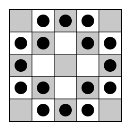

## Statement

Aux échecs, un cavalier se déplace en « L » : deux cases dans une direction (horizontale ou
verticale), puis une case perpendiculairement. Il **menace** les cases où il pourrait aller ainsi.

Sur un échiquier de $5 \times 5$ cases, on pose $k$ cavaliers, au plus un par case, de façon que
**chaque cavalier menace exactement deux autres cavaliers**.

Quelle est la plus grande valeur possible de $k$ ?

## Hints

1. Colorie l'échiquier comme un échiquier ordinaire, avec la case du centre noire. Un cavalier
   qui se déplace change-t-il de couleur ?
2. Compte les paires de cavaliers qui se menacent, d'abord à partir des cavaliers sur les cases
   noires, puis à partir des cavaliers sur les cases blanches. Que peux-tu en déduire ?
3. Combien y a-t-il de cases blanches, et de cases noires ? Regarde ce qui se passe si un
   cavalier est au centre, puis si un cavalier est sur une case qui touche le centre par un côté.
4. Si le centre et les quatre cases qui le touchent sont vides, que dire des coins ?

## Solution

La réponse est $k = 16$.

**Un exemple avec $16$ cavaliers.**

On pose un cavalier sur chaque case, sauf le centre, les quatre cases qui touchent le centre par
un côté, et les quatre coins. Cela fait $25 - 1 - 4 - 4 = 16$ cavaliers.

La figure ne change pas si on la tourne d'un quart de tour ou si on la retourne. Il suffit donc
de vérifier trois cavaliers, les autres s'en déduisent. Numérotons les lignes de haut en bas et
les colonnes de gauche à droite.

- Le cavalier en ligne $1$, colonne $2$ menace trois cases : ligne $2$ colonne $4$ (occupée),
  ligne $3$ colonne $1$ (occupée) et le centre (vide). Il menace deux cavaliers.
- Le cavalier en ligne $1$, colonne $3$ menace quatre cases : ligne $2$ colonnes $1$ et $5$
  (occupées), ligne $3$ colonnes $2$ et $4$ (vides, elles touchent le centre). Deux cavaliers.
- Le cavalier en ligne $2$, colonne $2$ menace quatre cases : ligne $1$ colonne $4$ et ligne $4$
  colonne $1$ (occupées), ligne $3$ colonne $4$ et ligne $4$ colonne $3$ (vides). Deux cavaliers.

**Étape 1. Autant de cavaliers sur le noir que sur le blanc.**

Colorions l'échiquier comme un échiquier ordinaire, avec la case du centre noire. Il y a $13$
cases noires et $12$ cases blanches. Quand un cavalier saute, il change toujours de couleur : il
avance d'un nombre impair de cases en tout ($2 + 1 = 3$).

Notons $n$ le nombre de cavaliers sur des cases noires et $b$ le nombre de cavaliers sur des
cases blanches. Comptons les paires de cavaliers qui se menacent. Dans une telle paire, il y a un
cavalier noir et un cavalier blanc.

- Chaque cavalier noir menace exactement deux cavaliers, tous blancs : il y a donc $2n$ paires.
- De même, chaque cavalier blanc en menace exactement deux, tous noirs : il y a $2b$ paires.

Donc $2n = 2b$, c'est-à-dire $n = b$, et le nombre total de cavaliers vaut $k = 2n = 2b$.

**Étape 2. Un cavalier au centre.**

Le cavalier du centre menace $8$ cases, toutes blanches. Exactement deux sont occupées, donc
$6$ cases blanches au moins sont vides. Ainsi $b \leqslant 12 - 6 = 6$ et $k = 2b \leqslant 12$.

**Étape 3. Le centre est vide, et un cavalier touche le centre.**

Supposons qu'un cavalier soit sur une des quatre cases blanches qui touchent le centre par un
côté. Il menace $6$ cases, toutes noires, dont exactement deux sont occupées : $4$ cases noires
sont vides. Le centre, noir, est vide aussi. Donc $n \leqslant 13 - 5 = 8$ et
$k = 2n \leqslant 16$.

**Étape 4. Le centre et ses quatre voisins sont vides.**

Un cavalier posé dans un coin ne menacerait que deux cases, qui sont justement deux voisines du
centre. Elles sont vides, donc ce cavalier ne menacerait personne. Les coins sont donc vides
aussi. Il ne reste que $16$ cases où poser des cavaliers, donc $k \leqslant 16$.

**Conclusion : dans tous les cas $k \leqslant 16$, et l'exemple montre que $16$ est possible. La
plus grande valeur de $k$ est $16$.**

## Going further

On peut montrer que la disposition de la figure est la **seule** qui contienne $16$ cavaliers.
