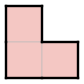
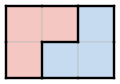
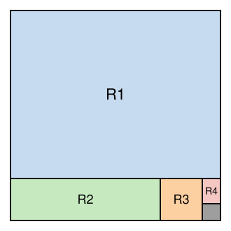
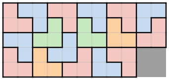

## Statement

On dispose de pièces de $3$ cases en forme de L, comme celle-ci :

On prend un échiquier de $2015 \times 2015$ cases, et on lui retire le carré de $2 \times 2$ cases
situé dans le coin en bas à droite.

Montrer qu'on peut recouvrir exactement ce qui reste de l'échiquier avec des pièces en forme de L,
sans qu'elles se chevauchent ni qu'elles dépassent. Les pièces peuvent être tournées dans tous les
sens.

## Hints

1. Avec deux pièces, on peut former un petit rectangle. Lequel ?
2. Montre qu'on peut paver tout rectangle de $6$ lignes, quel que soit son nombre de colonnes (au
   moins $2$). Un nombre de colonnes pair, puis impair.
3. On a $2015 = 2010 + 5$, et $2010$ est un multiple de $6$. Découpe l'échiquier en un grand
   rectangle et une bande de $5$ lignes.
4. Dans la bande, on peut aussi mettre de côté $2004$ colonnes. Il reste une petite région de
   $5$ lignes et $11$ colonnes, privée du carré du coin, à paver à la main. Commence par un
   rectangle de $5$ lignes et $9$ colonnes.

## Solution

Dans toute la solution, un rectangle « de $a$ lignes et $b$ colonnes » est formé de $a \times b$
cases.

**Étape 1. Deux pièces forment un rectangle.**

Deux pièces en L s'emboîtent pour former un rectangle de $2$ lignes et $3$ colonnes :

En le tournant, on obtient aussi un rectangle de $3$ lignes et $2$ colonnes. Toute région que l'on
peut découper en tels rectangles peut donc être pavée par des pièces en L.

**Étape 2. Les rectangles de $6$ lignes.**

Prenons un rectangle de $6$ lignes et $n$ colonnes, avec $n \geqslant 2$.

- Un bloc de $6$ lignes et $2$ colonnes se coupe en deux rectangles de $3$ lignes et $2$ colonnes,
  l'un au-dessus de l'autre.
- Un bloc de $6$ lignes et $3$ colonnes se coupe en trois rectangles de $2$ lignes et $3$ colonnes,
  les uns au-dessus des autres.
- Si $n$ est pair, on coupe le rectangle en blocs de $2$ colonnes. Si $n$ est impair, alors
  $n \geqslant 3$ et $n - 3$ est pair : on coupe un bloc de $3$ colonnes, puis des blocs de
  $2$ colonnes.

Dans les deux cas, le rectangle peut être pavé. Par suite, **tout rectangle dont le nombre de lignes
est un multiple de $6$, et qui a au moins $2$ colonnes, peut être pavé** : on le coupe en bandes de
$6$ lignes. En le tournant, c'est vrai aussi pour un rectangle dont le nombre de colonnes est un
multiple de $6$ et qui a au moins $2$ lignes.

**Étape 3. On découpe l'échiquier.**

On découpe l'échiquier privé de son coin en quatre morceaux :

- $R_1$ : les $2010$ lignes du haut, sur toute la largeur. Comme $2010 = 6 \times 335$, l'étape 2
  permet de le paver.
- $R_2$ : les $5$ lignes du bas, sur les $2004$ premières colonnes. Comme $2004 = 6 \times 334$, et
  qu'il a $5$ lignes, l'étape 2 permet aussi de le paver.
- $R_3$ : les $5$ lignes du bas, sur les $9$ colonnes suivantes.
- $R_4$ : les $3$ lignes situées au-dessus du carré retiré, sur les $2$ dernières colonnes. C'est un
  rectangle de $3$ lignes et $2$ colonnes, formé de deux pièces.

On a bien $2004 + 9 + 2 = 2015$ colonnes en bas, et $3 + 2 = 5$ lignes au-dessus du coin.

**Étape 4. Le morceau $R_3$.**

Il reste à paver le rectangle $R_3$, de $5$ lignes et $9$ colonnes. Voici un pavage, dessiné avec
$R_4$ à sa droite et le carré retiré en gris :

**Conclusion : chacun des quatre morceaux peut être pavé par des pièces en L, donc l'échiquier
$2015 \times 2015$ privé du carré du coin aussi.**

## Going further

- Il fallait s'y attendre : le nombre de cases, $2015^2 - 4 = 4\,060\,221$, est un multiple de $3$.
- Un rectangle de $3$ lignes et d'un nombre impair de colonnes ne peut jamais être pavé. Regarde la
  colonne de gauche. Les pièces qui la touchent sont dans les deux premières colonnes, et chacune
  prend $1$ ou $2$ cases de la première colonne. Trois pièces prendraient $6$ cases de la deuxième
  colonne, qui n'en a que $3$. Il y a donc deux pièces, qui remplissent exactement un rectangle de
  $3$ lignes et $2$ colonnes. On retire ce rectangle et on recommence : les colonnes
  partent deux par deux. C'est pour cela qu'il faut ici des bandes de $6$ lignes, et un pavage à la
  main pour le rectangle de $5$ lignes et $9$ colonnes.
