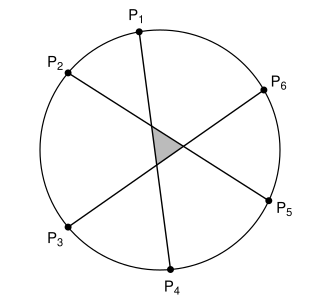

## Statement

Soit $n \geqslant 3$ un entier. On place $n$ points sur un cercle, et on trace le polygone à
$n$ côtés qui a ces points pour sommets. Puis on trace toutes ses diagonales : chaque sommet est
relié à tous les autres.

Les points sont placés de sorte que trois diagonales ne passent jamais par un même point.

Combien de triangles voit-on sur la figure dont **aucun sommet** n'est un sommet du polygone ?
Les côtés d'un tel triangle doivent être portés par des segments tracés.

## Hints

1. Fais la figure pour $n = 6$. Combien trouves-tu de tels triangles ? Et pour $n = 5$ ?
2. Les côtés d'un tel triangle sont des morceaux de segments tracés. Lesquels ? Les sommets du
   triangle sont alors des points où deux diagonales se croisent.
3. Regarde les extrémités des trois diagonales qui portent les côtés du triangle. Combien de sommets
   du polygone cela fait-il ?
4. Inversement, si l'on choisit $6$ sommets du polygone, de combien de façons peut-on les relier par
   trois diagonales qui se croisent deux à deux ?

## Solution

L'idée est de montrer qu'il y a **autant de triangles que de façons de choisir $6$ sommets** du
polygone, puis de compter ces choix.

### Étape 1 : un triangle, c'est trois diagonales qui se croisent deux à deux

Prenons un triangle de la figure dont aucun sommet n'est un sommet du polygone.

Ses côtés sont portés par des segments tracés. Ce ne peut pas être un côté du polygone : les seuls
points d'un côté du polygone où d'autres segments arrivent sont ses deux extrémités, qui sont des
sommets du polygone. Les trois côtés du triangle sont donc portés par **trois diagonales**
différentes, et chaque sommet du triangle est le point où deux de ces diagonales se croisent, à
l'intérieur du cercle.

Inversement, prenons trois diagonales qui se croisent deux à deux à l'intérieur du cercle. Elles ne
passent pas toutes les trois par le même point, d'après l'hypothèse, donc leurs trois points de
croisement sont différents et forment un vrai triangle de la figure, dont aucun sommet n'est sur le
cercle.

Compter les triangles revient donc à compter les **groupes de trois diagonales qui se croisent deux
à deux**.

### Étape 2 : quand deux diagonales se croisent-elles ?

Une diagonale $[AB]$ coupe le disque en deux morceaux, et le cercle en deux arcs. Une autre diagonale
$[CD]$ croise $[AB]$ à l'intérieur du cercle exactement quand $C$ et $D$ sont **sur deux arcs
différents**, c'est-à-dire quand les points $A$, $C$, $B$, $D$ se succèdent en alternant le long du
cercle.

En particulier, deux diagonales qui ont une extrémité commune ne se croisent pas à l'intérieur du
cercle : elles se touchent seulement en ce sommet.

### Étape 3 : trois diagonales qui se croisent deux à deux, c'est six sommets

Prenons trois diagonales qui se croisent deux à deux. D'après l'étape 2, deux d'entre elles n'ont
jamais d'extrémité commune : leurs extrémités sont donc **six sommets différents** du polygone.

Inversement, partons de six sommets du polygone et appelons-les $P_1$, $P_2$, $P_3$, $P_4$, $P_5$,
$P_6$ dans l'ordre où on les rencontre en tournant autour du cercle. Cherchons comment les relier
par trois diagonales qui se croisent deux à deux.

- La diagonale qui part de $P_1$ doit croiser les deux autres. Il faut donc, de chaque côté d'elle,
  une extrémité de chacune des deux autres diagonales : deux points de chaque côté. Elle va donc de
  $P_1$ à $P_4$.
- La diagonale qui part de $P_2$ doit croiser $[P_1P_4]$, donc aboutir de l'autre côté, en $P_5$ ou
  en $P_6$. Si elle allait en $P_6$, la dernière diagonale serait $[P_3P_5]$, dont les deux
  extrémités sont du même côté de $[P_2P_6]$ : elles ne se croiseraient pas. Donc la deuxième
  diagonale est $[P_2P_5]$, et la troisième est $[P_3P_6]$.

Et ces trois diagonales $[P_1P_4]$, $[P_2P_5]$, $[P_3P_6]$ se croisent bien deux à deux, car à
chaque fois les extrémités alternent.

Ainsi, **chaque choix de six sommets donne exactement un triangle**, et chaque triangle vient d'un
seul choix de six sommets, les extrémités de ses trois diagonales. Le nombre de triangles cherché est
donc le nombre de façons de choisir $6$ sommets parmi les $n$.

### Étape 4 : compter les choix de six sommets

Choisissons d'abord six sommets **dans un certain ordre** : $n$ choix pour le premier, $n - 1$ pour le
deuxième, et ainsi de suite jusqu'à $n - 5$ pour le sixième. Cela fait

$$n(n-1)(n-2)(n-3)(n-4)(n-5)$$

listes ordonnées. Mais un même groupe de six sommets apparaît dans plusieurs listes, une pour chaque
façon de ranger ses six éléments, soit $6 \times 5 \times 4 \times 3 \times 2 \times 1 = 720$ listes.
Le nombre de groupes de six sommets est donc

$$\frac{n(n-1)(n-2)(n-3)(n-4)(n-5)}{720} .$$

**Vérifications.** Pour $n = 6$, on trouve $\dfrac{720}{720} = 1$ : un seul triangle, au centre de
la figure. Pour $n = 7$, on trouve $\dfrac{7 \times 6 \times 5 \times 4 \times 3 \times 2}{720} = 7$.
Pour $n \leqslant 5$, le produit contient le facteur $0$, et en effet il n'y a aucun triangle.

**Conclusion.** La figure contient exactement

$$\boxed{\dfrac{n(n-1)(n-2)(n-3)(n-4)(n-5)}{720}}$$

triangles dont aucun sommet n'est un sommet du polygone, autant que de façons de choisir $6$ sommets
parmi $n$.

## Going further

Avec la même idée, combien y a-t-il de points de croisement de deux diagonales à l'intérieur du
cercle ? Chacun correspond à un choix de $4$ sommets, ceux qui sont les extrémités des deux
diagonales, et on trouve $\dfrac{n(n-1)(n-2)(n-3)}{24}$.
