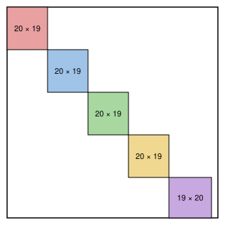

## Statement

On dispose de cinq couleurs et d'une grille de $99 \times 99$ cases. On colorie certaines cases de la
grille, chacune avec l'une des cinq couleurs, en respectant deux règles :

- chaque couleur est utilisée pour le même nombre de cases ;
- aucune ligne et aucune colonne ne contient deux cases de couleurs différentes.

Les cases non coloriées restent blanches. Quel est le plus grand nombre de cases que l'on peut
colorier ?

## Hints

1. Une ligne qui contient des cases coloriées n'a qu'une seule couleur. Donne à chaque ligne, et à
   chaque colonne, « sa » couleur.
2. Si $x$ lignes et $y$ colonnes sont rouges, combien y a-t-il de cases rouges au plus ?
3. Montre que si $x + y \leqslant 39$, alors $xy \leqslant 380$. Additionne ensuite les nombres de
   lignes et de colonnes de chaque couleur.

## Solution

La réponse est $\boxed{1900}$.

Appelons $N$ le nombre de cases de chaque couleur : on colorie en tout $5N$ cases. Il faut montrer
que $N \leqslant 380$, puis trouver un coloriage avec $N = 380$.

**La couleur d'une ligne.** Une ligne qui contient au moins une case coloriée ne contient qu'une seule
couleur : on dit que la ligne est de cette couleur. Une ligne sans case coloriée reçoit une couleur au
hasard. On fait de même pour les colonnes. Numérotons les couleurs de $1$ à $5$, et notons $x_i$ le
nombre de lignes de la couleur $i$ et $y_i$ le nombre de colonnes de la couleur $i$. Chaque ligne a
exactement une couleur, donc

$$x_1 + x_2 + x_3 + x_4 + x_5 = 99, \qquad y_1 + y_2 + y_3 + y_4 + y_5 = 99 .$$

**Une majoration pour chaque couleur.** Une case de la couleur $i$ est dans une ligne de la couleur
$i$ et dans une colonne de la couleur $i$. Il y a $x_i \times y_i$ cases qui sont à la fois dans une
ligne et dans une colonne de la couleur $i$, donc

$$N \leqslant x_i\, y_i \quad \text{pour chaque couleur } i .$$

**Un petit calcul.** Montrons que si deux entiers positifs $x$ et $y$ vérifient $x + y \leqslant 39$,
alors $xy \leqslant 380$.

L'un des deux est au plus $19$, sinon leur somme serait au moins $40$. Disons $x \leqslant 19$. Comme
$y \leqslant 39 - x$, on a $xy \leqslant x(39 - x)$. Or, en développant,

$$x(39 - x) = 380 - (19 - x)(20 - x),$$

et $(19 - x)(20 - x) \geqslant 0$ puisque $x \leqslant 19$. Donc $xy \leqslant 380$.

**Pas plus de 380 cases par couleur.** Supposons $N \geqslant 381$. Pour chaque couleur,
$x_i y_i \geqslant N \geqslant 381$, donc d'après le petit calcul, $x_i + y_i \geqslant 40$. En
additionnant les cinq couleurs :

$$99 + 99 = (x_1 + y_1) + (x_2 + y_2) + \cdots + (x_5 + y_5) \geqslant 5 \times 40 = 200,$$

ce qui est faux puisque $198 < 200$. Donc $N \leqslant 380$, et on colorie au plus
$5 \times 380 = 1900$ cases.

**Un coloriage avec 1900 cases.** On découpe les lignes, de haut en bas, en quatre paquets de $20$
lignes et un paquet de $19$ lignes ($4 \times 20 + 19 = 99$). On découpe les colonnes, de gauche à
droite, en quatre paquets de $19$ colonnes et un paquet de $20$ colonnes
($4 \times 19 + 20 = 96$, les $3$ dernières colonnes restent blanches). On colorie avec la couleur $i$
toutes les cases qui sont à la fois dans le $i$-ème paquet de lignes et dans le $i$-ème paquet de
colonnes.

Chaque couleur occupe un rectangle de $20 \times 19 = 380$ cases ou de $19 \times 20 = 380$ cases :
la première règle est respectée. Une ligne coupe au plus un des rectangles, et une colonne aussi :
la deuxième règle est respectée.

**Conclusion.** On peut colorier au plus $1900$ cases, et le coloriage ci-dessus en colorie $1900$.

## Going further

Beaucoup d'élèves pensent qu'il faut donner à chaque couleur autant de lignes que de colonnes. Avec
$19$ lignes et $19$ colonnes par couleur, on ne colorie que $5 \times 19 \times 19 = 1805$ cases. Le
meilleur coloriage n'est pas aussi régulier : quatre couleurs prennent une ligne de plus, la
cinquième prend une colonne de plus.

Le même raisonnement marche avec une grille $n \times n$ et cinq couleurs. Que trouves-tu pour une
grille $100 \times 100$ ? (On trouve $2000$ : cette fois, $20$ lignes et $20$ colonnes par couleur conviennent, et le petit calcul devient « si $x + y \leqslant 40$, alors $xy \leqslant 400$ ».)
