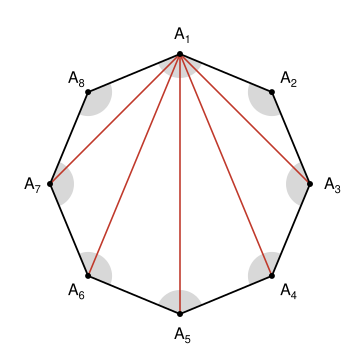

## Statement

Soit $n$ un entier, $n \geqslant 3$. Le gâteau d'anniversaire de Rémi a la forme d'un polygone régulier
à $n$ sommets. Théo a caché une fève quelque part dans le gâteau.

Pour la trouver, Rémi pose des questions. Pour chaque question, il choisit trois sommets différents $A$,
$B$, $C$ du polygone et demande à Théo : « La fève est-elle dans le triangle $ABC$, bord compris ? ».
Théo répond honnêtement. Dès que Théo répond « oui », Rémi a gagné.

Quel est le plus petit nombre de questions qui permet à Rémi d'être sûr de gagner, où que soit la fève ?

## Hints

1. Tant que Rémi n'a pas gagné, toutes les réponses sont « non ». Quelle propriété doivent avoir les
   triangles demandés pour que Rémi soit sûr de gagner ?
2. Trouve $n - 2$ triangles qui recouvrent tout le gâteau.
3. Pour montrer qu'on ne peut pas faire mieux, les aires ne suffisent pas : certains triangles sont très
   gros. Regarde plutôt les coins du gâteau. Tout près d'un sommet $A$, quels triangles peuvent
   recouvrir le gâteau ?
4. Additionne des angles. Les angles d'un triangle font $180^\circ$ en tout, et ceux du polygone font
   $(n - 2) \times 180^\circ$ en tout.

## Solution

Notons $A_1, A_2, \ldots, A_n$ les sommets du gâteau, dans l'ordre.

**Ce que Rémi doit faire.** Tant que Rémi n'a pas gagné, Théo a toujours répondu « non ». La stratégie de
Rémi revient donc à choisir une liste de triangles $T_1, T_2, T_3, \ldots$, qu'il demande dans cet ordre
jusqu'au premier « oui ».

Rémi est sûr de gagner en $q$ questions exactement quand **les triangles $T_1, \ldots, T_q$ recouvrent
tout le gâteau**. En effet, s'ils le recouvrent, la fève est dans l'un d'eux. Et s'il reste un point du
gâteau en dehors de tous ces triangles, Théo a pu cacher la fève à cet endroit, et les $q$ réponses sont
toutes « non ».

**$n - 2$ questions suffisent.** Les $n - 2$ triangles

$$A_1A_2A_3, \quad A_1A_3A_4, \quad A_1A_4A_5, \quad \ldots, \quad A_1A_{n-1}A_n$$

découpent le gâteau en parts, comme sur la figure : ils le recouvrent entièrement. En les demandant l'un
après l'autre, Rémi gagne en au plus $n - 2$ questions.

**Pourquoi on ne peut pas compter les triangles d'un découpage.** Tout découpage du polygone en triangles
compte $n - 2$ triangles, mais cela ne suffit pas : les triangles de Rémi ont le droit de se chevaucher,
et on pourrait espérer recouvrir le gâteau avec moins de triangles qui débordent les uns sur les autres.
Il faut un autre argument.

**Les coins du gâteau.** Soient $T_1, \ldots, T_q$ des triangles qui recouvrent le gâteau. Montrons que
$q \geqslant n - 2$.

*Un triangle ne touche pas les sommets qui ne sont pas les siens.* Prenons un sommet $A_i$ et la droite
tangente en $A_i$ au cercle qui passe par tous les sommets du polygone régulier. Tous les autres
sommets sont strictement du même côté de cette droite. Un triangle dont les trois sommets sont pris parmi
ces autres sommets est donc entièrement de ce côté : il ne contient pas $A_i$ et reste à une certaine
distance de lui.

Il n'y a qu'un nombre fini de triangles possibles. On peut donc choisir un rayon $r$ très petit, tel que :

- tout triangle dont $A_i$ n'est pas un sommet ne rencontre pas le disque de centre $A_i$ et de rayon $r$ ;
- tout triangle dont $A_i$ est un sommet, avec un angle $\beta$ en $A_i$, rencontre ce disque exactement
  selon un secteur d'angle $\beta$ (il suffit de prendre $r$ plus petit que la distance de $A_i$ au côté
  opposé du triangle).

Appelons **coin** $i$ la partie du gâteau située à distance au plus $r$ de $A_i$. C'est un secteur de
disque dont l'angle est l'angle $\alpha_i$ du polygone en $A_i$ (les secteurs gris de la figure).

*Recouvrir un coin.* Le coin $i$ doit être recouvert par les triangles $T_1, \ldots, T_q$. D'après le
choix de $r$, seuls les triangles qui ont $A_i$ pour sommet le rencontrent, et chacun en recouvre un
secteur dont l'angle est son propre angle en $A_i$. Des secteurs de même centre et de même rayon qui
recouvrent un secteur d'angle $\alpha_i$ ont des angles dont la somme vaut au moins $\alpha_i$. Donc

$$\text{(somme des angles en } A_i \text{ des triangles } T_j \text{ qui ont } A_i \text{ pour sommet)} \geqslant \alpha_i . \qquad (1)$$

*Additionner.* Écrivons l'inégalité (1) pour les $n$ sommets et ajoutons-les.

- À droite, on obtient $\alpha_1 + \alpha_2 + \cdots + \alpha_n$, la somme des angles du polygone, qui vaut
  $(n - 2) \times 180^\circ$.
- À gauche, chaque triangle $T_j$ apparaît trois fois, une fois pour chacun de ses sommets, avec à chaque
  fois son angle en ce sommet. On obtient donc la somme des angles de tous les triangles, c'est-à-dire
  $q \times 180^\circ$.

Ainsi $q \times 180^\circ \geqslant (n - 2) \times 180^\circ$, donc $q \geqslant n - 2$.

**Conclusion.** Le plus petit nombre de questions qui permet à Rémi d'être sûr de gagner est $n - 2$.

## Going further

**Pourquoi pas les aires ?** On pourrait essayer de dire qu'il faut assez de triangles pour que leurs
aires totalisent au moins l'aire du gâteau. Mais certains triangles sont très gros : dans un hexagone
régulier, le triangle $A_1A_3A_5$ couvre à lui seul la moitié du gâteau, et l'argument des aires ne
donne alors que $2$ triangles au minimum, au lieu de $4$. Les angles, eux, ne trichent pas : chaque
triangle apporte exactement $180^\circ$.

La preuve n'utilise pas vraiment que le polygone est régulier : elle marche pour tout polygone convexe
dont aucun angle ne vaut $180^\circ$.
