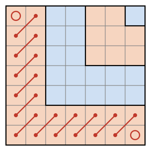

## Statement

Soit $n$ un entier strictement positif. Anatole pose des lutins sur les cases d'une grille $n \times n$,
avec au plus un lutin par case.

Il s'aperçoit ensuite qu'il n'y a jamais deux lutins sur deux cases qui se touchent par un coin sans se
toucher par un côté. Autrement dit, deux lutins ne sont jamais voisins en diagonale. En revanche, deux
lutins peuvent très bien occuper deux cases qui ont un côté commun.

Combien de lutins Anatole a-t-il pu poser, au maximum ?

## Hints

1. Essaie avec $n = 2$, $n = 3$ et $n = 4$. Remplir des colonnes entières est une bonne idée : lesquelles ?
2. Pour $n$ pair, découpe la grille en carrés $2 \times 2$. Combien de lutins un tel carré peut-il
   contenir ?
3. Pour $n$ impair, regarde la bande formée des deux premières lignes et des deux premières colonnes, en
   forme de L. Groupe ses cases par paires de cases voisines en diagonale : combien de lutins le L
   peut-il contenir ?
4. Quand on retire ce L, il reste un carré $(n - 2) \times (n - 2)$. On peut recommencer.

## Solution

Appelons **voisines en diagonale** deux cases qui se touchent par un coin sans se toucher par un côté.
Deux voisines en diagonale contiennent au plus un lutin à elles deux.

Nous allons montrer que le maximum vaut $\frac{n^2}{2}$ si $n$ est pair, et $\frac{n(n+1)}{2}$ si $n$ est
impair.

**Une bonne disposition.** Numérotons les colonnes de $1$ à $n$ et mettons un lutin sur toutes les cases
des colonnes de numéro impair : $1$, $3$, $5$, … Deux lutins de la même colonne ne sont jamais voisins
en diagonale. Deux lutins de colonnes différentes sont dans des colonnes séparées d'au moins une autre
colonne, donc ils ne se touchent pas du tout. La disposition est donc permise.

- Si $n$ est pair, il y a $\frac{n}{2}$ colonnes impaires, donc $\frac{n}{2} \times n = \frac{n^2}{2}$
  lutins.
- Si $n$ est impair, il y a $\frac{n+1}{2}$ colonnes impaires, donc $\frac{n(n+1)}{2}$ lutins.

Il reste à montrer qu'on ne peut pas faire mieux.

**Cas où $n$ est pair.** Découpons la grille en $\frac{n^2}{4}$ carrés $2 \times 2$. Dans un carré
$2 \times 2$, les deux cases d'une même diagonale sont voisines en diagonale. Chacune des deux diagonales
contient donc au plus un lutin, et le carré au plus $2$. En tout, il y a au plus
$2 \times \frac{n^2}{4} = \frac{n^2}{2}$ lutins.

**Cas où $n$ est impair.** Repérons une case par son numéro de ligne $i$, compté depuis le bas, et son
numéro de colonne $j$, compté depuis la gauche : on la note $(i, j)$.

*Un L contient au plus $2m - 1$ lutins.* Dans un carré $m \times m$, avec $m \geqslant 3$, appelons
**L de taille $m$** la partie formée des deux lignes du bas et des deux colonnes de gauche. Groupons ses
cases ainsi :

- les $m - 1$ paires formées de $(i, 1)$ et $(i + 1, 2)$, pour $i = 1, 2, \ldots, m - 1$ ;
- les $m - 2$ paires formées de $(1, i)$ et $(2, i + 1)$, pour $i = 2, 3, \ldots, m - 1$ ;
- les deux cases seules $(1, m)$ et $(m, 1)$.

Chaque case du L appartient à exactement un de ces groupes (voir la figure). Les deux cases d'une paire
sont voisines en diagonale, donc chaque paire contient au plus un lutin. Le L contient donc au plus

$$(m - 1) + (m - 2) + 2 = 2m - 1 \ \text{lutins}.$$

*Découper la grille en L.* Retirons de la grille $n \times n$ son L de taille $n$. Il reste un carré
$(n - 2) \times (n - 2)$, en haut à droite. Retirons son L de taille $n - 2$, et ainsi de suite. Comme $n$
est impair, on retire des L de tailles $n$, $n - 2$, …, $5$, $3$, et il reste à la fin une seule case.

Écrivons $n = 2p + 1$. Les tailles des L sont $m = 2j + 1$ pour $j = 1, 2, \ldots, p$, et un L de taille
$2j + 1$ contient au plus $2(2j + 1) - 1 = 4j + 1$ lutins. La case restante en contient au plus $1$. Le
nombre total de lutins est donc au plus

$$(4 \times 1 + 1) + (4 \times 2 + 1) + \cdots + (4p + 1) + 1 = 4(1 + 2 + \cdots + p) + p + 1 .$$

Comme $1 + 2 + \cdots + p = \frac{p(p+1)}{2}$, cela vaut

$$2p(p + 1) + (p + 1) = (p + 1)(2p + 1) = \frac{n + 1}{2} \times n = \frac{n(n+1)}{2} .$$

Pour $n = 1$, il n'y a aucun L et une seule case : le maximum $1 = \frac{1 \times 2}{2}$ est encore juste.

**Conclusion.** Anatole a pu poser au maximum $\frac{n^2}{2}$ lutins si $n$ est pair, et $\frac{n(n+1)}{2}$
lutins si $n$ est impair.

## Going further

Pour $n$ impair, les carrés $2 \times 2$ ne suffisent pas. Si l'on découpe un carré $(n-1) \times (n-1)$
en carrés $2 \times 2$ et qu'on traite à part la dernière ligne et la dernière colonne, on obtient au
mieux la borne $\frac{n^2 + 2n - 3}{2}$. Elle est juste pour $n = 3$, mais trop grande dès $n = 5$ : elle
donne $16$ au lieu de $15$. C'est pour cela qu'on a besoin des L.

Une bonne habitude est de tester une formule sur de petites valeurs avant de la croire. Plusieurs élèves
ont affirmé des résultats faux pour $n$ impair, qu'un essai avec $n = 3$ ou $n = 5$ aurait démentis.
