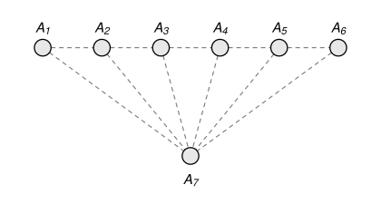

## Statement

Un archipel compte $7$ îles $A_1, A_2, \ldots, A_7$. On a le droit de construire des ponts de deux sortes :

- entre une île $A_i$ et l'île suivante $A_{i+1}$, pour $i = 1, 2, \ldots, 6$ ;
- entre une île $A_i$ et la dernière île $A_7$, pour $i = 1, 2, \ldots, 6$.

On veut construire des ponts de sorte qu'on puisse aller de n'importe quelle île à n'importe quelle autre, en utilisant le moins de ponts possible. De combien de façons peut-on le faire ?

Par exemple, avec $3$ îles au lieu de $7$, il faut deux ponts, et il y a trois façons de faire :

1. un pont entre $A_1$ et $A_2$, et un pont entre $A_1$ et $A_3$ ;
2. un pont entre $A_1$ et $A_2$, et un pont entre $A_2$ et $A_3$ ;
3. un pont entre $A_1$ et $A_3$, et un pont entre $A_2$ et $A_3$.

## Hints

1. Commence par trouver le nombre minimal de ponts. Imagine qu'on construit les ponts un par un, et regarde comment change le nombre de « groupes » d'îles reliées entre elles.
2. Regarde seulement les ponts entre deux îles voisines parmi $A_1, \ldots, A_6$. Ils découpent la rangée $A_1, \ldots, A_6$ en blocs d'îles consécutives.
3. À quelle condition sur les ponts vers $A_7$ peut-on aller partout ? Combien de ponts vers $A_7$ faut-il dans chaque bloc quand on en construit le moins possible ?
4. Note $c_j$ le nombre de façons de faire pour une rangée de $j$ îles, et regarde la taille du dernier bloc. Tu dois trouver $c_1 = 1$, $c_2 = 3$ et $c_3 = 8$.

## Solution

On dit qu'une construction est **bonne** si l'on peut aller de n'importe quelle île à n'importe quelle autre.

Le pont entre $A_6$ et $A_7$ est des deux sortes à la fois : c'est le même pont. Pour la suite, on range les ponts permis en deux familles qui ne se recouvrent pas :

- les **ponts de la rangée**, entre $A_i$ et $A_{i+1}$ pour $i = 1, \ldots, 5$ ;
- les **ponts vers $A_7$**, entre $A_i$ et $A_7$ pour $i = 1, \ldots, 6$.

**Étape 1. Il faut au moins $6$ ponts, et $6$ suffisent.**

Avec les six ponts vers $A_7$, on peut aller de toute île à $A_7$, puis à n'importe quelle autre île. Six ponts suffisent donc.

Inversement, prenons une bonne construction, et imaginons qu'on construit ses ponts un par un. À chaque instant, on appelle **groupe** un ensemble d'îles qu'on peut joindre entre elles avec les ponts déjà construits, le plus grand possible. Au départ, aucun pont n'est construit, et il y a $7$ groupes d'une seule île. Un nouveau pont relie deux îles, donc il réunit au plus deux groupes en un seul : le nombre de groupes diminue d'au plus $1$. À la fin, il ne reste qu'un groupe, puisque la construction est bonne. Il a donc fallu au moins $7 - 1 = 6$ ponts.

Le nombre minimal de ponts est donc $6$, et l'on doit compter les bonnes constructions qui ont exactement $6$ ponts.

**Étape 2. Les blocs.**

Prenons une construction quelconque. Les ponts de la rangée découpent la rangée $A_1, A_2, \ldots, A_6$ en **blocs** d'îles consécutives : deux îles voisines $A_i$ et $A_{i+1}$ sont dans le même bloc si et seulement si le pont entre elles est construit. Par exemple, si les seuls ponts de la rangée sont $A_1A_2$, $A_2A_3$ et $A_5A_6$, les blocs sont $\{A_1, A_2, A_3\}$, $\{A_4\}$ et $\{A_5, A_6\}$.

Si l'on a $k$ blocs, de tailles $\ell_1, \ell_2, \ldots, \ell_k$, alors $\ell_1 + \ell_2 + \cdots + \ell_k = 6$. Un bloc de $\ell$ îles contient $\ell - 1$ ponts de la rangée, donc le nombre de ponts de la rangée est
$$(\ell_1 - 1) + (\ell_2 - 1) + \cdots + (\ell_k - 1) = 6 - k.$$

**Étape 3. Quand la construction est-elle bonne ?**

*Une construction est bonne si et seulement si chaque bloc contient au moins une île reliée à $A_7$.*

- Supposons qu'un bloc n'ait aucune île reliée à $A_7$. Partons d'une île de ce bloc. Les seuls ponts qui partent de ses îles sont des ponts de la rangée, et ceux-ci restent dans le bloc, puisque le pont qui relierait le bloc à son voisin n'est pas construit. On ne peut donc jamais quitter le bloc, ni atteindre $A_7$ : la construction n'est pas bonne.
- Supposons que chaque bloc ait une île reliée à $A_7$. Depuis n'importe quelle île de la rangée, on suit les ponts de son bloc jusqu'à l'île reliée à $A_7$, puis on va en $A_7$. Toutes les îles peuvent donc rejoindre $A_7$, et donc aussi n'importe quelle autre île en passant par $A_7$ : la construction est bonne.

Une bonne construction avec $k$ blocs a donc $6 - k$ ponts de la rangée et au moins $k$ ponts vers $A_7$, soit au moins $6$ ponts. Elle en a exactement $6$ si et seulement si **chaque bloc contient exactement une île reliée à $A_7$**.

Ainsi, une bonne construction à $6$ ponts revient à choisir deux choses :

- un découpage de la rangée $A_1, \ldots, A_6$ en blocs d'îles consécutives ;
- dans chaque bloc, une île, celle qu'on relie à $A_7$.

Inversement, chaque tel choix donne une bonne construction à $6$ ponts, et deux choix différents donnent deux constructions différentes.

**Étape 4. On compte.**

Pour tout entier $j \geqslant 1$, on note $c_j$ le nombre de façons de découper une rangée de $j$ îles en blocs d'îles consécutives, puis de choisir une île dans chaque bloc. On pose aussi $c_0 = 1$ : pour une rangée vide, il y a une seule façon de faire, qui est de ne rien faire.

Soit $j \geqslant 1$. Le dernier bloc a une taille $\ell$ comprise entre $1$ et $j$. Il y a $\ell$ façons de choisir son île, et $c_{j - \ell}$ façons de traiter les $j - \ell$ îles qui restent avant lui. Donc
$$c_j = 1 \times c_{j-1} + 2 \times c_{j-2} + \cdots + j \times c_0.$$

On calcule de proche en proche :

| $j$ | calcul | $c_j$ |
|---|---|---|
| $1$ | $1 \times 1$ | $1$ |
| $2$ | $1 + 2 \times 1$ | $3$ |
| $3$ | $3 + 2 \times 1 + 3 \times 1$ | $8$ |
| $4$ | $8 + 2 \times 3 + 3 \times 1 + 4 \times 1$ | $21$ |
| $5$ | $21 + 2 \times 8 + 3 \times 3 + 4 \times 1 + 5 \times 1$ | $55$ |
| $6$ | $55 + 2 \times 21 + 3 \times 8 + 4 \times 3 + 5 \times 1 + 6 \times 1$ | $144$ |

On retrouve l'exemple de l'énoncé : avec $3$ îles, la rangée $A_1, A_2$ a $2$ îles, et $c_2 = 3$.

**Réponse :** il faut $6$ ponts, et il y a $144$ façons de les construire.

## Going further

Les nombres $1, 3, 8, 21, 55, 144$ sont un terme sur deux de la suite de Fibonacci, où chaque terme est la somme des deux précédents :

$$1, \quad 1, \quad 2, \quad 3, \quad 5, \quad 8, \quad 13, \quad 21, \quad 34, \quad 55, \quad 89, \quad 144, \quad \ldots$$

En écrivant la formule de l'étape 4 pour $c_j$ et pour $c_{j-1}$, puis en soustrayant, montre que $c_j = 2\,c_{j-1} + c_{j-2} + c_{j-3} + \cdots + c_0$ pour tout $j \geqslant 2$, puis que $c_j = 3\,c_{j-1} - c_{j-2}$ pour tout $j \geqslant 3$.
