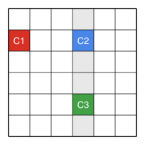

## Statement

On considère une grille de $2024 \times 2024$ cases. Quentin dispose de $k$ couleurs. Il colorie chacune des $2024^2$ cases de la grille avec l'une de ces $k$ couleurs, en utilisant chaque couleur au moins une fois.

Déterminer le plus petit entier $k$ qui a la propriété suivante :

*quel que soit le coloriage de Quentin, on peut toujours trouver trois cases $C_1$, $C_2$ et $C_3$, de trois couleurs différentes, telles que $C_1$ et $C_2$ sont sur la même ligne, et $C_2$ et $C_3$ sont sur la même colonne.*

Les trois cases ne sont pas forcément voisines.

## Hints

1. Commence par une petite grille de $2 \times 2$ cases. Avec $2$ couleurs, peut-on toujours trouver les trois cases ? Et avec $3$ couleurs ?
2. Avec $2024$ couleurs, trouve un coloriage pour lequel c'est impossible. Pense à colorier colonne par colonne.
3. Avec $2025$ couleurs, montre qu'au moins une colonne contient deux cases de couleurs différentes.
4. Cette colonne a $2024$ cases, donc une des $2025$ couleurs, disons le rouge, n'y apparaît pas. Prends une case rouge ailleurs dans la grille, et regarde sa ligne.

## Solution

On va montrer que **la réponse est $k = 2025$**. Il y a deux choses à faire : montrer que pour $k \leqslant 2024$, il existe un coloriage où l'on ne peut pas trouver les trois cases, puis montrer qu'avec $2025$ couleurs, on les trouve toujours.

### Avec $2024$ couleurs ou moins, ça ne marche pas

Supposons que $k \leqslant 2024$. On numérote les couleurs de $1$ à $k$ et les colonnes de $1$ à $2024$. Quentin colorie toute la colonne numéro $1$ avec la couleur $1$, toute la colonne numéro $2$ avec la couleur $2$, et ainsi de suite jusqu'à la colonne numéro $k$. Il colorie les colonnes restantes, s'il y en a, avec la couleur $1$. Chaque couleur est bien utilisée.

Dans ce coloriage, deux cases d'une même colonne ont toujours la même couleur. Les cases $C_2$ et $C_3$, qui doivent être dans la même colonne, ne peuvent donc jamais être de couleurs différentes. Les trois cases n'existent pas. La propriété est donc fausse pour tout $k \leqslant 2024$.

### Avec $2025$ couleurs, ça marche toujours

Prenons maintenant un coloriage quelconque avec $2025$ couleurs, chacune utilisée au moins une fois.

**Étape 1 : une colonne a deux couleurs.** Si chaque colonne était d'une seule couleur, la grille, qui a $2024$ colonnes, contiendrait au plus $2024$ couleurs. Or les $2025$ couleurs sont utilisées. Il existe donc une colonne, qu'on appelle la colonne choisie, qui contient deux cases de couleurs différentes.

**Étape 2 : une couleur manque dans cette colonne.** La colonne choisie a $2024$ cases, donc elle contient au plus $2024$ couleurs différentes. Une des $2025$ couleurs n'y apparaît donc pas. Appelons-la le rouge.

**Étape 3 : on construit les trois cases.**

- Le rouge est utilisé quelque part dans la grille, mais pas dans la colonne choisie. On prend pour $C_1$ une case rouge, qui est donc hors de la colonne choisie.
- On prend pour $C_2$ la case de la colonne choisie qui est sur la même ligne que $C_1$. Elle n'est pas rouge, car le rouge n'apparaît pas dans la colonne choisie.
- La colonne choisie contient deux couleurs différentes. Elle contient donc une case $C_3$ dont la couleur n'est pas celle de $C_2$. Cette case n'est pas rouge non plus.

Les trois cases $C_1$, $C_2$ et $C_3$ ont trois couleurs différentes : $C_1$ est rouge, $C_2$ et $C_3$ ne le sont pas, et $C_2$ et $C_3$ n'ont pas la même couleur. De plus $C_1$ et $C_2$ sont sur la même ligne, et $C_2$ et $C_3$ sont dans la même colonne.

**Conclusion.** Le plus petit entier $k$ cherché est $k = 2025$.

*Attention à un piège.* Il ne suffit pas de trouver une ligne qui contient deux couleurs et une colonne qui contient deux couleurs. Si ce sont les deux mêmes couleurs, par exemple bleu et vert dans les deux cas, on n'obtient pas trois couleurs différentes. C'est pour cela qu'on a choisi une couleur qui manque dans la colonne.

## Going further

On remplace la grille par un rectangle de $10$ lignes et $30$ colonnes. Quel est alors le plus petit entier $k$ qui a la même propriété ? Et pour un rectangle de $30$ lignes et $10$ colonnes ?
