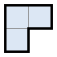

## Statement

Maxime écrit un nombre entier dans chacune des $64$ cases d'une grille $8 \times 8$. Rien ne l'oblige à écrire des nombres différents : il peut répéter autant qu'il veut.

Maxime possède aussi une pièce en carton. Il peut la tourner dans n'importe quel sens, et la poser n'importe où sur la grille, à condition qu'elle ne dépasse pas de la grille et que chaque case soit recouverte soit entièrement, soit pas du tout.

Il s'aperçoit alors d'une chose surprenante : **quel que soit l'endroit où il pose sa pièce, et quel que soit le sens dans lequel il la tourne, la somme des nombres recouverts est toujours la même.**

1. Combien de nombres **différents** Maxime peut-il avoir écrits au maximum, si sa pièce est le coin de trois cases ci-dessous ?

2. Même question si sa pièce est le domino de deux cases ci-dessous.

## Hints

1. Les questions demandent un **maximum**. Il faudra donc toujours deux choses : montrer qu'on ne peut pas dépasser une certaine valeur, et donner un exemple qui atteint cette valeur.
2. Ne raisonnez pas sur toute la grille d'un coup. Prenez juste un petit carré $2 \times 2$ et posez-y la pièce coin de toutes les façons possibles.
3. Dans un carré $2 \times 2$, le coin recouvre trois cases sur quatre, et il laisse toujours une case découverte. Que vaut alors le nombre écrit sur la case découverte ?
4. Pour le domino : au lieu d'un carré $2 \times 2$, prenez trois cases en coin, $C_1$, $C_2$, $C_3$, avec $C_2$ au milieu. Posez le domino sur $C_1 C_2$, puis sur $C_2 C_3$.
5. Le domino relie deux cases **voisines par un côté**. Le raisonnement précédent, lui, relie deux cases voisines **en diagonale**. Deux cases reliées en diagonale ont-elles la même couleur sur un damier ?

## Solution

Les deux questions se traitent de la même manière : on montre d'abord que certaines cases sont forcément **égales**, puis on construit un exemple.

### Question 1 : la pièce coin. Réponse : $1$ seul nombre

Notons $S$ la somme commune à tous les placements du coin.

**Toutes les cases d'un même carré $2 \times 2$ portent le même nombre.**

Prenons n'importe quel carré $2 \times 2$ dans la grille, et notons $T$ la somme des quatre nombres qu'il contient. Le coin tient exactement dans ce carré $2 \times 2$, et on peut l'y poser de quatre façons en le tournant de $90^\circ$ à chaque fois : chaque fois il recouvre trois cases sur quatre et en laisse une seule découverte, et chacune des quatre cases est la case découverte pour exactement un de ces quatre placements.

Pour chacun de ces placements, la somme des trois cases couvertes vaut $S$. Donc le nombre écrit sur la case laissée découverte vaut

$$T - S.$$

Et cela pour les quatre cases. Les quatre cases du carré $2 \times 2$ portent donc toutes le même nombre $T-S$.

**On passe du petit au grand.**

Prenons maintenant deux cases quelconques de la grille $8 \times 8$. On peut aller de l'une à l'autre en passant de case en case, chaque pas se faisant vers une case voisine. Or deux cases voisines (par un côté ou par un coin) tiennent toujours ensemble dans un même carré $2 \times 2$ de la grille, donc elles portent le même nombre. En enchaînant les pas, les deux cases de départ et d'arrivée portent le même nombre.

Toutes les cases de la grille portent donc le même nombre : Maxime n'a écrit **qu'un seul nombre différent**.

**L'exemple.** Si Maxime écrit $0$ partout, toute pose du coin donne la somme $0$. La condition est bien respectée, avec un seul nombre.

$$\boxed{\text{Question 1 : au maximum } 1 \text{ nombre.}}$$

### Question 2 : le domino. Réponse : $2$ nombres

Notons encore $S$ la somme commune à tous les placements du domino.

**Deux cases voisines en diagonale portent le même nombre.**

Soient $C_1$ et $C_3$ deux cases qui se touchent par un coin mais pas par un côté. Il existe alors une case $C_2$ voisine des deux par un côté, de sorte que $C_1$, $C_2$, $C_3$ forment un coin. Notons $T$ la somme des trois nombres écrits sur $C_1$, $C_2$, $C_3$.

- En posant le domino sur $C_1$ et $C_2$ : la somme de ces deux cases vaut $S$, donc le nombre sur $C_3$ vaut $T - S$.
- En posant le domino sur $C_2$ et $C_3$ : la somme de ces deux cases vaut $S$, donc le nombre sur $C_1$ vaut $T - S$.

Donc $C_1$ et $C_3$ portent le même nombre.

**Ce que cela impose à la grille.**

Colorions la grille $8 \times 8$ comme un damier, en blanc et en noir. Deux cases voisines en diagonale ont toujours la même couleur, et on peut relier deux cases de même couleur par une suite de pas en diagonale. Donc **toutes les cases blanches portent le même nombre, et toutes les cases noires portent le même nombre.** Cela fait au plus deux nombres différents.

**L'exemple.** Maxime écrit $0$ sur toutes les cases blanches et $1$ sur toutes les cases noires. Un domino recouvre deux cases voisines par un côté, donc une blanche et une noire : sa somme vaut toujours $0 + 1 = 1$. La condition est respectée, et Maxime a bien utilisé deux nombres différents.

$$\boxed{\text{Question 2 : au maximum } 2 \text{ nombres.}}$$

*Ce qu'il ne faut pas sauter.* À la question 1, montrer que les quatre cases d'un carré $2 \times 2$ sont égales ne suffit pas : il faut encore expliquer comment on passe de là à « toute la grille ». Ce passage du local au global paraît évident quand on regarde la figure, mais c'est bien un argument, et il se rédige.

## Going further

1. Avec la barre de trois cases alignées, montrez que deux cases distantes de trois colonnes portent le même nombre. Combien de nombres différents Maxime peut-il alors écrire ? (Un carré magique $3 \times 3$ vous donnera l'exemple.)
2. Et avec une pièce carrée de quatre cases, $2 \times 2$ ? Cherchez d'abord une grille avec beaucoup de nombres différents : vous verrez que cette pièce-là n'impose presque rien.
