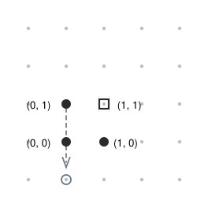

## Statement

Trois sauterelles sont posées dans le plan, aux points de coordonnées

$$(0, 0), \qquad (0, 1), \qquad (1, 0).$$

À chaque tour, une sauterelle saute **par-dessus une autre** : si la sauterelle qui saute est au point $P$ et qu'une autre sauterelle est au point $Q$, la première atterrit sur le symétrique de $P$ par rapport à $Q$. Autrement dit, $Q$ devient le milieu du trajet, et la sauterelle parcourt exactement deux fois la distance $PQ$ en ligne droite.

La sauterelle survolée, elle, ne bouge pas.

Une sauterelle peut-elle un jour atterrir sur le point $(1, 1)$ ?

## Hints

1. Essayez quelques sauts sur une feuille quadrillée. Où atterrit-on ? Les points atteints ont-ils quelque chose en commun ?
2. Si la sauterelle qui saute est en $P = (a, b)$ et qu'elle saute par-dessus $Q = (c, d)$, écrivez les coordonnées du point d'arrivée en fonction de $a$, $b$, $c$, $d$.
3. Regardez seulement si chaque coordonnée est paire ou impaire. Qu'est-ce qui change pendant un saut ? Qu'est-ce qui ne change pas ?
4. Classez les points du plan en quatre familles selon la parité de leurs deux coordonnées. Dans quelle famille sont les trois points de départ ? Et le point $(1,1)$ ?

## Solution

**La réponse est non.**

### Les coordonnées du point d'arrivée

Supposons que la sauterelle qui saute soit en $P = (a, b)$ et qu'elle saute par-dessus une sauterelle située en $Q = (c, d)$. Le point d'arrivée $P'$ est le symétrique de $P$ par rapport à $Q$, c'est-à-dire que $Q$ est le milieu de $[PP']$. Si $P' = (a', b')$, cela s'écrit

$$\dfrac{a+a'}{2} = c \qquad \text{et} \qquad \dfrac{b+b'}{2} = d,$$

d'où

$$a' = 2c - a \qquad \text{et} \qquad b' = 2d - b.$$

### L'invariant : la parité de chaque coordonnée

Regardons la parité. Le nombre $2c$ est pair, donc $a' = 2c - a$ a **la même parité que $a$**. De même $b'$ a la même parité que $b$.

Autrement dit : **une sauterelle qui saute ne change jamais la parité de ses coordonnées.** Et les deux autres sauterelles ne bougent pas, donc leurs coordonnées non plus.

Classons les points à coordonnées entières en quatre familles, selon la parité de leurs deux coordonnées :

| Famille | Exemple |
|---|---|
| (pair, pair) | $(0,0)$ |
| (pair, impair) | $(0,1)$ |
| (impair, pair) | $(1,0)$ |
| (impair, impair) | $(1,1)$ |

Chaque sauterelle reste pour toujours dans la famille où elle a commencé.

### Conclusion

Au départ, les trois sauterelles sont respectivement dans les familles (pair, pair), (pair, impair) et (impair, pair). Aucune n'est dans la famille (impair, impair).

Or le point $(1,1)$ appartient à la famille (impair, impair). Aucune des trois sauterelles ne pourra donc jamais l'atteindre, quel que soit le nombre de sauts effectués.

$$\boxed{\text{Non, aucune sauterelle ne peut atteindre } (1,1).}$$

*Le point de méthode.* Pour démontrer qu'une position est **impossible** à atteindre, il ne sert à rien d'essayer des suites de coups : il y en a une infinité. On cherche à la place une quantité qui ne bouge jamais, un **invariant**, et qui n'a pas la même valeur au départ et à l'arrivée. Ici l'invariant est la parité des deux coordonnées de chaque sauterelle.

## Going further

1. Quels points du plan la sauterelle partie de $(0,0)$ peut-elle atteindre ? Montrez qu'elle peut atteindre tous les points de sa famille, ou trouvez ceux qu'elle ne peut pas atteindre.
2. Et avec **quatre** sauterelles, en $(0,0)$, $(0,1)$, $(1,0)$ et $(1,1)$ ? Peut-on ramener les quatre sauterelles aux sommets d'un carré plus petit, par exemple de côté $\tfrac{1}{2}$ ?
