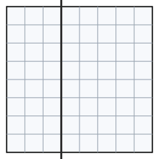

## Statement

On recouvre entièrement une grille $8 \times 8$ avec des dominos, chacun couvrant exactement deux cases voisines. Les dominos peuvent être posés couchés ou debout, ils ne se chevauchent pas et ne dépassent pas de la grille.

On trace ensuite une droite $l$ parallèle à deux des côtés de la grille, qui **suit un trait du quadrillage** (elle ne coupe donc aucune case en deux) et qui laisse des cases des deux côtés.

Montrer qu'il est impossible que cette droite coupe **exactement un** domino.

## Hints

1. Raisonnez par l'absurde : supposez que $l$ coupe exactement un domino, et cherchez une contradiction.
2. Que deviennent les autres dominos ? Chacun est-il entièrement à gauche, entièrement à droite, ou peut-il être à cheval ?
3. Enlevez le seul domino coupé. Que reste-t-il du côté gauche de la droite ?
4. Comptez les cases de la partie gauche. Combien en reste-t-il après avoir enlevé la demi-case du domino retiré ? Ce nombre est-il pair ?

## Solution

**Raisonnement par l'absurde.** Supposons qu'une telle droite $l$ coupe exactement un domino.

Quitte à tourner la grille d'un quart de tour, on peut supposer que $l$ est **verticale**. Elle sépare alors la grille en deux rectangles : celui de gauche a $k$ colonnes entières et $8$ lignes, avec $1 \leq k \leq 7$ puisque les deux côtés contiennent des cases.

### Ce que devient le pavage

Chaque domino du pavage est soit entièrement à gauche de $l$, soit entièrement à droite, soit à cheval sur $l$ (c'est-à-dire coupé par elle). Par hypothèse, un seul domino est à cheval.

**Enlevons ce domino.** Il occupait une case à gauche de $l$ et une case à droite. Tous les dominos restants sont entièrement d'un côté ou de l'autre.

### Le comptage à gauche

Le rectangle de gauche a

$$8 \times k \text{ cases}.$$

Une seule de ces cases a été libérée par le domino retiré. Les dominos qui restent à gauche recouvrent donc exactement

$$8k - 1 \text{ cases},$$

sans chevauchement et sans trou.

Or chaque domino couvre exactement $2$ cases. Le nombre de cases recouvertes par un ensemble de dominos est donc toujours **pair**. Mais $8k$ est pair, donc $8k - 1$ est **impair**.

C'est impossible.

### Conclusion

L'hypothèse de départ est donc fausse.

$$\boxed{\text{Une telle droite ne peut jamais couper exactement un domino.}}$$

*Ce que dit vraiment ce résultat.* Le nombre de dominos coupés par une telle droite est donc $0$, ou bien au moins $2$. Le même comptage montre d'ailleurs mieux : ce nombre est toujours **pair**, puisque la partie gauche contient $8k$ cases dont $d$ sont occupées par les demi-dominos coupés, et qu'il reste $8k - d$ cases à paver, ce qui exige $d$ pair.

## Going further

1. Reprenez la démonstration avec une grille $m \times n$ quelconque. Sur quelles tailles l'argument fonctionne-t-il encore ?
2. Une **ligne de faille** d'un pavage est une droite comme celle de l'énoncé qui ne coupe aucun domino. Existe-t-il un pavage de la grille $8 \times 8$ par des dominos sans aucune ligne de faille ? Et de la grille $6 \times 6$ ?
