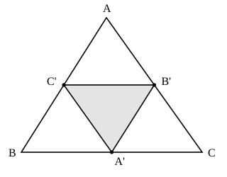

## Statement

$ABC$ est un triangle. On note $A'$, $B'$, $C'$ les milieux respectifs de $[BC]$, $[AC]$ et $[AB]$. Les trois segments $[A'B']$, $[B'C']$ et $[C'A']$ découpent le triangle $ABC$ en quatre petits triangles.

Montrer que ces quatre petits triangles sont tous semblables au triangle $ABC$, et donner le rapport de similitude.

## Hints

1. Rappel : le théorème des milieux dit que le segment qui joint les milieux de deux côtés d'un triangle est parallèle au troisième côté et mesure la moitié de sa longueur.
2. Commence par le triangle du milieu, $A'B'C'$ : calcule ses trois côtés en fonction de ceux de $ABC$.
3. Quand les trois côtés d'un triangle sont proportionnels aux trois côtés d'un autre, les deux triangles sont semblables. C'est le seul outil dont tu as besoin ici.
4. Pour un triangle de coin comme $AC'B'$, deux de ses côtés se lisent directement ($AC' = \frac{AB}{2}$ car $C'$ est le milieu de $[AB]$) et le troisième est l'un des trois segments des milieux.

## Solution

**Les trois segments des milieux.** Appliquons trois fois le théorème des milieux dans le triangle $ABC$ :

- $B'$ et $C'$ sont les milieux de $[AC]$ et $[AB]$, donc $B'C' = \dfrac{BC}{2}$ ;
- $C'$ et $A'$ sont les milieux de $[AB]$ et $[BC]$, donc $C'A' = \dfrac{CA}{2}$ ;
- $A'$ et $B'$ sont les milieux de $[BC]$ et $[CA]$, donc $A'B' = \dfrac{AB}{2}$.

**Le triangle du milieu.** Les trois côtés de $A'B'C'$ valent

$$A'B' = \frac{AB}{2}, \qquad B'C' = \frac{BC}{2}, \qquad C'A' = \frac{CA}{2}.$$

Les trois côtés de $A'B'C'$ sont donc proportionnels à ceux de $ABC$, avec le même rapport $\dfrac{1}{2}$ :

$$A'B'C' \sim ABC, \qquad \text{de rapport } \frac{1}{2}.$$

**Les trois triangles des coins.** Prenons celui du sommet $A$, c'est-à-dire $AC'B'$. Comme $C'$ est le milieu de $[AB]$ et $B'$ le milieu de $[AC]$ :

$$AC' = \frac{AB}{2}, \qquad AB' = \frac{AC}{2}, \qquad C'B' = \frac{BC}{2}.$$

Là encore les trois côtés sont la moitié de ceux de $ABC$ : le triangle $AC'B'$ est semblable à $ABC$, de rapport $\dfrac{1}{2}$, avec la correspondance $A \leftrightarrow A$, $C' \leftrightarrow B$, $B' \leftrightarrow C$.

Le même calcul marche aux deux autres coins :

- $C'BA'$ : $BC' = \dfrac{AB}{2}$, $BA' = \dfrac{BC}{2}$, $C'A' = \dfrac{CA}{2}$ ;
- $B'A'C$ : $CB' = \dfrac{CA}{2}$, $CA' = \dfrac{CB}{2}$, $B'A' = \dfrac{AB}{2}$.

**Conclusion.** Les quatre petits triangles ont tous leurs trois côtés égaux à la moitié des côtés de $ABC$. Ils sont donc tous semblables à $ABC$, avec le même rapport $\dfrac{1}{2}$. Au passage, ils sont aussi superposables entre eux, et chacun a pour aire le quart de l'aire de $ABC$.

## Going further

On dispose de six points sur la figure : $A$, $B$, $C$, $A'$, $B'$, $C'$. On peut en choisir trois de vingt façons différentes ; trois de ces choix donnent des points alignés, les dix-sept autres donnent un vrai triangle. Combien de ces triangles sont semblables à $ABC$ ?

Indication : on vient d'en trouver quatre, plus $ABC$ lui-même, soit cinq. Mais attention, la réponse dépend de la forme du triangle de départ : essaie avec un triangle rectangle en $B$, par exemple celui de côtés $3$, $4$ et $5$, et compte à nouveau.
