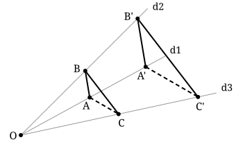

## Statement

Les droites $d_1$, $d_2$ et $d_3$ sont concourantes en un point $O$. Les points $A$ et $A'$ sont sur $d_1$, les points $B$ et $B'$ sont sur $d_2$, les points $C$ et $C'$ sont sur $d_3$, et aucun de ces six points n'est confondu avec $O$.

On suppose que les droites $(AB)$ et $(A'B')$ sont parallèles, et que les droites $(BC)$ et $(B'C')$ sont parallèles.

Montrer que les droites $(AC)$ et $(A'C')$ sont elles aussi parallèles.

## Hints

1. Toutes les longueurs utiles partent du même point : $O$. Écris-les sous la forme $OA$, $OA'$, $OB$, $OB'$, …
2. Les droites $d_1$ et $d_2$ sont coupées par les deux parallèles $(AB)$ et $(A'B')$ : c'est une configuration de Thalès. Quelle égalité de rapports donne-t-elle ?
3. Recommence avec $d_2$, $d_3$ et les parallèles $(BC)$ et $(B'C')$. Un même rapport apparaît dans les deux égalités.
4. Tu obtiens $\dfrac{OA'}{OA} = \dfrac{OC'}{OC}$. Quel théorème permet de conclure au parallélisme ?

## Solution

**L'idée : traduire chaque parallélisme en une égalité de rapports partant de $O$, et faire la chaîne.**

**Étape 1. Ce que donne la première paire de parallèles.** Les droites $d_1$ et $d_2$ se coupent en $O$ ; les points $A$ et $A'$ sont sur $d_1$, les points $B$ et $B'$ sont sur $d_2$, et $(AB) \parallel (A'B')$. C'est exactement la configuration du théorème de Thalès, qui donne

$$\frac{OA'}{OA} = \frac{OB'}{OB}.$$

**Étape 2. Ce que donne la seconde paire.** De la même façon, avec les droites $d_2$ et $d_3$ coupées par les parallèles $(BC)$ et $(B'C')$,

$$\frac{OB'}{OB} = \frac{OC'}{OC}.$$

**Étape 3. On enchaîne.** Les deux égalités ont le rapport $\dfrac{OB'}{OB}$ en commun, donc

$$\frac{OA'}{OA} = \frac{OC'}{OC}.$$

**Étape 4. On conclut par la réciproque du théorème de Thalès.** Les points $O$, $A$, $A'$ sont alignés sur $d_1$, les points $O$, $C$, $C'$ sont alignés sur $d_3$, et les deux rapports sont égaux. La réciproque du théorème de Thalès donne alors

$$(AC) \parallel (A'C').$$

**Conclusion : les droites $(AC)$ et $(A'C')$ sont parallèles.**

*Une précision sur la figure.* La réciproque de Thalès demande aussi que les points soient placés « dans le même sens » : il faut que $A'$ soit du même côté de $O$ que $A$ exactement lorsque $C'$ est du même côté de $O$ que $C$. C'est automatique ici. En effet, le théorème de Thalès appliqué à l'étape 1 dit non seulement que les rapports sont égaux, mais aussi que $A'$ est du même côté de $O$ que $A$ si et seulement si $B'$ est du même côté de $O$ que $B$ (configuration en triangle), l'autre possibilité étant que les deux changent de côté à la fois (configuration en papillon). L'étape 2 transmet la même information de $d_2$ à $d_3$. Les points $A, A'$ et $C, C'$ sont donc bien dans la même situation.

## Going further

Dit autrement, on a montré que le triangle $A'B'C'$ est l'image du triangle $ABC$ par un agrandissement (ou une réduction) de centre $O$, de rapport $k = \dfrac{OA'}{OA}$ — ce qu'on appelle une **homothétie** de centre $O$. Les deux premières hypothèses suffisent à fixer ce rapport une fois pour toutes, et le troisième parallélisme suit tout seul. Le résultat reste d'ailleurs vrai avec un nombre quelconque de droites concourantes.
