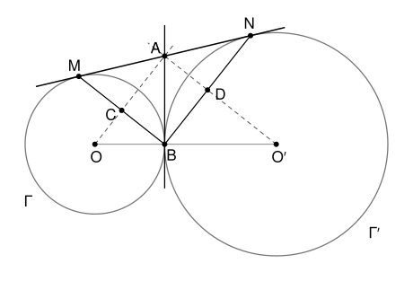

## Statement

Deux cercles $\Gamma$ et $\Gamma'$, de centres $O$ et $O'$, sont tangents extérieurement en un point $B$ : ils se touchent en $B$, et chacun est à l'extérieur de l'autre.

Une tangente commune aux deux cercles, qui ne passe pas par $B$, touche $\Gamma$ en $M$ et $\Gamma'$ en $N$. La tangente commune aux deux cercles au point $B$ coupe la droite $(MN)$ en $A$.

On note $C$ le point d'intersection des droites $(OA)$ et $(BM)$, et $D$ le point d'intersection des droites $(O'A)$ et $(BN)$.

Montrer que la droite $(CD)$ est parallèle à la droite $(MN)$.

## Hints

1. Compare les longueurs $AM$ et $AB$. Pour cela, utilise le théorème de Pythagore dans les triangles $OMA$ et $OBA$.
2. Les points $O$ et $A$ sont chacun à la même distance de $M$ et de $B$. Que représente la droite $(OA)$ pour le segment $[MB]$ ?
3. Le point $C$ est donc le milieu de $[MB]$. Fais de même pour $D$, puis pense au théorème des milieux dans le triangle $BMN$.

## Solution

**Rappel.** La tangente à un cercle en un point est perpendiculaire au rayon qui aboutit en ce point.

### Étape 1 : $AM = AB$

La droite $(MN)$ est tangente à $\Gamma$ en $M$, donc $(OM) \perp (MA)$ : le triangle $OMA$ est rectangle en $M$. De même, la droite $(AB)$ est tangente à $\Gamma$ en $B$, donc le triangle $OBA$ est rectangle en $B$. Le théorème de Pythagore donne
$$AM^2 = OA^2 - OM^2 \qquad \text{et} \qquad AB^2 = OA^2 - OB^2 .$$
Comme $OM = OB$ (ce sont deux rayons de $\Gamma$), on obtient $AM^2 = AB^2$, donc $AM = AB$.

### Étape 2 : $C$ est le milieu de $[MB]$

Les points $M$ et $B$ sont distincts : la tangente $(MN)$ ne passe pas par $B$. Le point $A$ n'est pas $B$ pour la même raison, donc $A$ est un point de la tangente en $B$ autre que $B$ : il est à l'extérieur de $\Gamma$, et il est différent de $O$.

On a $OM = OB$ et $AM = AB$ (étape 1). Les deux points distincts $O$ et $A$ sont donc sur la médiatrice du segment $[MB]$, et **la droite $(OA)$ est la médiatrice de $[MB]$**. Elle coupe la droite $(BM)$ au milieu du segment $[MB]$. Donc $C$ est le milieu de $[MB]$.

### Étape 3 : $D$ est le milieu de $[BN]$

On refait les étapes 1 et 2 avec le cercle $\Gamma'$ : la droite $(MN)$ est tangente à $\Gamma'$ en $N$ et la droite $(AB)$ est tangente à $\Gamma'$ en $B$. On obtient $AN = AB$, puis : la droite $(O'A)$ est la médiatrice de $[BN]$. Donc $D$ est le milieu de $[BN]$.

### Étape 4 : conclusion

Le point $B$ n'est pas sur la droite $(MN)$, donc $BMN$ est un vrai triangle. Dans ce triangle, $C$ est le milieu du côté $[BM]$ et $D$ est le milieu du côté $[BN]$. D'après le théorème des milieux, **la droite $(CD)$ est parallèle à la droite $(MN)$**.

## Going further

- Les étapes 1 et 3 donnent $AM = AB = AN$. Que peut-on dire du point $A$ sur le segment $[MN]$ ?
- Montre que le triangle $OAO'$ est rectangle en $A$. Indication : $(OA)$ est la bissectrice de l'angle $\widehat{MAB}$, et $(O'A)$ celle de l'angle $\widehat{BAN}$.
- Le théorème des milieux donne aussi $CD = \frac{1}{2}\,MN$. Calcule $MN$ en fonction des rayons $R$ et $R'$ des deux cercles.
