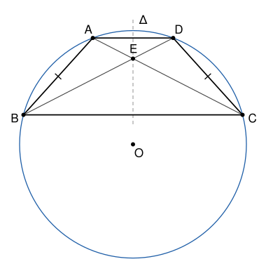

## Statement

Soit $ABCD$ un trapèze isocèle de bases $[AD]$ et $[BC]$ : les droites $(AD)$ et $(BC)$ sont parallèles, et la médiatrice $\Delta$ de $[BC]$ est un axe de symétrie du trapèze, qui échange $B$ et $C$, et aussi $A$ et $D$.

1. Montrer qu'il existe un cercle qui passe par les quatre points $A$, $B$, $C$ et $D$.
2. On note $O$ le centre de ce cercle et $E$ le point d'intersection des diagonales $[AC]$ et $[BD]$. Montrer que $O$ est sur le cercle circonscrit au triangle $AEB$.

## Hints

1. Pour la première question, coupe la médiatrice de $[AB]$ avec l'axe $\Delta$. Pourquoi $\Delta$ est-elle aussi la médiatrice de $[AD]$ ?
2. On note $\alpha$ l'angle $\widehat{ACB}$. Avec la symétrie, que vaut l'angle $\widehat{DBC}$ ? Que peux-tu dire du triangle $EBC$ ?
3. Exprime l'angle $\widehat{AEB}$ en fonction de $\alpha$, puis l'angle $\widehat{AOB}$ avec le théorème de l'angle au centre.
4. Pour conclure, vérifie que $O$ et $E$ sont du même côté de la droite $(AB)$.

## Solution

**Rappel.**

- *Angle au centre.* Si $A$, $B$, $C$ sont sur un cercle de centre $O$ et si l'angle $\widehat{ACB}$ est aigu, alors $\widehat{AOB} = 2\,\widehat{ACB}$, et $O$ est du même côté de la droite $(AB)$ que $C$.
- *Quatre points sur un cercle.* Si $Z$ et $T$ sont du même côté de la droite $(XY)$ et si $\widehat{XZY} = \widehat{XTY}$, alors $X$, $Y$, $Z$, $T$ sont sur un même cercle.

### 1. Le cercle qui passe par les quatre sommets

La droite $\Delta$ est perpendiculaire à $(BC)$, donc aussi à $(AD)$, qui est parallèle à $(BC)$. La symétrie d'axe $\Delta$ échange $A$ et $D$, donc $\Delta$ passe par le milieu de $[AD]$. Ainsi $\Delta$ est aussi la médiatrice de $[AD]$.

Soit $m$ la médiatrice de $[AB]$. Elle est perpendiculaire à $(AB)$. Si $m$ était parallèle à $\Delta$, les droites $(AB)$ et $(BC)$, perpendiculaires à deux droites parallèles, seraient parallèles. Elles ont le point $B$ en commun, donc $A$ serait sur $(BC)$, ce qui est faux, puisque $A$ est sur la droite $(AD)$, parallèle à $(BC)$ et distincte d'elle. Donc $m$ et $\Delta$ se coupent en un point $O$, et :

- $O$ est sur $m$, donc $OA = OB$ ;
- $O$ est sur $\Delta$, médiatrice de $[BC]$, donc $OB = OC$ ;
- $O$ est sur $\Delta$, médiatrice de $[AD]$, donc $OA = OD$.

Ainsi $OA = OB = OC = OD$ : **le cercle de centre $O$ et de rayon $OA$ passe par $A$, $B$, $C$ et $D$.**

### 2. Le point $O$ est sur le cercle $AEB$

Un trapèze est un quadrilatère convexe : ses diagonales se coupent en un point $E$ qui est à la fois entre $A$ et $C$ et entre $B$ et $D$.

On note $\alpha = \widehat{ACB}$. La symétrie d'axe $\Delta$ envoie $A$ sur $D$, $C$ sur $B$ et $B$ sur $C$. Elle conserve les angles, donc
$$\widehat{DBC} = \widehat{ACB} = \alpha .$$

Dans le triangle $EBC$, l'angle en $B$ est $\widehat{EBC} = \widehat{DBC} = \alpha$, car $E$ est sur $[BD]$, et l'angle en $C$ est $\widehat{ECB} = \widehat{ACB} = \alpha$, car $E$ est sur $[AC]$. On en tire deux choses.

- La somme des angles du triangle donne $\widehat{BEC} = 180° - 2\alpha$. En particulier $2\alpha < 180°$, donc **$\alpha < 90°$ : l'angle $\widehat{ACB}$ est aigu.**
- Les points $A$, $E$, $C$ sont alignés dans cet ordre, donc les angles $\widehat{AEB}$ et $\widehat{BEC}$ sont supplémentaires :
$$\widehat{AEB} = 180° - \widehat{BEC} = 2\alpha .$$

Les points $A$, $B$, $C$ sont sur le cercle de centre $O$, et l'angle $\widehat{ACB}$ est aigu. Le théorème de l'angle au centre donne
$$\widehat{AOB} = 2\,\widehat{ACB} = 2\alpha ,$$
et il dit aussi que $O$ est du même côté de la droite $(AB)$ que $C$. Le point $E$ est sur le segment $[AC]$ et n'est pas $A$, donc lui aussi est du même côté de $(AB)$ que $C$.

Si $O = E$, il n'y a rien à démontrer. Sinon, $O$ et $E$ sont deux points du même côté de $(AB)$ tels que $\widehat{AOB} = \widehat{AEB}$. D'après le rappel, **les points $A$, $B$, $E$ et $O$ sont sur un même cercle : $O$ est sur le cercle circonscrit au triangle $AEB$.**

## Going further

- Dans quel cas a-t-on $O = E$ ? Montre que cela arrive exactement quand le trapèze est un rectangle.
- Montre que le point $E$ est sur l'axe $\Delta$.
- Montre, avec la symétrie d'axe $\Delta$, que $O$ est aussi sur le cercle circonscrit au triangle $DEC$.
