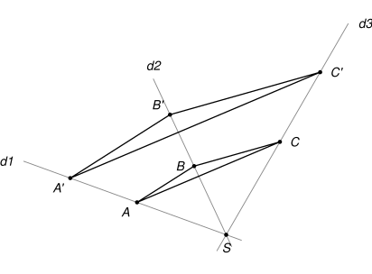

## Statement

Trois droites $d_1$, $d_2$ et $d_3$ passent toutes par un même point $S$.

On place deux points $A$ et $A'$ sur $d_1$, deux points $B$ et $B'$ sur $d_2$, et deux points $C$ et $C'$ sur $d_3$, tous différents de $S$. On suppose que :

- la droite $(AB)$ est parallèle à la droite $(A'B')$ ;
- la droite $(BC)$ est parallèle à la droite $(B'C')$.

Montrer que la droite $(AC)$ est parallèle à la droite $(A'C')$.

## Hints

1. Quel théorème du cours parle de deux droites parallèles qui coupent deux droites sécantes en $S$ ?
2. Écrivez l'égalité de rapports que donne $(AB) \parallel (A'B')$, puis celle que donne $(BC) \parallel (B'C')$. Un même rapport apparaît dans les deux.
3. Pour conclure, il faut la réciproque du théorème de Thalès. Vérifiez bien que les points sont placés dans le même ordre sur les deux droites.

## Solution

**Étape 1 : ce que donne $(AB) \parallel (A'B')$.**

Les droites $d_1$ et $d_2$ se coupent en $S$, et les droites $(AB)$ et $(A'B')$ sont parallèles. D'après le théorème de Thalès dans les triangles $SAB$ et $SA'B'$ :

$$\frac{SA'}{SA} = \frac{SB'}{SB}.$$

Appelons $k$ ce rapport commun.

Il y a deux cas de figure. Soit $A'$ est du même côté de $S$ que $A$, et alors $B'$ est du même côté de $S$ que $B$ (les deux triangles sont « emboîtés »). Soit $A'$ est de l'autre côté de $S$, et alors $B'$ aussi est de l'autre côté (configuration « papillon »). On ne peut pas avoir un point du même côté et l'autre de l'autre côté : la droite $(A'B')$, parallèle à $(AB)$, ne peut pas croiser la parallèle à $(AB)$ qui passe par $S$.

**Étape 2 : ce que donne $(BC) \parallel (B'C')$.**

De la même façon, dans les triangles $SBC$ et $SB'C'$ :

$$\frac{SC'}{SC} = \frac{SB'}{SB} = k,$$

et $C'$ est du même côté de $S$ que $C$ exactement quand $B'$ est du même côté de $S$ que $B$.

**Étape 3 : on compare.**

Des deux étapes précédentes, on tire

$$\frac{SA'}{SA} = k = \frac{SC'}{SC}.$$

De plus, les étapes 1 et 2 disent toutes les deux la même chose sur les positions : ou bien $A'$ et $C'$ sont tous les deux du même côté de $S$ que $A$ et $C$, ou bien ils sont tous les deux de l'autre côté. Les points $S, A, A'$ d'une part et $S, C, C'$ d'autre part sont donc dans le même ordre sur leurs droites.

**Conclusion.**

D'après la réciproque du théorème de Thalès, dans les triangles $SAC$ et $SA'C'$, l'égalité $\dfrac{SA'}{SA} = \dfrac{SC'}{SC}$ avec des points dans le même ordre donne :

$$(AC) \parallel (A'C').$$

## Going further

1. Que devient l'énoncé si les trois droites $d_1$, $d_2$, $d_3$ sont parallèles au lieu de passer par un même point ? Est-il encore vrai ? Démontrez-le à l'aide de parallélogrammes.
2. Avec la notion d'agrandissement-réduction de centre $S$ (homothétie), on peut écrire une preuve en trois lignes. Laquelle ?
