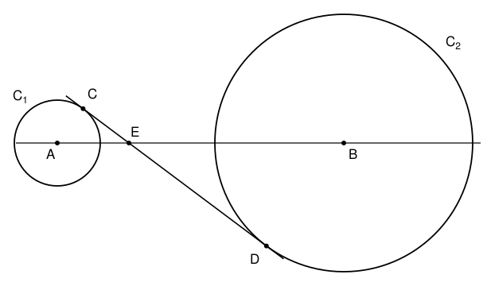

## Statement

Deux cercles $\mathcal{C}_1$ et $\mathcal{C}_2$ n'ont aucun point commun et sont extérieurs
l'un à l'autre. Le cercle $\mathcal{C}_1$ a pour centre $A$ et pour rayon $3$, le cercle
$\mathcal{C}_2$ a pour centre $B$ et pour rayon $9$.

Une droite est tangente aux deux cercles et passe entre eux (on dit que c'est une tangente
commune *intérieure*). Elle touche $\mathcal{C}_1$ au point $C$ et $\mathcal{C}_2$ au point
$D$. Elle coupe la droite $(AB)$ au point $E$.

On suppose que $AE = 5$. Combien vaut $CD$ ?

## Hints

1. Une tangente à un cercle est perpendiculaire au rayon qui aboutit au point de contact.
   Trace les rayons $[AC]$ et $[BD]$.
2. Dans le triangle $ACE$, tu connais deux longueurs et un angle droit. Que vaut $CE$ ?
3. Les droites $(AC)$ et $(BD)$ sont parallèles. Quel théorème relie alors les longueurs
   $EC$, $ED$, $AC$ et $BD$ ?

## Solution

**Deux angles droits.** Une tangente à un cercle est perpendiculaire au rayon qui va au point
de contact. Donc $(AC) \perp (CD)$ et $(BD) \perp (CD)$.

**La longueur $CE$.** Le triangle $ACE$ est rectangle en $C$, avec $AC = 3$ et $AE = 5$.
D'après le théorème de Pythagore,

$$CE^2 = AE^2 - AC^2 = 25 - 9 = 16, \qquad \text{donc} \qquad CE = 4.$$

**La longueur $ED$.** Les droites $(AC)$ et $(BD)$ sont toutes les deux perpendiculaires à
$(CD)$, donc elles sont parallèles. Les droites $(AB)$ et $(CD)$ se coupent en $E$. Comme la
tangente passe entre les deux cercles, $E$ est entre $A$ et $B$, et aussi entre $C$ et $D$ :
c'est la configuration « en papillon » du théorème de Thalès. On a donc

$$\frac{ED}{EC} = \frac{BD}{AC} = \frac{9}{3} = 3, \qquad \text{donc} \qquad ED = 3 \times EC = 12.$$

**Conclusion.** Puisque $E$ est entre $C$ et $D$,

$$CD = CE + ED = 4 + 12 = 16.$$

On peut vérifier que tout est cohérent : de même $EB = 3 \times EA = 15$, donc $AB = 20$, qui
est bien plus grand que $3 + 9 = 12$, et les deux cercles sont bien extérieurs l'un à l'autre.

**On a $CD = 16$.**
