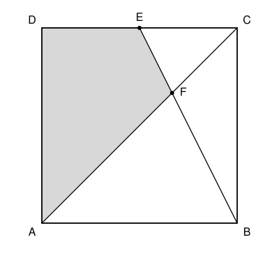

## Statement

Soit $ABCD$ un carré, $E$ le milieu du côté $[DC]$, et $F$ le point d'intersection des droites
$(AC)$ et $(BE)$.

L'aire du quadrilatère $AFED$ vaut $45$. Quelle est l'aire du carré $ABCD$ ?

## Hints

1. Le quadrilatère $AFED$ est le triangle $ACD$ auquel on a retiré un petit triangle. Lequel ?
2. Les droites $(EC)$ et $(AB)$ sont parallèles. Compare les triangles $FEC$ et $FBA$.
3. À quelle fraction de la diagonale $[AC]$ se trouve le point $F$ ? Déduis-en la hauteur du
   triangle $FEC$.

## Solution

Notons $c$ le côté du carré. Son aire est $c^2$.

**Découper la figure.** La diagonale $[AC]$ coupe le carré en deux triangles d'aire
$\dfrac{c^2}{2}$ chacun. Le quadrilatère $AFED$ est le triangle $ACD$ privé du triangle $FEC$.

**La position de $F$.** Les droites $(EC)$ et $(AB)$ sont parallèles, puisque ce sont deux côtés
opposés du carré. Les droites $(AC)$ et $(BE)$ se coupent en $F$. D'après le théorème de Thalès,

$$\frac{FC}{FA} = \frac{EC}{AB} = \frac{c/2}{c} = \frac{1}{2}.$$

Donc $FA = 2\,FC$, et $FC = \dfrac{1}{3} AC$ : le point $F$ est au tiers de la diagonale, en
partant de $C$.

**L'aire du triangle $FEC$.** Prenons $[EC]$ comme base : elle mesure $\dfrac{c}{2}$. La hauteur
est la distance de $F$ à la droite $(DC)$. Quand on va de $C$ à $A$ le long de la diagonale, on
s'éloigne de $(DC)$ d'une distance qui va de $0$ à $AD = c$, proportionnellement au chemin
parcouru (encore le théorème de Thalès). Au tiers du chemin, la distance vaut $\dfrac{c}{3}$.
Ainsi

$$\text{aire}(FEC) = \frac{1}{2} \times \frac{c}{2} \times \frac{c}{3} = \frac{c^2}{12}.$$

**L'aire de $AFED$.** On a

$$\text{aire}(AFED) = \frac{c^2}{2} - \frac{c^2}{12} = \frac{6c^2 - c^2}{12} = \frac{5}{12}\,c^2.$$

L'égalité $\dfrac{5}{12}\,c^2 = 45$ donne $c^2 = 45 \times \dfrac{12}{5} = 108$.

**L'aire du carré $ABCD$ est $108$.**
