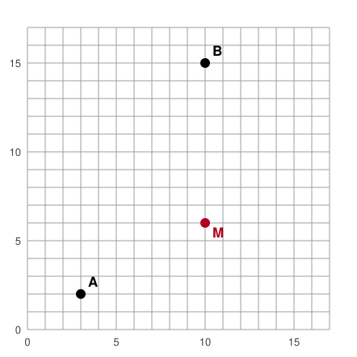

## Statement

La ville de Quadrillon est bâtie sur un quadrillage parfait. Un carrefour est repéré par deux nombres entiers $(x\,;\,y)$, avec $0 \leqslant x \leqslant 17$ et $0 \leqslant y \leqslant 17$ : $x$ compte les rues vers l'est, $y$ les rues vers le nord. Deux carrefours voisins sont séparés par un pâté de maisons, soit $100$ mètres. **Les camions ne peuvent rouler que dans les rues.**

Il y a deux casernes de pompiers : la caserne $A$ au carrefour $(3\,;\,2)$ et la caserne $B$ au carrefour $(10\,;\,15)$. Ta maison $M$ est au carrefour $(10\,;\,6)$.

**a)** Quelle caserne est la plus proche de chez toi à vol d'oiseau ?

**b)** Les deux casernes ont des camions identiques, qui roulent à la même vitesse. Lequel arrivera le premier chez toi ?

**c)** Place sur le plan tous les carrefours situés à exactement $4$ pâtés de maisons de chez toi, pour un camion. Quelle figure forment-ils ?

## Hints

1. À vol d'oiseau, un oiseau coupe en diagonale : c'est la distance habituelle, celle que donne le théorème de Pythagore.
2. Pour un camion, ce qui compte est le nombre de pâtés de maisons parcourus. Compte les déplacements vers l'est ou l'ouest, puis ceux vers le nord ou le sud, et additionne.
3. Question c) : pour aller à un carrefour situé à $4$ pâtés, tu peux faire $4$ pas vers l'est et $0$ vers le nord, ou $3$ et $1$, ou $2$ et $2$... sans oublier les directions opposées.

## Solution

**a) À vol d'oiseau.**

Les distances se calculent avec le théorème de Pythagore, en prenant le pâté de maisons comme unité.

De $A(3\,;\,2)$ à $M(10\,;\,6)$ : on avance de $10 - 3 = 7$ vers l'est et de $6 - 2 = 4$ vers le nord, donc
$$AM = \sqrt{7^2 + 4^2} = \sqrt{65} \approx \text{8,06} \text{ pâtés, soit environ } 806 \text{ m.}$$

De $B(10\,;\,15)$ à $M(10\,;\,6)$ : même abscisse, donc le trajet est vertical :
$$BM = 15 - 6 = 9 \text{ pâtés, soit } 900 \text{ m.}$$

Comme $\sqrt{65} < 9$ (car $65 < 81$), **c'est la caserne $A$ qui est la plus proche à vol d'oiseau.**

**b) Par la route.**

Un camion ne peut pas couper en diagonale. Pour aller de $A(3\,;\,2)$ à $M(10\,;\,6)$, il doit parcourir $7$ pâtés vers l'est et $4$ pâtés vers le nord, dans l'ordre qu'il veut : cela fait toujours
$$7 + 4 = 11 \text{ pâtés.}$$

Pour aller de $B(10\,;\,15)$ à $M(10\,;\,6)$, il doit parcourir $0$ pâté vers l'est et $9$ vers le sud :
$$0 + 9 = 9 \text{ pâtés.}$$

**C'est donc le camion de la caserne $B$ qui arrivera le premier**, alors même que $B$ est plus loin à vol d'oiseau. Les rues rendent le détour de $A$ inévitable, tandis que $B$ est exactement dans le prolongement de la rue verticale.

**c) Les carrefours à 4 pâtés de maisons.**

Un carrefour $(x\,;\,y)$ est à $4$ pâtés de $M(10\,;\,6)$ lorsque
$$|x - 10| + |y - 6| = 4 .$$

Si on fait $k$ pas horizontaux, il reste $4 - k$ pas verticaux. Cela donne, pour $k = 0, 1, 2, 3, 4$ :

$$(10\,;\,10),\ (10\,;\,2),\quad (9\,;\,9),\ (11\,;\,9),\ (9\,;\,3),\ (11\,;\,3),\quad (8\,;\,8),\ (12\,;\,8),\ (8\,;\,4),\ (12\,;\,4),$$
$$(7\,;\,7),\ (13\,;\,7),\ (7\,;\,5),\ (13\,;\,5),\quad (6\,;\,6),\ (14\,;\,6) .$$

Cela fait $16$ carrefours, et ils se placent sur un **carré posé sur la pointe**, de centre $M$, dont les côtés font un angle de $45^\circ$ avec les rues.

C'est amusant : pour un camion de Quadrillon, ce carré joue exactement le rôle que joue un cercle pour un oiseau. Un « cercle » de rayon $4$ y est un carré incliné.

## Going further

1. Combien y a-t-il de carrefours à exactement $n$ pâtés de maisons de $M$, quand on est assez loin des bords de la ville ?
2. Combien existe-t-il de chemins les plus courts différents pour aller de $A$ à $M$ ?
3. Et si les pâtés de maisons étaient deux fois plus longs d'est en ouest que du nord au sud, quelle caserne arriverait la première ?
