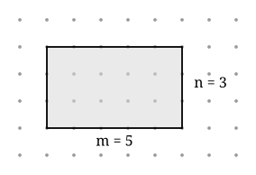

## Statement

On appelle **nœud** un point du plan dont les deux coordonnées sont des nombres entiers.

Le **théorème de Pick** affirme ceci : si un polygone a tous ses sommets sur des nœuds et si
ses côtés ne se croisent pas, alors son aire $A$, son nombre $I$ de nœuds intérieurs et son
nombre $B$ de nœuds sur le bord sont liés par

$$A = I + \frac{B}{2} - 1 .$$

Le but de l'exercice est de **démontrer** cette formule dans le cas le plus simple : celui
d'un rectangle dont les côtés suivent le quadrillage.

Soit un rectangle de $m$ carreaux de large et $n$ carreaux de haut, $m$ et $n$ étant des
entiers strictement positifs, et dont les côtés suivent les lignes du quadrillage.

1. Combien de nœuds se trouvent sur le bord du rectangle ? Exprime $B$ en fonction de $m$ et
   $n$.
2. Combien de nœuds se trouvent strictement à l'intérieur ? Exprime $I$ en fonction de $m$ et
   $n$.
3. Calcule $I + \dfrac{B}{2} - 1$ et vérifie que tu retrouves bien l'aire $mn$.

## Hints

1. Commence par le rectangle du dessin, $m = 5$ et $n = 3$ : compte les nœuds du bord, puis
   ceux de l'intérieur. Tu pourras ensuite vérifier tes formules dessus.
2. Pour les nœuds du bord, attention aux quatre coins : chacun appartient à deux côtés. Une
   façon sûre de compter est de faire le tour et, pour chaque côté, de compter son point de
   départ mais pas son point d'arrivée.
3. Les nœuds intérieurs forment eux aussi un rectangle de nœuds. Combien de colonnes ?
   Combien de lignes ?
4. Pour la question 3, développe $(m-1)(n-1)$ avant d'additionner.

## Solution

**1. Les nœuds du bord.**

Le côté du bas mesure $m$ carreaux, donc il porte $m + 1$ nœuds. Même chose pour le côté du
haut. Les deux côtés verticaux portent $n + 1$ nœuds chacun.

Si on additionne tout, on trouve $2(m+1) + 2(n+1)$, mais chacun des quatre coins a été compté
deux fois. Il faut donc en retirer $4$ :

$$B = 2(m+1) + 2(n+1) - 4 = 2m + 2n .$$

*Autre façon de voir :* en faisant le tour du rectangle, on compte pour chaque côté son point
de départ seulement. On obtient $m + n + m + n = 2m + 2n$, sans risque de doublon.

*Vérification sur le dessin :* $m = 5$, $n = 3$ donne $B = 10 + 6 = 16$. On compte bien $16$
points sur le bord.

**2. Les nœuds intérieurs.**

Un nœud intérieur se trouve sur l'une des lignes verticales strictement comprises entre les
deux côtés verticaux : il y en a $m - 1$. Et sur l'une des lignes horizontales strictement
comprises entre le bas et le haut : il y en a $n - 1$. Chaque choix d'une verticale et d'une
horizontale donne exactement un nœud intérieur, donc

$$I = (m-1)(n-1) .$$

*Vérification sur le dessin :* $(5-1)(3-1) = 4 \times 2 = 8$. On compte bien $8$ points à
l'intérieur.

**3. Le calcul.**

$$I + \frac{B}{2} - 1 = (m-1)(n-1) + \frac{2m+2n}{2} - 1 .$$

On développe le produit :

$$(m-1)(n-1) = mn - m - n + 1 ,$$

et on simplifie la fraction : $\dfrac{2m+2n}{2} = m + n$. Donc

$$I + \frac{B}{2} - 1 = (mn - m - n + 1) + (m + n) - 1 = mn .$$

Les $-m$ et $+m$ se compensent, les $-n$ et $+n$ aussi, le $+1$ et le $-1$ aussi. Il ne reste
que $mn$, qui est exactement l'aire du rectangle.

$$\boxed{A = I + \frac{B}{2} - 1 \text{ est vrai pour tout rectangle du quadrillage.}}$$

**Vérification sur le dessin :** $I + \dfrac{B}{2} - 1 = 8 + 8 - 1 = 15 = 5 \times 3$.

## Going further

1. Reprends le même travail pour un triangle rectangle dont les deux côtés de l'angle droit
   suivent le quadrillage et mesurent $m$ et $n$. Attention : cette fois l'hypoténuse peut
   passer par des nœuds, et leur nombre dépend de $m$ et de $n$.
2. Un rectangle du quadrillage a $I = 24$ nœuds intérieurs. Quelles sont ses dimensions
   possibles ?
