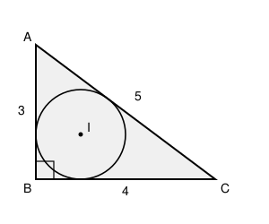

## Statement

Un triangle a pour longueurs de côtés $3$, $4$ et $5$.

Calculer le rayon de son **cercle inscrit**, c'est-à-dire du cercle intérieur au triangle et
tangent à ses trois côtés.

## Hints

1. Le triangle de côtés $3$, $4$, $5$ a une propriété remarquable. Calcule $3^2 + 4^2$.
2. Relie le centre $I$ du cercle inscrit aux trois sommets : le triangle est découpé en trois
   petits triangles. Quelle est la hauteur de chacun d'eux, si l'on prend pour base un côté du
   grand triangle ?
3. Calcule l'aire du triangle de deux façons différentes.

## Solution

**Le triangle est rectangle.**

$$3^2 + 4^2 = 9 + 16 = 25 = 5^2 .$$
D'après la réciproque du théorème de Pythagore, le triangle est rectangle, et son hypoténuse
est le côté de longueur $5$.

Son aire se calcule donc facilement : les deux côtés de l'angle droit mesurent $3$ et $4$,
donc
$$\mathcal{A} = \frac{3 \times 4}{2} = 6 .$$

**La même aire, calculée autrement.**

Appelons $A$, $B$, $C$ les sommets, $I$ le centre du cercle inscrit et $r$ son rayon.
Relions $I$ aux trois sommets : le triangle $ABC$ se découpe en trois triangles $IAB$, $IBC$
et $ICA$, qui ne se chevauchent pas.

Prenons pour base de chacun le côté du triangle qu'il contient. Le cercle inscrit étant
tangent à ce côté, la distance de $I$ à ce côté vaut exactement $r$ : c'est la hauteur du
petit triangle. Donc
$$\text{aire}(IAB) = \frac{r \times AB}{2}, \qquad
  \text{aire}(IBC) = \frac{r \times BC}{2}, \qquad
  \text{aire}(ICA) = \frac{r \times CA}{2} .$$

En additionnant :
$$\mathcal{A} = \frac{r \times (AB + BC + CA)}{2} = \frac{r \times \text{périmètre}}{2} .$$

**Le calcul.**

Le périmètre vaut $3 + 4 + 5 = 12$, donc
$$6 = \frac{12\,r}{2} = 6r .$$

**Conclusion.** Le rayon du cercle inscrit vaut $\boxed{r = 1}$.

## Going further

La formule obtenue en chemin est générale et vaut la peine d'être retenue :
$$\mathcal{A} = r \times p, \qquad \text{où } p = \frac{a+b+c}{2} \text{ est le demi-périmètre.}$$

Pour un triangle **rectangle** en $A$, il existe une seconde méthode. Les deux tangentes
issues d'un même point à un cercle ont la même longueur ; en notant $u$, $v$, $w$ ces
longueurs depuis $A$, $B$, $C$, on trouve $u = \dfrac{-a+b+c}{2}$, et comme $AEIF$ est un
carré de côté $r$ (où $E$ et $F$ sont les points de contact sur les côtés de l'angle droit),
$$r = u = \frac{-5+4+3}{2} = 1 .$$
On retrouve bien la même valeur.
