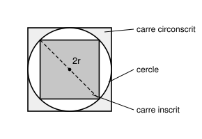

## Statement

On se donne un cercle. On trace :

- le carré **circonscrit** au cercle, c'est-à-dire celui dont les quatre côtés touchent le
  cercle ;
- le carré **inscrit** dans le cercle, c'est-à-dire celui dont les quatre sommets sont sur le
  cercle.

Quel est le rapport entre l'aire du grand carré et celle du petit ?

## Hints

1. Donne un nom au rayon du cercle, par exemple $r$, et exprime tout en fonction de $r$.
2. Pour le carré circonscrit : le cercle touche deux côtés opposés. Quelle est la distance
   entre ces deux côtés ?
3. Pour le carré inscrit : ses quatre sommets sont sur le cercle. Que représente une diagonale
   de ce carré pour le cercle ?
4. Connaissant la diagonale d'un carré, comment retrouver son côté ? Pense au théorème de
   Pythagore.

## Solution

**Réponse : le grand carré a une aire exactement deux fois plus grande.**

Notons $r$ le rayon du cercle et $O$ son centre.

**L'aire du carré circonscrit.**

Le cercle touche les deux côtés horizontaux du grand carré. La distance entre ces deux côtés
est donc le diamètre du cercle, soit $2r$. Comme cette distance est aussi le côté du carré, le
grand carré a pour côté $2r$ et pour aire

$$\mathcal{A}_{\text{grand}} = (2r)^2 = 4r^2 .$$

**L'aire du carré inscrit.**

Les quatre sommets du petit carré sont sur le cercle. Deux sommets opposés sont donc
diamétralement opposés : la **diagonale** du petit carré vaut $2r$.

Notons $\ell$ le côté du petit carré. Le théorème de Pythagore dans le demi-carré (un triangle
rectangle isocèle de côtés $\ell$, $\ell$ et de diagonale $2r$) donne

$$\ell^2 + \ell^2 = (2r)^2, \qquad \text{donc} \qquad 2\ell^2 = 4r^2 .$$

L'aire du petit carré est $\ell^2$, donc

$$\mathcal{A}_{\text{petit}} = \ell^2 = 2r^2 .$$

(Remarquons qu'on obtient l'aire sans jamais avoir besoin de calculer $\ell$ lui-même.)

**Le rapport.**

$$\frac{\mathcal{A}_{\text{grand}}}{\mathcal{A}_{\text{petit}}} = \frac{4r^2}{2r^2} = 2 .$$

$$\boxed{\text{Le carré circonscrit a une aire deux fois plus grande que le carré inscrit.}}$$

**Une vérification sans calcul.** Tourne le petit carré d'un huitième de tour : ses sommets
viennent au milieu des côtés du grand carré. Le grand carré est alors découpé en huit petits
triangles rectangles identiques, dont quatre forment le petit carré. Deux fois, donc.

## Going further

1. Que vaut le rapport entre l'aire du disque et celle du carré inscrit ? Et entre l'aire du
   carré circonscrit et celle du disque ? Laquelle des deux est la plus proche de $1$ ?
2. Mêmes questions avec des triangles équilatéraux à la place des carrés : quel est le rapport
   des aires du triangle équilatéral circonscrit et du triangle équilatéral inscrit ?
3. Et avec des hexagones réguliers ?
