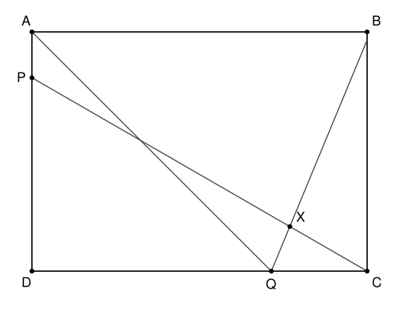

## Statement

$ABCD$ est un rectangle, plus large que haut : $AB > AD$. On place deux points.

- $P$ est sur le segment $[DA]$, de façon que $\widehat{DCP} = 30^\circ$.
- $Q$ est sur le segment $[CD]$, de façon que $\widehat{DAQ} = 45^\circ$.

On trace ensuite la bissectrice de l'angle $\widehat{AQC}$ ; elle coupe la droite $(CP)$ en un point $X$.

Combien mesure l'angle $\widehat{PXQ}$ ?

Fais toi-même la figure : elle ne sert qu'à voir la situation, la réponse doit venir d'un calcul d'angles, pas d'un rapporteur.

## Hints

1. Commence par le triangle $ADQ$. Il est rectangle en $D$ et tu connais un de ses angles aigus. Que valent les deux autres ?
2. Les points $A$, $Q$ et $C$ sont-ils alignés ? Non. Mais $D$, $Q$ et $C$ le sont : l'angle $\widehat{AQC}$ et l'angle $\widehat{AQD}$ sont donc supplémentaires, ils font $180^\circ$ à eux deux.
3. Une bissectrice coupe un angle en deux angles égaux. Tu peux maintenant calculer $\widehat{XQC}$.
4. Regarde le triangle $XQC$ : tu connais l'angle en $Q$, et l'angle en $C$ est justement l'angle de $30^\circ$ de l'énoncé. Il reste à passer de $\widehat{QXC}$ à $\widehat{PXQ}$.

## Solution

**Étape 1. Le triangle $ADQ$.**

Le quadrilatère $ABCD$ est un rectangle, donc l'angle en $D$ est droit : le triangle $ADQ$ est rectangle en $D$. La somme de ses trois angles vaut $180^\circ$, donc
$$\widehat{DQA} = 180 - 90 - 45 = 45^\circ .$$

**Étape 2. L'angle $\widehat{AQC}$.**

Le point $Q$ est sur le segment $[DC]$ : les points $D$, $Q$, $C$ sont alignés dans cet ordre. Les angles $\widehat{AQD}$ et $\widehat{AQC}$ sont donc supplémentaires :
$$\widehat{AQC} = 180 - 45 = 135^\circ .$$

**Étape 3. La bissectrice.**

Par définition, la bissectrice de $\widehat{AQC}$ partage cet angle en deux angles égaux. Comme $X$ est sur cette bissectrice,
$$\widehat{AQX} = \widehat{XQC} = \frac{135}{2} = \text{67,5}^\circ .$$

**Étape 4. Le triangle $XQC$.**

Dans ce triangle, l'angle en $Q$ vaut $\text{67,5}^\circ$ et l'angle en $C$ est l'angle $\widehat{QCX}$. Or $Q$ est sur $[DC]$ et $X$ est sur la droite $(CP)$, du même côté que $P$ : cet angle en $C$ est exactement l'angle $\widehat{DCP}$ de l'énoncé, soit $30^\circ$. La somme des angles donne
$$\widehat{QXC} = 180 - \text{67,5} - 30 = \text{82,5}^\circ .$$

**Étape 5. On revient à l'angle demandé.**

Les points $P$, $X$, $C$ sont alignés, car $X$ est sur la droite $(CP)$, et $X$ est entre $P$ et $C$. Les angles $\widehat{PXQ}$ et $\widehat{QXC}$ sont donc supplémentaires :
$$\widehat{PXQ} = 180 - \text{82,5} = \text{97,5}^\circ .$$

**Conclusion.** L'angle $\widehat{PXQ}$ mesure $\boxed{\text{97,5}^\circ}$.

Remarque : les longueurs $AB$ et $AD$ n'interviennent jamais dans le calcul. La réponse est la même pour tous les rectangles autorisés par l'énoncé, ce qui explique qu'on n'ait pas eu besoin de les connaître.

## Going further

Refais le calcul en remplaçant $30^\circ$ par un angle $\alpha$ quelconque, et $45^\circ$ par un angle $\beta$ quelconque. Quelle formule obtiens-tu pour $\widehat{PXQ}$ ?
