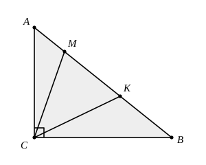

## Statement

$ABC$ est un triangle rectangle en $C$. Sur l'hypoténuse $[AB]$, on place deux points $M$ et $K$ tels que

$$BM = BC \qquad \text{et} \qquad AK = AC.$$

Calculer la mesure de l'angle $\widehat{MCK}$.

On remarquera que la réponse ne dépend pas de la forme du triangle de départ.

## Hints

1. Aucune longueur n'est donnée : il faut donc travailler uniquement avec les angles. Pose $\alpha = \widehat{BAC}$ et $\beta = \widehat{ABC}$. Que vaut $\alpha + \beta$ dans un triangle rectangle ?
2. Le triangle $AKC$ est isocèle, car $AK = AC$. Son sommet principal est $A$ et son angle au sommet vaut $\alpha$. Que valent ses deux angles à la base ?
3. Recommence avec le triangle $BMC$, isocèle de sommet principal $B$ et d'angle au sommet $\beta$.
4. Regarde maintenant le triangle $CMK$. Tu connais ses angles en $M$ et en $K$ : ce sont ceux que tu viens de calculer. Écris que la somme des angles de $CMK$ vaut $180^\circ$.

## Solution

**L'idée : nommer les deux angles aigus et tout exprimer avec eux.**

Posons
$$\alpha = \widehat{BAC}, \qquad \beta = \widehat{ABC}.$$

Le triangle $ABC$ est rectangle en $C$, donc ses deux angles aigus sont complémentaires :
$$\alpha + \beta = 90^\circ.$$

Sur la figure, les points se suivent dans l'ordre $A$, $M$, $K$, $B$ sur l'hypoténuse (c'est démontré à la fin).

**Étape 1. Le triangle $AKC$.**

On a $AK = AC$, donc le triangle $AKC$ est isocèle de sommet principal $A$. Son angle au sommet est $\widehat{KAC} = \alpha$, et ses deux angles à la base sont égaux :
$$\widehat{AKC} = \widehat{ACK} = \frac{180^\circ - \alpha}{2} = 90^\circ - \frac{\alpha}{2}.$$

**Étape 2. Le triangle $BMC$.**

De même, $BM = BC$ donc le triangle $BMC$ est isocèle de sommet principal $B$, d'angle au sommet $\widehat{MBC} = \beta$, et
$$\widehat{BMC} = \widehat{BCM} = \frac{180^\circ - \beta}{2} = 90^\circ - \frac{\beta}{2}.$$

**Étape 3. Le triangle $CMK$.**

Regardons ses angles en $M$ et en $K$.

- En $K$ : le point $M$ est du même côté que $A$, donc l'angle $\widehat{CKM}$ est le même que $\widehat{CKA}$, soit $90^\circ - \dfrac{\alpha}{2}$.
- En $M$ : le point $K$ est du même côté que $B$, donc l'angle $\widehat{CMK}$ est le même que $\widehat{CMB}$, soit $90^\circ - \dfrac{\beta}{2}$.

La somme des angles du triangle $CMK$ vaut $180^\circ$ :
$$\left(90^\circ - \frac{\alpha}{2}\right) + \left(90^\circ - \frac{\beta}{2}\right) + \widehat{MCK} = 180^\circ.$$

D'où
$$\widehat{MCK} = \frac{\alpha}{2} + \frac{\beta}{2} = \frac{\alpha + \beta}{2} = \frac{90^\circ}{2} = 45^\circ.$$

**Conclusion.** L'angle $\widehat{MCK}$ mesure $45^\circ$, quelle que soit la forme du triangle rectangle de départ.

**Pourquoi $M$ est-il entre $A$ et $K$ ?**

Notons $a = BC$, $b = AC$ et $c = AB$. Alors $AK = b$ et $AM = AB - BM = c - a$. L'inégalité triangulaire dans $ABC$ donne $c < a + b$, donc $c - a < b$, c'est-à-dire $AM < AK$. Les points $M$ et $K$ étant tous deux sur $[AB]$, le point $M$ est bien entre $A$ et $K$. Cette position ne change donc jamais.

## Going further

1. Avec les notations $a = BC$, $b = AC$, $c = AB$, exprimer la longueur $MK$ en fonction de $a$, $b$ et $c$.
2. Le triangle $CMK$ a un angle de $45^\circ$ en $C$. Peut-il être isocèle ? Rectangle ? Dans quels cas ?
