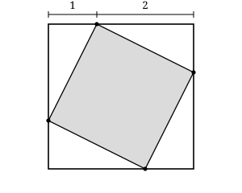

## Statement

Les quatre sommets d'un carré sont posés sur les côtés d'un carré plus grand. Chacun de ces points partage le côté sur lequel il se trouve dans le rapport $1 : 2$, et toujours dans le même sens quand on tourne autour du grand carré.

Quel est le rapport de l'aire du grand carré à l'aire du petit ?

## Hints

1. Note $x$ la longueur du plus petit des deux morceaux découpés sur un côté. Combien mesure alors l'autre morceau, et combien mesure le côté du grand carré ?
2. Regarde bien la figure : le grand carré est découpé en cinq morceaux qui ne se chevauchent pas. Lesquels ?
3. Les quatre morceaux qui ne sont pas le petit carré sont des triangles rectangles, tous identiques. Quelles sont les longueurs de leurs côtés de l'angle droit ?
4. Calcule l'aire d'un de ces triangles, puis celle du grand carré, et retranche.

## Solution

**On donne un nom aux longueurs.**

Sur chaque côté du grand carré, le point de partage laisse deux morceaux, l'un deux fois plus long que l'autre. Notons $x$ la longueur du plus petit : l'autre mesure $2x$, et le côté du grand carré mesure

$$x + 2x = 3x .$$

L'aire du grand carré vaut donc $(3x)^2 = 9x^2$.

**On découpe le grand carré.**

Le petit carré et les quatre triangles des coins recouvrent exactement le grand carré, sans se chevaucher. L'aire du grand carré est donc la somme des cinq aires.

Regardons l'un de ces triangles, par exemple celui du coin en haut à gauche. Son angle droit est un coin du grand carré. Ses deux côtés de l'angle droit sont portés par deux côtés du grand carré : sur l'un, le triangle occupe le morceau de longueur $x$ ; sur l'autre, le morceau de longueur $2x$. C'est vrai à chaque coin, parce que le partage se fait toujours dans le même sens : chaque coin reçoit un morceau court et un morceau long.

L'aire de ce triangle vaut donc

$$\frac{x \times 2x}{2} = x^2 ,$$

et les quatre triangles ont ensemble une aire de $4x^2$.

**On conclut.**

L'aire du petit carré vaut

$$9x^2 - 4x^2 = 5x^2 .$$

Le rapport cherché est donc

$$\frac{9x^2}{5x^2} = \frac{9}{5} .$$

L'aire du grand carré est $\dfrac{9}{5}$ fois, c'est-à-dire $\text{1,8}$ fois, celle du petit. Le rapport des aires est $9 : 5$, et il ne dépend pas de la taille du grand carré.

**Vérification.** Le côté du petit carré est l'hypoténuse d'un des triangles. D'après le théorème de Pythagore, il mesure $\sqrt{x^2 + (2x)^2} = \sqrt{5x^2} = x\sqrt{5}$, et l'aire du petit carré vaut bien $(x\sqrt{5})^2 = 5x^2$.

## Going further

1. Reprendre le problème lorsque les points partagent les côtés dans le rapport $1 : 3$.
2. On partage maintenant les côtés dans le rapport $p : q$. Montrer que l'aire du petit carré vaut $p^2 + q^2$ lorsque le côté du grand carré mesure $p+q$.
3. Pour quel rapport de partage l'aire du petit carré est-elle exactement la moitié de celle du grand ?
