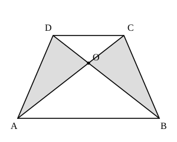

## Statement

$ABCD$ est un trapèze de bases $[AB]$ et $[CD]$ : les droites $(AB)$ et $(CD)$ sont parallèles. Ses diagonales $[AC]$ et $[BD]$ se coupent en $O$.

Montrer que les triangles $AOD$ et $BOC$ (grisés sur la figure) ont la même aire.

## Hints

1. Les deux triangles grisés n'ont, à première vue, rien en commun. Plutôt que de calculer leurs aires, essaie d'ajouter à chacun **la même pièce** pour obtenir deux figures plus faciles à comparer.
2. Ajoute à chacun le triangle $OCD$. Quels triangles obtiens-tu ?
3. Les triangles $ACD$ et $BCD$ ont la même base $[CD]$. Que peux-tu dire de leurs hauteurs relatives à cette base, sachant que $(AB)$ et $(CD)$ sont parallèles ?

## Solution

**L'idée : compléter les deux triangles par une même pièce.**

Plutôt que de comparer directement les deux triangles grisés, ajoutons à chacun d'eux le triangle $OCD$.

- Le point $O$ est sur la diagonale $[AC]$. Le segment $[OD]$ coupe donc le triangle $ACD$ en deux morceaux : les triangles $AOD$ et $OCD$. Autrement dit

$$\mathcal{A}(ACD) = \mathcal{A}(AOD) + \mathcal{A}(OCD).$$

- Le point $O$ est aussi sur la diagonale $[BD]$. Le segment $[OC]$ coupe donc le triangle $BCD$ en deux morceaux : les triangles $BOC$ et $OCD$. Autrement dit

$$\mathcal{A}(BCD) = \mathcal{A}(BOC) + \mathcal{A}(OCD).$$

**Les triangles $ACD$ et $BCD$ ont la même aire.**

Ces deux triangles ont la même base, le côté $[CD]$. Leur troisième sommet est $A$ pour l'un et $B$ pour l'autre. Or $A$ et $B$ sont tous les deux sur la droite $(AB)$, qui est **parallèle** à $(CD)$ : ils sont donc à la même distance de la droite $(CD)$.

Les deux triangles ont ainsi la même base et la même hauteur relative à cette base. Comme

$$\mathcal{A} = \frac{\text{base} \times \text{hauteur}}{2},$$

on en déduit

$$\mathcal{A}(ACD) = \mathcal{A}(BCD).$$

**On conclut.**

Il ne reste plus qu'à retirer des deux côtés l'aire commune, celle du triangle $OCD$ :

$$\mathcal{A}(AOD) = \mathcal{A}(ACD) - \mathcal{A}(OCD) = \mathcal{A}(BCD) - \mathcal{A}(OCD) = \mathcal{A}(BOC).$$

Les triangles $AOD$ et $BOC$ ont bien la même aire.

**L'idée à retenir.** Quand on déplace le sommet d'un triangle le long d'une droite parallèle à sa base, la hauteur ne change pas, donc l'aire non plus. Le résultat démontré ici est un outil très utile : dans un trapèze, **les deux triangles posés sur les côtés obliques ont toujours la même aire**.

## Going further

1. On note $P$ l'aire du triangle $AOB$ et $Q$ celle du triangle $COD$, c'est-à-dire les aires des deux triangles posés sur les bases. Montrer que

$$\mathcal{A}(AOD) \times \mathcal{A}(BOC) = P \times Q.$$

Indication : deux triangles de même hauteur ont des aires proportionnelles à leurs bases. Compare $\mathcal{A}(AOD)$ et $\mathcal{A}(OCD)$, dont les bases $[AO]$ et $[OC]$ sont portées par la même droite, puis fais de même avec $\mathcal{A}(AOB)$ et $\mathcal{A}(BOC)$.

2. Dans un trapèze, l'aire de $AOB$ vaut $9$ cm² et celle de $COD$ vaut $4$ cm². Quelle est l'aire du trapèze entier ?
