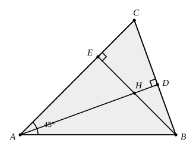

## Statement

$ABC$ est un triangle dont les trois angles sont aigus, avec $\widehat{BAC} = 45^\circ$.

La hauteur issue de $A$ coupe $[BC]$ en $D$, la hauteur issue de $B$ coupe $[AC]$ en $E$, et
ces deux hauteurs se coupent en $H$.

Montrer que $AH = BC$.

## Hints

1. Où l'angle de $45^\circ$ peut-il servir ? Cherche un triangle rectangle qui possède cet
   angle : il est alors isocèle.
2. Le triangle $ABE$ est rectangle en $E$ et son angle en $A$ vaut $45^\circ$. Que vaut son
   angle en $B$ ? Qu'en déduis-tu sur $AE$ et $BE$ ?
3. $AH$ et $BC$ sont des côtés de deux triangles rectangles qui ont le sommet $E$ en commun.
   Lesquels ?
4. Pour comparer les triangles $AEH$ et $BEC$, il te manque une égalité d'angles. Calcule
   $\widehat{HAE}$ et $\widehat{CBE}$ en utilisant les deux triangles rectangles $ADC$ et
   $BEC$.

## Solution

**L'idée : $AH$ et $BC$ sont les hypoténuses de deux triangles rectangles superposables, tous
deux de sommet $E$.**

**Étape 1. L'angle de $45^\circ$ fabrique un triangle rectangle isocèle.**

Le triangle $ABE$ est rectangle en $E$, car $(BE) \perp (AC)$. Son angle en $A$ vaut
$\widehat{BAE} = \widehat{BAC} = 45^\circ$, donc son angle en $B$ vaut
$180^\circ - 90^\circ - 45^\circ = 45^\circ$. Le triangle $ABE$ est donc rectangle isocèle, et

$$AE = BE.$$

**Étape 2. Deux angles égaux.**

Dans le triangle $ADC$, rectangle en $D$, les deux angles aigus sont complémentaires :

$$\widehat{DAC} = 90^\circ - \widehat{ACB}.$$

Dans le triangle $BEC$, rectangle en $E$, de même :

$$\widehat{EBC} = 90^\circ - \widehat{ACB}.$$

Donc $\widehat{DAC} = \widehat{EBC}$. Or le point $H$ est sur le segment $[AD]$, donc la
demi-droite $[AH)$ est la demi-droite $[AD)$, et $\widehat{HAE} = \widehat{DAC}$. Finalement

$$\widehat{HAE} = \widehat{EBC}.$$

**Étape 3. Deux triangles superposables.**

Comparons les triangles $AEH$ et $BEC$ :

- $\widehat{AEH} = \widehat{BEC} = 90^\circ$, car $(BE) \perp (AC)$ et $H$ est sur $(BE)$ ;
- $AE = BE$, d'après l'étape 1 ;
- $\widehat{HAE} = \widehat{CBE}$, d'après l'étape 2.

Ils ont un côté égal compris entre deux angles égaux : ils sont superposables.

**Conclusion.** Les côtés correspondants sont égaux, donc

$$AH = BC.$$

## Going further

Où est le point $H$ lorsque le triangle a un angle droit en $A$ ? Et l'égalité $AH = BC$,
que devient-elle si $\widehat{BAC} \ne 45^\circ$ ? On pourra montrer que le rapport
$\dfrac{AH}{BC}$ ne dépend que de l'angle $\widehat{BAC}$.
