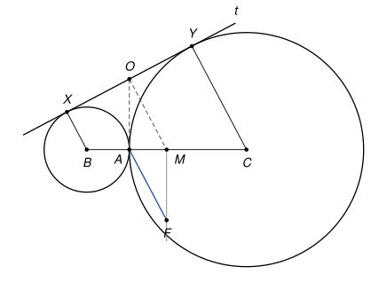

## Statement

Deux cercles, de centres $B$ et $C$ et de rayons différents, sont tangents extérieurement en un point $A$ : ils se touchent en $A$, et chacun est à l'extérieur de l'autre.

Soit $t$ une tangente commune aux deux cercles qui ne passe pas par $A$. La perpendiculaire à $t$ passant par $A$ coupe la médiatrice du segment $[BC]$ en un point $F$.

Montrer que $BC = 2\,AF$.

## Hints

1. Appelez $X$ et $Y$ les points où $t$ touche les deux cercles. Les deux cercles ont une autre tangente commune, celle qui passe par $A$ ; elle coupe $t$ en un point $O$. Comparez $OX$, $OA$ et $OY$.
2. Le quadrilatère $BXYC$ a deux côtés parallèles. Le point $O$ est le milieu de l'un de ses deux autres côtés, et le milieu $M$ de $[BC]$ est le milieu de l'autre. Que vaut $OM$ ?
3. Cherchez un parallélogramme qui a pour sommets $A$, $F$, $O$ et $M$.

## Solution

Notons $r$ le rayon du cercle de centre $B$ et $R$ celui du cercle de centre $C$. Comme les cercles sont tangents extérieurement en $A$, les points $B$, $A$, $C$ sont alignés et $BC = r + R$. Notons $X$ et $Y$ les points de contact de $t$ avec les deux cercles, et $M$ le milieu de $[BC]$.

On utilise deux faits du cours sur les tangentes : une tangente est perpendiculaire au rayon qui aboutit au point de contact, et les deux segments de tangente menés d'un même point à un cercle ont la même longueur (cela vient du théorème de Pythagore).

**Étape 1 : la tangente en $A$ coupe $t$ au milieu de $[XY]$.**

La droite perpendiculaire à $(BC)$ en $A$ est tangente aux deux cercles. Elle coupe $t$ en un point $O$. Depuis $O$, on mène deux tangentes au cercle de centre $B$, qui le touchent en $X$ et en $A$, donc $OX = OA$. De même, avec l'autre cercle, $OY = OA$. Ainsi $OX = OY$ : le point $O$ est le milieu de $[XY]$.

**Étape 2 : le segment $[OM]$.**

Les rayons $[BX]$ et $[CY]$ sont tous les deux perpendiculaires à $t$, donc ils sont parallèles : $BXYC$ est un trapèze de bases $[BX]$ et $[CY]$.

Appelons $N$ le milieu de la diagonale $[BY]$.

- Dans le triangle $YXB$, les points $O$ et $N$ sont les milieux de $[YX]$ et de $[YB]$. D'après le théorème des milieux, $(ON)$ est parallèle à $(BX)$ et $ON = \dfrac{BX}{2} = \dfrac{r}{2}$.
- Dans le triangle $BYC$, les points $N$ et $M$ sont les milieux de $[BY]$ et de $[BC]$. Donc $(NM)$ est parallèle à $(YC)$ et $NM = \dfrac{YC}{2} = \dfrac{R}{2}$.

Les droites $(ON)$ et $(NM)$ sont parallèles à la même direction (celle de $(BX)$ et $(CY)$) et passent toutes les deux par $N$ : elles sont confondues, et $N$ est entre $O$ et $M$. Donc $(OM)$ est perpendiculaire à $t$ et

$$OM = ON + NM = \frac{r + R}{2} = \frac{BC}{2}.$$

**Étape 3 : le parallélogramme $OMFA$.**

- Les droites $(OM)$ et $(AF)$ sont toutes les deux perpendiculaires à $t$ : elles sont parallèles.
- Les droites $(OA)$ et $(MF)$ sont toutes les deux perpendiculaires à $(BC)$ (la première est la tangente en $A$, la seconde est la médiatrice de $[BC]$) : elles sont parallèles.

Le quadrilatère $OMFA$ a ses côtés opposés parallèles, c'est un parallélogramme. C'est ici qu'on utilise que les rayons sont différents : sinon $A$ serait le milieu de $[BC]$, la droite $t$ serait parallèle à $(BC)$, et le parallélogramme serait aplati (le point $F$ ne serait même pas défini).

**Conclusion.**

Les côtés opposés d'un parallélogramme ont la même longueur, donc

$$AF = OM = \frac{BC}{2}, \qquad \text{c'est-à-dire} \qquad BC = 2\,AF.$$

## Going further

1. Montrer que l'angle $\widehat{BOC}$ est droit. (C'est le chemin pris par le corrigé officiel : $M$ est alors le centre du cercle circonscrit au triangle $BOC$.)
2. Exprimer la longueur $XY$ en fonction de $r$ et $R$.
