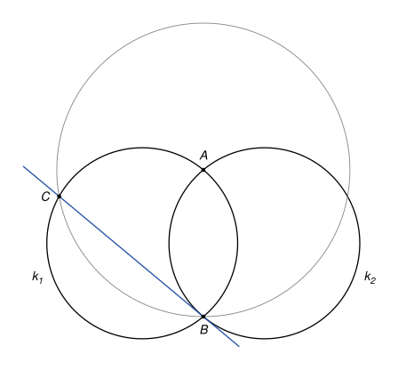
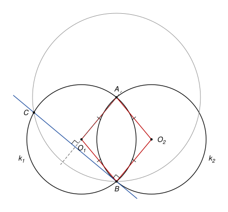

## Statement

Deux cercles $k_1$ et $k_2$ ont le même rayon et se coupent en deux points $A$ et $B$.

Le cercle de centre $A$ qui passe par $B$ recoupe le cercle $k_1$ en un point $C$, autre que $B$.

Montrer que la droite $(BC)$ est tangente au cercle $k_2$.

## Hints

1. Une droite qui passe par un point $B$ d'un cercle est tangente à ce cercle en $B$ exactement quand elle est perpendiculaire au rayon qui aboutit en $B$. Placez les centres $O_1$ et $O_2$ des deux cercles.
2. Que dire du quadrilatère $O_1 A O_2 B$ ? Comparez les longueurs de ses quatre côtés.
3. Les points $A$ et $O_1$ sont tous les deux à la même distance de $B$ et de $C$. Que représente la droite $(AO_1)$ pour le segment $[BC]$ ?

## Solution

On note $O_1$ et $O_2$ les centres des cercles $k_1$ et $k_2$, et $r$ leur rayon commun.

**Étape 1 : un losange.** Les points $A$ et $B$ sont sur $k_1$, donc $O_1A = O_1B = r$. Ils sont aussi sur $k_2$, donc $O_2A = O_2B = r$. Le quadrilatère $O_1AO_2B$ a ses quatre côtés égaux à $r$ : c'est un losange. En particulier ses côtés opposés sont parallèles :

$$(O_2B) \parallel (O_1A).$$

**Étape 2 : une médiatrice.** Le point $A$ est le centre du cercle qui passe par $B$ et $C$, donc $AB = AC$. Le point $O_1$ est le centre de $k_1$, qui passe aussi par $B$ et $C$, donc $O_1B = O_1C$. Les deux points $A$ et $O_1$ sont donc sur la médiatrice du segment $[BC]$. Ce sont deux points distincts ($A$ est sur le cercle $k_1$, il n'en est pas le centre), donc la droite $(AO_1)$ est la médiatrice de $[BC]$. En particulier

$$(AO_1) \perp (BC).$$

**Étape 3 : conclusion.** La droite $(BC)$ est perpendiculaire à $(O_1A)$, qui est parallèle à $(O_2B)$. Donc $(BC) \perp (O_2B)$. La droite $(BC)$ passe par le point $B$ du cercle $k_2$ et elle est perpendiculaire au rayon $[O_2B]$ : **la droite $(BC)$ est tangente au cercle $k_2$ en $B$.**

*Remarque.* L'hypothèse « même rayon » sert à l'étape 1. Avec deux rayons différents, $O_1AO_2B$ n'est plus qu'un cerf-volant, $(O_2B)$ n'est plus parallèle à $(O_1A)$, et la droite $(BC)$ n'est plus tangente à $k_2$.

## Going further

Le corrigé officiel donne une autre preuve : la symétrie par rapport à la droite $(AB)$ échange les cercles $k_1$ et $k_2$ (pourquoi ?) et envoie $C$ sur un point $D$ de $k_2$. Montrer que $\widehat{CBA} = \widehat{ADB}$, et conclure avec la réciproque du théorème de l'angle entre une tangente et une corde.
