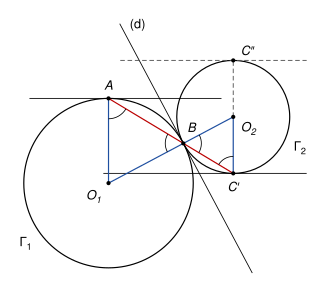

## Statement

Deux cercles $\Gamma_1$ et $\Gamma_2$ sont tangents extérieurement en un point $B$ : ils sont tous les deux tangents en $B$ à une même droite $(d)$, et ils sont de part et d'autre de cette droite.

Soit $A$ un point de $\Gamma_1$ et $C$ un point de $\Gamma_2$ tels que la tangente en $A$ à $\Gamma_1$ et la tangente en $C$ à $\Gamma_2$ soient parallèles, et que le point $B$ soit situé strictement entre ces deux tangentes.

Montrer que les points $A$, $B$ et $C$ sont alignés.

## Hints

1. Tracez les centres $O_1$ et $O_2$ des deux cercles. Que dire des droites $(O_1B)$ et $(O_2B)$ par rapport à $(d)$ ?
2. Plutôt que de partir de $C$, appelez $C'$ le second point d'intersection de la droite $(AB)$ avec $\Gamma_2$, et comparez les triangles $O_1AB$ et $O_2C'B$. Que dire de la tangente en $C'$ ?
3. Il y a exactement deux points de $\Gamma_2$ où la tangente est parallèle à celle en $A$. Pourquoi la condition « $B$ entre les deux tangentes » élimine-t-elle l'un des deux ?

## Solution

*Rappels.*

- *Tangente.* La tangente à un cercle en un point $M$ est la droite perpendiculaire au rayon $[OM]$ en $M$, où $O$ est le centre. Le cercle est tout entier du même côté de cette tangente que son centre, et il ne la touche qu'en $M$.
- *Triangle isocèle.* Dans un triangle isocèle, les deux angles à la base sont égaux.
- *Parallèles.* Si deux droites coupées par une sécante forment deux angles alternes-internes égaux, elles sont parallèles. Deux droites perpendiculaires à deux droites parallèles sont elles aussi parallèles.

On note $O_1$ et $O_2$ les centres des cercles $\Gamma_1$ et $\Gamma_2$, et $r_1$, $r_2$ leurs rayons. Le point $A$ n'est pas $B$, sinon la tangente en $A$ serait $(d)$ elle-même, et $B$ serait dessus, pas strictement entre les deux tangentes.

**Étape 1 : $O_1$, $B$ et $O_2$ sont alignés.** Les droites $(O_1B)$ et $(O_2B)$ sont toutes les deux perpendiculaires à $(d)$ au point $B$. Il n'y a qu'une seule perpendiculaire à $(d)$ passant par $B$, donc ces deux droites sont la même. Comme les cercles sont de part et d'autre de $(d)$, leurs centres aussi, donc $B$ est entre $O_1$ et $O_2$.

**Étape 2 : un bon candidat $C'$.** La droite $(AB)$ n'est pas $(d)$, car $(d)$ ne touche $\Gamma_1$ qu'en $B$. Elle n'est donc pas tangente à $\Gamma_2$ en $B$, et elle recoupe $\Gamma_2$ en un second point, que l'on note $C'$. Par construction, $A$, $B$ et $C'$ sont alignés, avec $B$ entre $A$ et $C'$.

Supposons d'abord que $A$ ne soit pas sur la droite $(O_1O_2)$. Alors :

- les angles $\widehat{O_1BA}$ et $\widehat{O_2BC'}$ sont opposés par le sommet, puisque $O_1, B, O_2$ sont alignés et $A, B, C'$ aussi. Ils sont donc égaux ;
- le triangle $O_1AB$ est isocèle en $O_1$ ($O_1A = O_1B = r_1$), donc $\widehat{O_1AB} = \widehat{O_1BA}$ ;
- le triangle $O_2C'B$ est isocèle en $O_2$ ($O_2C' = O_2B = r_2$), donc $\widehat{O_2C'B} = \widehat{O_2BC'}$.

En mettant bout à bout ces trois égalités :

$$\widehat{O_1AB} = \widehat{O_2C'B}.$$

Pour les droites $(O_1A)$ et $(O_2C')$ coupées par la sécante $(AC')$, ces deux angles sont alternes-internes : $O_1$ et $O_2$ sont de part et d'autre de $(AC')$, puisque $B$ est entre eux. Ils sont égaux, donc $(O_1A) \parallel (O_2C')$.

La tangente en $A$ est perpendiculaire à $(O_1A)$, la tangente en $C'$ est perpendiculaire à $(O_2C')$. Ces deux tangentes sont donc parallèles.

**Étape 3 : $C$ ne peut être que $C'$.** La tangente en $C$ est parallèle à la tangente en $A$, donc le rayon $(O_2C)$ est parallèle à $(O_1A)$, donc à $(O_2C')$. Les droites $(O_2C)$ et $(O_2C')$ sont parallèles et passent toutes les deux par $O_2$ : c'est la même droite. Le point $C$ est donc l'un des deux points où cette droite coupe $\Gamma_2$, c'est-à-dire $C'$ ou le point $C''$ diamétralement opposé à $C'$.

Montrons que $C''$ ne convient pas. Tournons la figure pour que la tangente en $A$ soit horizontale, avec $O_1$ en dessous. Le cercle $\Gamma_1$ est tout entier sous cette tangente. Les vecteurs $\overrightarrow{O_1A}$ et $\overrightarrow{O_2C'}$ sont de sens contraires (étape 2, angles alternes-internes), donc $\overrightarrow{O_2C''}$ pointe vers le haut : $C''$ est le point le plus haut de $\Gamma_2$, et $\Gamma_2$ est tout entier sous la tangente en $C''$, qui est horizontale.

Le point $B$ est sur les deux cercles. Il est donc sous la tangente en $A$ (ou dessus), et sous la tangente en $C''$ (ou dessus). Un point situé sous deux droites horizontales n'est pas strictement entre elles. Donc $C \neq C''$, et $C = C'$.

**Le cas où $A$ est sur $(O_1O_2)$.** Comme $A \neq B$, le point $A$ est alors diamétralement opposé à $B$ sur $\Gamma_1$, et la droite $(AB)$ est $(O_1O_2)$. Elle recoupe $\Gamma_2$ au point $C'$ diamétralement opposé à $B$. Les tangentes en $A$ et en $C'$ sont toutes les deux perpendiculaires à $(O_1O_2)$, donc parallèles, et l'étape 3 s'applique telle quelle.

**Conclusion.** Dans tous les cas, $C$ est le point $C'$ où la droite $(AB)$ recoupe $\Gamma_2$. Les points $A$, $B$ et $C$ sont alignés.

*Remarque.* La condition « $B$ entre les deux tangentes » n'est pas décorative. Sans elle, le point $C''$ de la figure, où la tangente est aussi parallèle à celle en $A$, donnerait un contre-exemple : $A$, $B$ et $C''$ ne sont pas alignés.

## Going further

1. Montrer que $\frac{BA}{BC} = \frac{r_1}{r_2}$.
2. Les droites $(AC'')$ et $(O_1O_2)$ se coupent en un point $X$ (quand elles ne sont pas parallèles). Montrer que $X$ ne dépend pas du choix de $A$ sur $\Gamma_1$.
