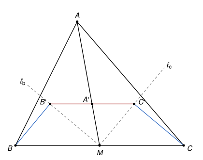

## Statement

Soit $ABC$ un triangle et $M$ le milieu du côté $[BC]$. On note $\ell_b$ la bissectrice de l'angle
$\widehat{AMB}$ et $\ell_c$ la bissectrice de l'angle $\widehat{AMC}$. Soit $B'$ le projeté
orthogonal de $B$ sur $\ell_b$, $C'$ le projeté orthogonal de $C$ sur $\ell_c$, et $A'$ le point
d'intersection des droites $(AM)$ et $(B'C')$.

Démontrer que $A'B' = A'C'$.

## Hints

1. Note $\beta$ la moitié de l'angle $\widehat{AMB}$ et $\gamma$ la moitié de l'angle
   $\widehat{AMC}$. Que vaut $\beta + \gamma$ ? Que peux-tu en déduire pour l'angle
   $\widehat{B'MC'}$ ?
2. Dans les triangles rectangles $BB'M$ et $CC'M$, exprime $MB'$ et $CC'$ à l'aide de $MB$, de
   $MC$ et de $\sin \gamma$.
3. Compare les angles $\widehat{MC'B'}$ et $\widehat{CMC'}$ en calculant leurs tangentes.
4. Montre que le triangle $A'MC'$ est isocèle, puis fais de même avec $A'MB'$.

## Solution

Notons $\beta = \frac{1}{2}\widehat{AMB}$ et $\gamma = \frac{1}{2}\widehat{AMC}$. Les angles
$\widehat{AMB}$ et $\widehat{AMC}$ sont supplémentaires, car $B$, $M$, $C$ sont alignés, donc
$2\beta + 2\gamma = 180^\circ$, c'est-à-dire
$$\beta + \gamma = 90^\circ.$$

### Étape 1 : l'angle $\widehat{B'MC'}$ est droit

Le point $B'$ est sur la demi-droite de $\ell_b$ qui est à l'intérieur de l'angle $\widehat{AMB}$ :
en effet, cette demi-droite fait avec $[MB)$ l'angle aigu $\beta$, donc le projeté de $B$ tombe de
ce côté. De même, $C'$ est sur la demi-droite de $\ell_c$ à l'intérieur de l'angle $\widehat{AMC}$.

La demi-droite $[MA)$ est donc entre $[MB')$ et $[MC')$, et
$$\widehat{B'MC'} = \widehat{B'MA} + \widehat{AMC'} = \beta + \gamma = 90^\circ.$$
En particulier, la demi-droite $[MA)$ coupe le segment $[B'C']$ : le point $A'$ est sur $[B'C']$
et sur $[MA)$.

### Étape 2 : $MB' = CC'$

- Dans le triangle $BB'M$, rectangle en $B'$, l'angle en $M$ vaut $\beta$, donc l'angle en $B$ vaut
  $90^\circ - \beta = \gamma$. Le côté opposé à cet angle est $[MB']$, donc
  $MB' = MB \times \sin \gamma$.
- Dans le triangle $CC'M$, rectangle en $C'$, l'angle en $M$ vaut $\gamma$. Le côté opposé à cet
  angle est $[CC']$, donc $CC' = MC \times \sin \gamma$.

Comme $M$ est le milieu de $[BC]$, on a $MB = MC$, et donc $MB' = CC'$.

### Étape 3 : $\widehat{MC'B'} = \gamma$

Dans le triangle $B'MC'$, rectangle en $M$ d'après l'étape 1,
$$\tan \widehat{MC'B'} = \frac{MB'}{MC'}.$$
Dans le triangle $CC'M$, rectangle en $C'$,
$$\tan \gamma = \tan \widehat{CMC'} = \frac{CC'}{MC'}.$$
D'après l'étape 2, ces deux quotients sont égaux. Deux angles aigus qui ont la même tangente sont
égaux, donc $\widehat{MC'B'} = \gamma$. Dans le triangle rectangle $B'MC'$, l'autre angle aigu vaut
alors $\widehat{MB'C'} = 90^\circ - \gamma = \beta$.

### Étape 4 : deux triangles isocèles

Le point $A'$ est sur $[MA)$ et sur $[B'C']$ (étape 1).

- Dans le triangle $A'MC'$, on a $\widehat{A'MC'} = \widehat{AMC'} = \gamma$ et
  $\widehat{A'C'M} = \widehat{B'C'M} = \gamma$. Ce triangle a deux angles égaux, il est isocèle en
  $A'$ : $A'M = A'C'$.
- Dans le triangle $A'MB'$, on a $\widehat{A'MB'} = \widehat{AMB'} = \beta$ et
  $\widehat{A'B'M} = \widehat{C'B'M} = \beta$. Il est isocèle en $A'$ : $A'M = A'B'$.

### Conclusion

**On a $A'B' = A'M = A'C'$.** Autrement dit, $A'$ est le milieu de l'hypoténuse $[B'C']$ du
triangle rectangle $B'MC'$.

## Going further

Démontrer que la droite $(B'C')$ est toujours parallèle à $(BC)$, et que $B'C' = \frac{1}{2}BC$.
