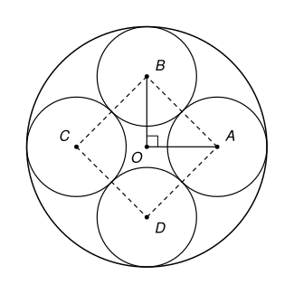

## Statement

Quatre cercles $\mathcal{C}_1$, $\mathcal{C}_2$, $\mathcal{C}_3$, $\mathcal{C}_4$, qui ont tous le même rayon $r$, sont tangents intérieurement à un grand cercle de rayon $R$ : chacun est à l'intérieur du grand cercle et le touche en un point.

De plus, $\mathcal{C}_1$ est tangent à $\mathcal{C}_2$, $\mathcal{C}_2$ est tangent à $\mathcal{C}_3$, $\mathcal{C}_3$ est tangent à $\mathcal{C}_4$, et $\mathcal{C}_4$ est tangent à $\mathcal{C}_1$.

Que vaut le rapport $\dfrac{r}{R}$ ?

## Hints

1. Fais une figure et place les centres : $O$ pour le grand cercle, $A$, $B$, $C$, $D$ pour les quatre petits.
2. Quand deux cercles sont tangents, leur point de contact est aligné avec leurs deux centres. Que vaut alors la distance $OA$ ? Et la distance $AB$ ?
3. Les triangles $OAB$, $OBC$, $OCD$ et $ODA$ ont les mêmes longueurs de côtés. Que peux-tu dire de leurs angles en $O$ ?
4. Ces quatre angles font le tour du point $O$. Que valent-ils ? Il reste à utiliser le théorème de Pythagore.

## Solution

Notons $O$ le centre du grand cercle et $A$, $B$, $C$, $D$ les centres de $\mathcal{C}_1$, $\mathcal{C}_2$, $\mathcal{C}_3$, $\mathcal{C}_4$.

**Les distances entre centres.** Quand deux cercles sont tangents, le point de contact est sur la droite qui joint leurs centres.

- Le cercle $\mathcal{C}_1$ touche le grand cercle de l'intérieur en un point $T$. Les points $O$, $A$, $T$ sont alignés, avec $A$ entre $O$ et $T$. Donc $OA = OT - AT = R - r$. De même $OB = OC = OD = R - r$.
- Les cercles $\mathcal{C}_1$ et $\mathcal{C}_2$ ont le même rayon et sont différents, donc ils se touchent de l'extérieur. Leur point de contact est entre $A$ et $B$, à la distance $r$ de chacun. Donc $AB = 2r$. De même $BC = CD = DA = 2r$.

**Les angles en $O$.** Les quatre triangles $OAB$, $OBC$, $OCD$ et $ODA$ ont tous pour côtés $R - r$, $R - r$ et $2r$. Ils sont donc superposables, et leurs angles en $O$ sont égaux :
$$\widehat{AOB} = \widehat{BOC} = \widehat{COD} = \widehat{DOA} .$$
Les quatre centres sont rangés dans l'ordre $A$, $B$, $C$, $D$ autour de $O$, et ces quatre angles font exactement le tour du point $O$. (La chaîne ne peut pas revenir en arrière : sur le cercle de centre $O$ et de rayon $R - r$, il n'y a que deux points à la distance $2r$ de $B$, ce sont $A$ et $C$, de part et d'autre de la droite $(OB)$.) Leur somme vaut donc $360^\circ$, et chacun mesure
$$\frac{360^\circ}{4} = 90^\circ .$$
Les centres $A$, $B$, $C$, $D$ forment un carré de centre $O$.

**Le théorème de Pythagore.** Le triangle $OAB$ est rectangle en $O$, donc
$$AB^2 = OA^2 + OB^2, \qquad \text{c'est-à-dire} \qquad (2r)^2 = 2\,(R - r)^2 .$$
On divise par $2$ : $2r^2 = (R - r)^2$. Les nombres $r\sqrt{2}$ et $R - r$ sont positifs et ont le même carré, donc ils sont égaux :
$$r\sqrt{2} = R - r, \qquad r\left(1 + \sqrt{2}\right) = R, \qquad \frac{r}{R} = \frac{1}{1 + \sqrt{2}} .$$

**Une écriture plus simple.** On a $\left(\sqrt{2} - 1\right)\left(\sqrt{2} + 1\right) = 2 - 1 = 1$, donc $\dfrac{1}{1 + \sqrt{2}} = \sqrt{2} - 1$.

**Conclusion.** Le rapport vaut
$$\frac{r}{R} = \sqrt{2} - 1 \approx \text{0,414} .$$

## Going further

1. Même question avec trois petits cercles au lieu de quatre, chacun tangent aux deux autres.
2. Et avec six petits cercles, chacun tangent à ses deux voisins ?
