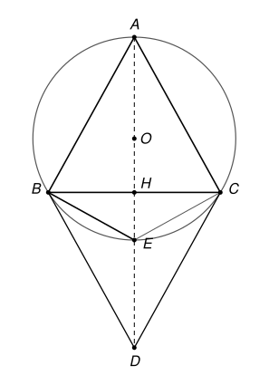

## Statement

Soit $ABC$ un triangle isocèle en $A$ tel que $\widehat{ABC} = 61^\circ$.

- Soit $E$ le point du cercle circonscrit au triangle $ABC$, autre que $A$, tel que $EB = EC$.
- Soit $D$ le point, autre que $A$, tel que $DB = DC = AB$.

Déterminer la mesure de l'angle $\widehat{BED}$.

## Hints

1. Fais une figure soignée. Les points $E$ et $D$ sont à égale distance de $B$ et de $C$ : sur quelle droite se trouvent-ils ?
2. Cette droite passe par $A$ et par le centre du cercle circonscrit. Que peux-tu dire du segment $[AE]$ ? Et du triangle $ABE$ ?
3. Le point $D$ est à la même distance de $B$ et de $C$ que le point $A$, mais de l'autre côté de $(BC)$. C'est le symétrique de $A$ par rapport à une droite.
4. Les points $A$, $E$ et $D$ sont alignés. L'angle $\widehat{BED}$ et l'angle $\widehat{AEB}$ sont donc liés, à condition de savoir dans quel ordre sont les trois points.

## Solution

Notons $H$ le milieu de $[BC]$ et $O$ le centre du cercle circonscrit au triangle $ABC$.

**Les angles du triangle.** Le triangle est isocèle en $A$, donc $\widehat{ACB} = \widehat{ABC} = 61^\circ$ et
$$\widehat{BAC} = 180^\circ - 2 \times 61^\circ = 58^\circ .$$

**Une seule droite pour $A$, $O$, $E$, $D$.** Les points à égale distance de $B$ et de $C$ sont exactement les points de la médiatrice de $[BC]$. Cette médiatrice passe par $A$ (car $AB = AC$), par $O$, par $H$, et aussi par $E$ et par $D$. C'est l'axe de symétrie du triangle isocèle : elle coupe l'angle $\widehat{BAC}$ en deux, donc
$$\widehat{BAH} = \frac{58^\circ}{2} = 29^\circ .$$

**Le point $E$.** La médiatrice passe par le centre $O$ du cercle, donc elle coupe le cercle en deux points diamétralement opposés. L'un est $A$, l'autre est $E$ : le segment $[AE]$ est un **diamètre** du cercle.

Le triangle $ABE$ est inscrit dans un cercle dont l'un des côtés, $[AE]$, est un diamètre. Il est donc rectangle en $B$. Dans ce triangle, $\widehat{BAE} = 29^\circ$, d'où
$$\widehat{AEB} = 180^\circ - 90^\circ - 29^\circ = 61^\circ .$$

**Le point $D$.** Le symétrique de $A$ par rapport à la droite $(BC)$ est sur la médiatrice de $[BC]$, de l'autre côté de $(BC)$, et il est à la distance $AB$ de $B$ et de $C$. Or sur une droite, il y a au plus deux points à une distance donnée de $B$. Le point $D$ est donc **le symétrique de $A$ par rapport à $(BC)$**, et
$$AD = 2\,AH .$$

**Dans quel ordre sont $A$, $E$, $D$ ?** Les trois points sont sur la demi-droite issue de $A$ qui passe par $H$. Comparons $AE$ et $AD$ avec le cosinus de l'angle $\widehat{BAH} = 29^\circ$.

- Dans le triangle $ABE$ rectangle en $B$ : $\cos 29^\circ = \dfrac{AB}{AE}$, donc $AE = \dfrac{AB}{\cos 29^\circ}$.
- Dans le triangle $ABH$ rectangle en $H$ : $\cos 29^\circ = \dfrac{AH}{AB}$, donc $AD = 2\,AH = 2\,AB \cos 29^\circ$.

Comme $\cos 29^\circ$ est supérieur à $\cos 45^\circ$, on a $2 \cos^2 29^\circ > 2 \times \dfrac{1}{2} = 1$, ce qui donne $AD > AE$. (À la calculatrice, $AE \approx \text{1,14}\,AB$ et $AD \approx \text{1,75}\,AB$.) Le point $E$ est donc entre $A$ et $D$.

**L'angle cherché.** Puisque $E$ est sur le segment $[AD]$, les angles $\widehat{AEB}$ et $\widehat{BED}$ forment ensemble un angle plat :
$$\widehat{BED} = 180^\circ - \widehat{AEB} = 180^\circ - 61^\circ = 119^\circ .$$

On peut vérifier avec le triangle $BED$. On a $\widehat{EDB} = \widehat{EAB} = 29^\circ$ par symétrie, et $\widehat{EBD} = \widehat{ABD} - \widehat{ABE} = 2 \times 61^\circ - 90^\circ = 32^\circ$. La somme vaut bien $119^\circ + 29^\circ + 32^\circ = 180^\circ$.

**Conclusion.** L'angle $\widehat{BED}$ mesure $119^\circ$.

## Going further

1. Refaire le calcul avec $\widehat{ABC} = x$ au lieu de $61^\circ$. Montrer que $\widehat{BED} = 180^\circ - x$ tant que $E$ est entre $A$ et $D$. Pour quelles valeurs de $x$ est-ce le cas ?
2. Pour quelle valeur de $\widehat{ABC}$ les points $E$ et $D$ sont-ils confondus ? Que vaut alors l'angle $\widehat{BAC}$ ?
