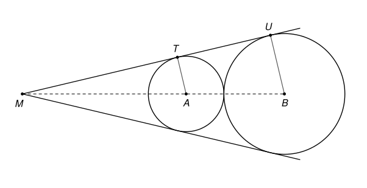

## Statement

Un cercle de centre $A$ et de rayon $99$ et un cercle de centre $B$ et de rayon $100$ sont tangents extérieurement : ils se touchent en un seul point, et chacun est à l'extérieur de l'autre.

Il existe deux droites qui sont tangentes aux deux cercles à la fois et qui laissent les deux cercles du même côté. Elles se coupent en un point $M$.

Déterminer la longueur $MA$.

## Hints

1. Fais une figure avec deux cercles de rayons nettement différents, par exemple $2$ cm et $3$ cm : avec $99$ et $100$, le point $M$ serait beaucoup trop loin.
2. Combien vaut la distance $AB$ ? Pourquoi le point $M$ est-il sur la droite $(AB)$ ?
3. Sur l'une des deux tangentes, note $T$ et $U$ les points de contact avec les deux cercles. Que peux-tu dire des droites $(AT)$ et $(BU)$ ?
4. Le théorème de Thalès donne un rapport entre $MA$ et $MB$. Écris ensuite $MB$ à l'aide de $MA$.

## Solution

**La distance $AB$.** Les deux cercles se touchent en un point qui est sur le segment $[AB]$, à la distance $99$ de $A$ et $100$ de $B$. Donc
$$AB = 99 + 100 = 199 .$$

**Le point $M$ est sur la droite $(AB)$.** La figure formée par les deux cercles est symétrique par rapport à la droite $(AB)$. Le symétrique d'une tangente commune est donc encore une tangente commune, qui laisse les deux cercles du même côté : les deux tangentes sont symétriques l'une de l'autre. Leur point d'intersection $M$ est son propre symétrique, il est donc sur l'axe $(AB)$.

**Deux rayons parallèles.** Sur l'une des tangentes, notons $T$ le point de contact avec le cercle de centre $A$ et $U$ celui avec le cercle de centre $B$. Une tangente à un cercle est perpendiculaire au rayon qui va au point de contact. Donc $(AT)$ et $(BU)$ sont toutes les deux perpendiculaires à la tangente $(MU)$ : elles sont **parallèles**.

**Thalès.** Les points $M$, $A$, $B$ sont alignés, ainsi que $M$, $T$, $U$, et $(AT)$ est parallèle à $(BU)$. Le théorème de Thalès donne
$$\frac{MA}{MB} = \frac{AT}{BU} = \frac{99}{100} .$$

**Où est $M$ ?** On a $MA < MB$, donc $M$ est plus près de $A$ que de $B$. Et $M$ n'est pas entre $A$ et $B$, car les deux cercles sont du même côté de la tangente : $A$ et $B$ aussi, alors que la droite $(MT)$ séparerait $A$ et $B$ si $M$ était entre eux. Ainsi $A$ est entre $M$ et $B$, et
$$MB = MA + AB = MA + 199 .$$

**Le calcul.** En faisant les produits en croix dans $\dfrac{MA}{MA + 199} = \dfrac{99}{100}$ :
$$100\,MA = 99\,MA + 99 \times 199, \qquad MA = 99 \times 199 = 19701 .$$

**Conclusion.** La longueur $MA$ vaut $19701$, c'est-à-dire près de cent fois la distance entre les deux centres. C'est pour cela qu'on ne peut pas faire la figure à l'échelle.

## Going further

1. Refaire le calcul avec des rayons $r$ et $R$ quelconques, $r < R$. Que se passe-t-il quand $r = R$ ?
2. Les deux cercles ont aussi une tangente commune qui passe par leur point de contact. Elle coupe chacune des deux autres tangentes en un point. Montrer que ce point est le milieu du segment $[TU]$ correspondant.
