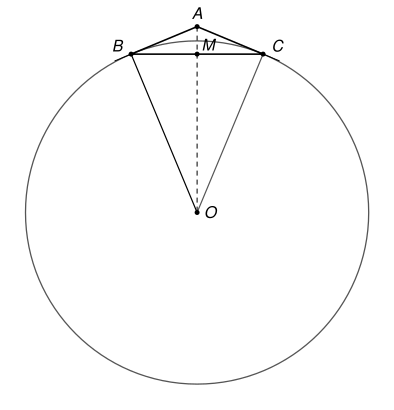

## Statement

Soit $ABC$ un triangle tel que $AB = AC = 130$ et $BC = 240$.

Un cercle de rayon $R$ est tangent à la droite $(AB)$ au point $B$, et tangent à la droite $(AC)$ au point $C$.

Déterminer la valeur de $R$.

## Hints

1. Note $O$ le centre du cercle. Que peux-tu dire de l'angle $\widehat{ABO}$ ? Pense à la tangente et au rayon.
2. Le point $O$ est à la même distance de $B$ et de $C$. Sur quelle droite se trouve-t-il ?
3. Note $M$ le milieu de $[BC]$ et calcule $AM$.
4. Les triangles $ABM$ et $ABO$ sont rectangles et ont le même angle en $A$. Écris la tangente de cet angle de deux façons.

## Solution

Notons $O$ le centre du cercle et $M$ le milieu de $[BC]$.

**Où est le centre ?** Le cercle passe par $B$ et par $C$, donc $OB = OC = R$, et $O$ est sur la médiatrice de $[BC]$. Comme $AB = AC$, cette médiatrice est la droite $(AM)$, perpendiculaire à $(BC)$ en $M$.

De plus, une tangente à un cercle est perpendiculaire au rayon qui va au point de contact. La droite $(AB)$ est tangente en $B$, donc
$$\widehat{ABO} = 90^\circ .$$
Le triangle $ABO$ est rectangle en $B$, donc son angle en $A$ est aigu : le point $O$ est sur la demi-droite $[AM)$, et $\widehat{BAO} = \widehat{BAM}$.

**La longueur $AM$.** On a $BM = \dfrac{240}{2} = 120$, et le triangle $ABM$ est rectangle en $M$. D'après le théorème de Pythagore,
$$AM^2 = AB^2 - BM^2 = 130^2 - 120^2 = 16900 - 14400 = 2500, \qquad AM = 50 .$$

**La tangente de l'angle en $A$, de deux façons.**

- Dans le triangle $ABM$ rectangle en $M$ : $\tan \widehat{BAM} = \dfrac{BM}{AM} = \dfrac{120}{50}$.
- Dans le triangle $ABO$ rectangle en $B$ : $\tan \widehat{BAO} = \dfrac{BO}{AB} = \dfrac{R}{130}$.

Les deux angles sont égaux, donc
$$\frac{R}{130} = \frac{120}{50}, \qquad R = \frac{130 \times 120}{50} = 312 .$$

**Conclusion.** Le rayon du cercle vaut $R = 312$.

## Going further

1. Calculer la distance $AO$ de deux façons : avec le théorème de Pythagore dans le triangle $ABO$, et à l'aide du cosinus de l'angle $\widehat{BAM}$.
2. Le cercle de l'exercice passe-t-il par le point $A$ ? Coupe-t-il le segment $[AM]$ ?
