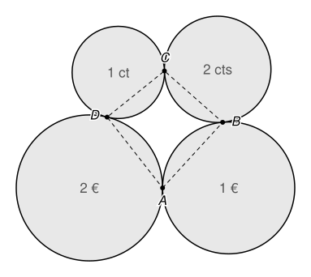

## Statement

Quatre pièces de monnaie, une de $2$ euros, une de $1$ euro, une de $2$ centimes et une de $1$ centime, sont posées à plat sur une table sans se chevaucher.

- La pièce de $2$ euros touche la pièce de $1$ euro au point $A$.
- La pièce de $1$ euro touche la pièce de $2$ centimes au point $B$.
- La pièce de $2$ centimes touche la pièce de $1$ centime au point $C$.
- La pièce de $1$ centime touche la pièce de $2$ euros au point $D$.

Montrer que $\widehat{ABC} + \widehat{CDA} = 180^\circ$.

## Hints

1. Les rayons des pièces ne sont pas donnés : la réponse ne doit pas en dépendre. Quels points, absents de la figure, permettraient de faire apparaître ces rayons ?
2. Place les centres $O_1$, $O_2$, $O_3$, $O_4$ des quatre pièces. Quand deux pièces se touchent, que peux-tu dire du point de contact et des deux centres ?
3. Le triangle $O_2AB$ a deux côtés égaux. Exprime l'angle $\widehat{O_2BA}$ à l'aide de l'angle $\widehat{AO_2B}$.
4. Exprime $\widehat{ABC}$ à l'aide des angles du quadrilatère $O_1O_2O_3O_4$, fais de même pour $\widehat{CDA}$, puis additionne.

## Solution

**Les centres.** Notons $O_1$, $O_2$, $O_3$, $O_4$ les centres des pièces de $2$ euros, $1$ euro, $2$ centimes et $1$ centime, et $r_1$, $r_2$, $r_3$, $r_4$ leurs rayons.

Quand deux pièces se touchent, elles ont la même tangente au point de contact. Cette tangente est perpendiculaire au rayon de chacune des deux pièces en ce point. Les deux rayons sont donc sur une même droite : **les deux centres et le point de contact sont alignés**, et le point de contact est entre les deux centres. Ainsi

$$A \in [O_1O_2], \qquad B \in [O_2O_3], \qquad C \in [O_3O_4], \qquad D \in [O_4O_1] .$$

On travaille dans la situation de la figure, où le quadrilatère $O_1O_2O_3O_4$ est convexe. Ses quatre angles ont une somme de $360^\circ$. Pour abréger, on note $\widehat{O_1}$, $\widehat{O_2}$, $\widehat{O_3}$, $\widehat{O_4}$ ces angles. Comme $A$ est sur $[O_2O_1]$ et $B$ sur $[O_2O_3]$, on a $\widehat{AO_2B} = \widehat{O_2}$, et de même pour les autres sommets.

**Un triangle isocèle.** Dans le triangle $O_2AB$, on a $O_2A = O_2B = r_2$. Il est isocèle en $O_2$, donc ses angles en $A$ et en $B$ sont égaux. Comme la somme des angles vaut $180^\circ$ :

$$\widehat{O_2BA} = \frac{180^\circ - \widehat{O_2}}{2} = 90^\circ - \frac{\widehat{O_2}}{2} .$$

De même, le triangle $O_3BC$ est isocèle en $O_3$ (car $O_3B = O_3C = r_3$), donc

$$\widehat{O_3BC} = 90^\circ - \frac{\widehat{O_3}}{2} .$$

**L'angle en $B$.** Les points $O_2$, $B$, $O_3$ sont alignés, avec $B$ au milieu. Les trois angles $\widehat{O_2BA}$, $\widehat{ABC}$ et $\widehat{CBO_3}$ se suivent et forment ensemble un angle plat :

$$\widehat{O_2BA} + \widehat{ABC} + \widehat{CBO_3} = 180^\circ .$$

Donc

$$\widehat{ABC} = 180^\circ - \left(90^\circ - \frac{\widehat{O_2}}{2}\right) - \left(90^\circ - \frac{\widehat{O_3}}{2}\right) = \frac{\widehat{O_2} + \widehat{O_3}}{2} .$$

**L'angle en $D$.** Le même raisonnement, avec les triangles isocèles $O_4CD$ et $O_1DA$ et l'alignement de $O_4$, $D$, $O_1$, donne

$$\widehat{CDA} = \frac{\widehat{O_4} + \widehat{O_1}}{2} .$$

**La somme.**

$$\widehat{ABC} + \widehat{CDA} = \frac{\widehat{O_1} + \widehat{O_2} + \widehat{O_3} + \widehat{O_4}}{2} = \frac{360^\circ}{2} = 180^\circ .$$

**Conclusion.** Quels que soient les rayons des quatre pièces, on a toujours $\widehat{ABC} + \widehat{CDA} = 180^\circ$.

## Going further

Au lycée, on démontre qu'un quadrilatère convexe dont deux angles opposés ont une somme de $180^\circ$ est inscrit dans un cercle. Le résultat montre donc que les quatre points de contact $A$, $B$, $C$, $D$ sont toujours sur un même cercle.
