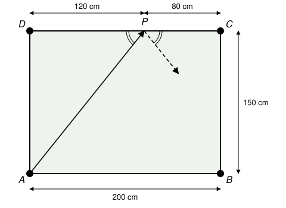
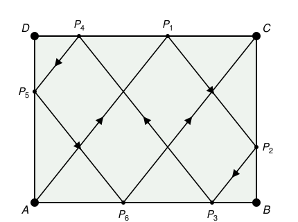

## Statement

$ABCD$ est une table de billard rectangulaire avec $AB = CD = 200$ cm et $BC = DA = 150$ cm. Il y a un trou à chacun des quatre coins $A$, $B$, $C$, $D$. Les bords sont élastiques : quand la boule touche un bord, elle rebondit, et l'angle que fait sa trajectoire avec ce bord en arrivant est égal à l'angle qu'elle fait avec ce bord en repartant.

Soit $P$ le point du côté $[CD]$ tel que $CP = 80$ cm et $PD = 120$ cm. Un joueur lance la boule depuis $A$, en direction de $P$.

Démontrer qu'après six rebonds sur les bords du rectangle, la boule tombe dans le trou $C$.

## Hints

1. Fais un dessin à l'échelle, par exemple $1$ cm pour $20$ cm, et suis la boule à la règle. Cela montre ce qu'il faut démontrer, mais un dessin ne suffit pas comme preuve.
2. Sur le premier trajet, de $A$ à $P$, la boule avance de $120$ cm vers la droite pendant qu'elle monte de $150$ cm. Que devient ce rapport après un rebond ?
3. Au point de rebond, trace la perpendiculaire au bord. Les deux morceaux de trajet sont symétriques par rapport à cette droite.
4. Après chaque rebond, calcule quel bord la boule atteint en premier, et à quelle distance des coins.

## Solution

On place la table avec $[AB]$ en bas, $A$ en bas à gauche, $B$ en bas à droite, $C$ en haut à droite et $D$ en haut à gauche. On parle de déplacement **horizontal** (parallèle à $[AB]$) et **vertical** (parallèle à $[BC]$).

**Le rapport $5/4$ ne change jamais.** Sur le premier morceau, de $A$ à $P$, la boule se déplace de $DP = 120$ cm horizontalement et de $AD = 150$ cm verticalement. Le rapport entre déplacement vertical et déplacement horizontal vaut $\frac{150}{120} = \frac{5}{4}$.

Regardons un rebond. Au point de rebond, traçons la perpendiculaire au bord. Le morceau qui arrive et le morceau qui repart font le même angle avec le bord, de part et d'autre de cette perpendiculaire : ils sont donc **symétriques l'un de l'autre par rapport à cette perpendiculaire**.

- Pour un rebond sur un bord horizontal ($[AB]$ ou $[CD]$), la perpendiculaire est verticale. La symétrie change le sens du mouvement vertical (la boule montait, elle descend, ou l'inverse), mais elle conserve les longueurs, donc le rapport $\frac{5}{4}$ ne change pas.
- Pour un rebond sur un bord vertical ($[BC]$ ou $[DA]$), la perpendiculaire est horizontale. Cette fois, c'est le sens du mouvement horizontal qui change, et le rapport reste encore $\frac{5}{4}$.

Donc, sur chaque morceau du trajet, **quand la boule se déplace de $4$ cm horizontalement, elle se déplace de $5$ cm verticalement**. Autrement dit, un déplacement vertical de $d$ correspond à un déplacement horizontal de $\frac{4}{5}d$, et un déplacement horizontal de $h$ correspond à un déplacement vertical de $\frac{5}{4}h$.

**On suit la boule.** On note $P_1 = P, P_2, \ldots$ les points de rebond successifs.

1. De $A$, la boule arrive en $P_1 = P$ sur $[CD]$, avec $DP_1 = 120$ cm. Elle repart vers le bas et vers la droite.
2. Pour atteindre le bord $[BC]$, il lui faut avancer de $P_1C = 80$ cm horizontalement, donc descendre de $\frac{5}{4} \times 80 = 100$ cm. Comme $100 < 150$, elle touche $[BC]$ avant $[AB]$, au point $P_2$ avec $CP_2 = 100$ cm, donc $BP_2 = 50$ cm. Elle repart vers le bas et vers la gauche.
3. Pour atteindre $[AB]$, il lui faut descendre de $50$ cm, donc aller à gauche de $\frac{4}{5} \times 50 = 40$ cm. Comme $40 < 200$, elle touche $[AB]$ en $P_3$ avec $BP_3 = 40$ cm, donc $AP_3 = 160$ cm. Elle repart vers le haut et vers la gauche.
4. Pour atteindre $[CD]$, il lui faut monter de $150$ cm, donc aller à gauche de $\frac{4}{5} \times 150 = 120$ cm. Comme $120 < 160$, elle touche $[CD]$ en $P_4$ avec $DP_4 = 160 - 120 = 40$ cm. Elle repart vers le bas et vers la gauche.
5. Pour atteindre $[DA]$, il lui faut aller à gauche de $40$ cm, donc descendre de $\frac{5}{4} \times 40 = 50$ cm. Comme $50 < 150$, elle touche $[DA]$ en $P_5$ avec $DP_5 = 50$ cm, donc $AP_5 = 100$ cm. Elle repart vers le bas et vers la droite.
6. Pour atteindre $[AB]$, il lui faut descendre de $100$ cm, donc aller à droite de $\frac{4}{5} \times 100 = 80$ cm. Comme $80 < 200$, elle touche $[AB]$ en $P_6$ avec $AP_6 = 80$ cm. Elle repart vers le haut et vers la droite.
7. Pour atteindre $[CD]$, il lui faut monter de $150$ cm, ce qui la fait aller à droite de $120$ cm. Pour atteindre $[BC]$, il lui faut aller à droite de $200 - 80 = 120$ cm. Les deux arrivent **en même temps** : la boule atteint exactement le coin $C$.

Aucun des points $P_1, \ldots, P_6$ n'est un coin (ils sont à $120$, $50$, $40$, $40$, $50$ et $80$ cm du coin le plus proche sur leur côté), donc la boule ne tombe dans aucun trou avant la fin.

**Conclusion.** La boule rebondit six fois, en $P_1, P_2, \ldots, P_6$, puis tombe dans le trou $C$.

## Going further

Une autre méthode évite tous ces calculs : au lieu de faire rebondir la boule, on fait « rebondir la table ». On dessine le symétrique de la table par rapport au bord touché, et la boule continue tout droit dans cette nouvelle table. En recommençant à chaque rebond, la trajectoire devient une seule droite, la droite $(AP)$, qui traverse un quadrillage de tables de $200$ cm sur $150$ cm.

Sur cette droite, la boule monte de $5$ cm chaque fois qu'elle avance de $4$ cm. Après $600$ cm horizontalement, soit $3$ largeurs de table, elle est montée de $750$ cm, soit $5$ hauteurs de table : elle tombe sur un coin du quadrillage. Combien de lignes du quadrillage a-t-elle traversées avant d'y arriver ? Pourquoi ce coin du quadrillage correspond-il au coin $C$ de la vraie table ?
