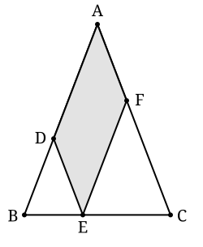

## Statement

Dans le triangle $ABC$, on a $AB = AC = 28$ et $BC = 20$.

Un point $E$ est placé sur le segment $[BC]$. On trace ensuite :

- le point $D$ sur $[AB]$ tel que $(DE)$ soit parallèle à $(AC)$ ;
- le point $F$ sur $[AC]$ tel que $(EF)$ soit parallèle à $(AB)$.

Calculer le périmètre du quadrilatère $ADEF$.

## Hints

1. Pourquoi $ADEF$ est-il un parallélogramme ? Que vaut alors son périmètre en fonction de $AD$ et de $DE$ seulement ?
2. Regarde le triangle $BDE$. Comme $(DE)$ est parallèle à $(AC)$, quels angles de ce triangle sont égaux à des angles du triangle $ABC$ ?
3. Le triangle $ABC$ est isocèle. Que peut-on en déduire pour le triangle $BDE$ ?
4. Si $BD = DE$, que vaut $AD + DE$ ?
5. Remarque que la réponse ne fait intervenir ni la position de $E$, ni la longueur $BC$.

## Solution

**$ADEF$ est un parallélogramme.**

Par construction $(DE) \parallel (AC)$, c'est-à-dire $(DE) \parallel (AF)$ puisque $F$ est sur $[AC]$. De même $(EF) \parallel (AB)$, c'est-à-dire $(EF) \parallel (AD)$.

Le quadrilatère $ADEF$ a donc ses côtés opposés parallèles deux à deux : c'est un parallélogramme. Ses côtés opposés sont égaux :

$$AD = EF \qquad \text{et} \qquad DE = AF .$$

Son périmètre vaut donc

$$\mathcal{P} = AD + DE + EF + FA = 2\left( AD + DE \right).$$

**Le triangle $BDE$ est isocèle.**

Le triangle $ABC$ est isocèle en $A$ (car $AB = AC = 28$), donc ses angles à la base sont égaux :

$$\widehat{ABC} = \widehat{ACB} .$$

Dans le triangle $BDE$ :

- l'angle $\widehat{DBE}$ est l'angle $\widehat{ABC}$, c'est le même angle ;
- comme $(DE) \parallel (AC)$, les angles $\widehat{DEB}$ et $\widehat{ACB}$ sont **correspondants** pour les droites parallèles $(DE)$ et $(AC)$ coupées par la sécante $(BC)$. Ils sont donc égaux.

Par conséquent

$$\widehat{DBE} = \widehat{ABC} = \widehat{ACB} = \widehat{DEB} .$$

Le triangle $BDE$ a deux angles égaux : il est isocèle en $D$, donc

$$DB = DE .$$

**On conclut.**

$$AD + DE = AD + DB = AB = 28 ,$$

puisque $D$ est un point du segment $[AB]$. Donc

$$\mathcal{P} = 2 \times 28 = 56 .$$

**Conclusion.** Le périmètre de $ADEF$ vaut $56$, **quelle que soit la position de $E$ sur $[BC]$**. La longueur $BC = 20$ ne sert pas : seule compte $AB = AC = 28$.

## Going further

1. Que se passe-t-il quand $E$ se confond avec $B$ ? Avec $C$ ? Le résultat reste-t-il vrai ?
2. Si le triangle n'était pas isocèle, avec $AB = 28$ et $AC = 25$, le périmètre de $ADEF$ dépendrait-il de la position de $E$ ? Écrire ce périmètre en fonction de $BE$ et de $BC$.
3. Pour quelle position de $E$ l'aire du parallélogramme $ADEF$ est-elle la plus grande ?
