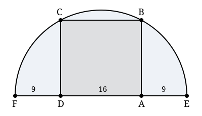

## Statement

Un rectangle $ABCD$ est posé sur le diamètre $[FE]$ d'un demi-cercle : les sommets $D$ et
$A$ sont sur le diamètre, et les sommets $C$ et $B$ sont sur le demi-cercle.

On sait que $DA = 16$ cm et que $FD = AE = 9$ cm.

Quelle est l'aire du rectangle $ABCD$ ?

## Hints

1. Commence par calculer la longueur du diamètre $[FE]$, puis le rayon du demi-cercle.
2. Place le centre $O$ du cercle. Où tombe-t-il exactement par rapport au rectangle ? Utilise le fait que $FD = AE$.
3. Trace le segment $[OB]$ : c'est un rayon, donc tu connais sa longueur. Quel triangle rectangle apparaît ?
4. Le théorème de Pythagore dans ce triangle donne la hauteur du rectangle.

## Solution

**Étape 1. Le rayon.**

Le diamètre $[FE]$ est formé des trois morceaux $[FD]$, $[DA]$ et $[AE]$ :

$$FE = 9 + 16 + 9 = 34 \text{ cm}.$$

Le rayon du demi-cercle vaut donc $R = 34 \div 2 = 17$ cm.

**Étape 2. Où est le centre ?**

Notons $O$ le milieu de $[FE]$, c'est-à-dire le centre du cercle. Comme $FD = AE = 9$ cm,
les points $D$ et $A$ sont placés symétriquement par rapport à $O$ : le point $O$ est donc
aussi le milieu de $[DA]$. D'où

$$OA = \frac{DA}{2} = \frac{16}{2} = 8 \text{ cm}.$$

**Étape 3. Le triangle rectangle.**

Traçons le rayon $[OB]$. Le point $B$ est sur le cercle, donc $OB = R = 17$ cm.

Le côté $[AB]$ du rectangle est perpendiculaire au côté $[DA]$, donc perpendiculaire au
diamètre. Le triangle $OAB$ est par conséquent rectangle en $A$.

Le théorème de Pythagore donne

$$OA^2 + AB^2 = OB^2,$$
$$8^2 + AB^2 = 17^2,$$
$$64 + AB^2 = 289,$$
$$AB^2 = 225, \qquad \text{donc} \qquad AB = 15 \text{ cm}.$$

**Étape 4. L'aire.**

$$\text{Aire} = DA \times AB = 16 \times 15 = 240 \text{ cm}^2.$$

**Réponse : l'aire du rectangle vaut $240$ cm².**

## Going further

Le triplet $(8 ; 15 ; 17)$ est un triplet pythagoricien : $64 + 225 = 289$. Les auteurs de
ce genre d'exercice choisissent presque toujours leurs nombres pour tomber sur un tel
triplet, afin que la racine carrée soit exacte. Les plus connus sont $(3 ; 4 ; 5)$,
$(5 ; 12 ; 13)$, $(8 ; 15 ; 17)$ et $(7 ; 24 ; 25)$.
