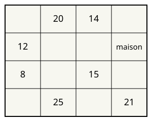

## Statement

Une ferme a la forme d'un grand rectangle. Trois clôtures parallèles la traversent de gauche à droite et trois autres la traversent de haut en bas, ce qui la découpe en $16$ parcelles rectangulaires, rangées en $4$ rangées et $4$ colonnes : $15$ champs, plus la parcelle sur laquelle est bâtie la maison.

On connaît l'aire, en hectares, de sept des champs. Elles sont indiquées sur le plan ci-dessous, qui **n'est pas à l'échelle**.

Quelle est l'aire de la parcelle sur laquelle est bâtie la maison ?

## Hints

1. Les clôtures traversent la ferme de part en part : toutes les parcelles d'une même rangée ont donc la même hauteur, et toutes celles d'une même colonne la même largeur.
2. Notez $h_1, h_2, h_3, h_4$ les hauteurs des rangées et $\ell_1, \ell_2, \ell_3, \ell_4$ les largeurs des colonnes. Quelle est l'aire de la parcelle de la rangée $i$ et de la colonne $j$ ?
3. Dans une même rangée, divisez les aires de deux parcelles : les hauteurs se simplifient. Le résultat ne dépend donc pas de la rangée choisie.
4. La rangée du haut compare les colonnes $2$ et $3$ ; la rangée du bas compare les colonnes $2$ et $4$. Ensemble, elles comparent les colonnes $3$ et $4$.
5. Vous pouvez alors calculer l'aire de la parcelle de la rangée $3$, colonne $4$. La colonne de gauche compare ensuite les rangées $2$ et $3$.

## Solution

### La mise en équations

Les clôtures traversent toute la ferme, donc les parcelles d'une même rangée ont la même hauteur, et celles d'une même colonne la même largeur. Notons

- $h_1, h_2, h_3, h_4$ les hauteurs des quatre rangées, de haut en bas ;
- $\ell_1, \ell_2, \ell_3, \ell_4$ les largeurs des quatre colonnes, de gauche à droite.

L'aire de la parcelle située dans la rangée $i$ et la colonne $j$ vaut alors $h_i \times \ell_j$. Les sept données de l'énoncé s'écrivent

$$h_1 \ell_2 = 20, \quad h_1 \ell_3 = 14, \quad h_2 \ell_1 = 12, \quad h_3 \ell_1 = 8, \quad h_3 \ell_3 = 15, \quad h_4 \ell_2 = 25, \quad h_4 \ell_4 = 21 ,$$

et l'on cherche $h_2 \ell_4$.

### L'idée : diviser deux aires d'une même rangée

Prenons deux parcelles d'une même rangée, par exemple la rangée du haut, colonnes $2$ et $3$ :

$$\frac{h_1 \ell_2}{h_1 \ell_3} = \frac{\ell_2}{\ell_3} = \frac{20}{14} = \frac{10}{7} .$$

La hauteur disparaît : **le rapport de deux colonnes se lit sur n'importe quelle rangée**. De même, le rapport de deux rangées se lit sur n'importe quelle colonne.

### Trois rapports

Rangée du haut, colonnes $2$ et $3$ :

$$\frac{\ell_2}{\ell_3} = \frac{20}{14} = \frac{10}{7} .$$

Rangée du bas, colonnes $4$ et $2$ :

$$\frac{\ell_4}{\ell_2} = \frac{21}{25} .$$

En multipliant ces deux rapports, on compare les colonnes $4$ et $3$ :

$$\frac{\ell_4}{\ell_3} = \frac{\ell_4}{\ell_2} \times \frac{\ell_2}{\ell_3} = \frac{21}{25} \times \frac{10}{7} = \frac{210}{175} = \frac{6}{5} .$$

Colonne de gauche, rangées $2$ et $3$ :

$$\frac{h_2}{h_3} = \frac{12}{8} = \frac{3}{2} .$$

### Deux multiplications, et c'est fini

On part de la parcelle connue de la rangée $3$, colonne $3$, qui vaut $15$ hectares. On passe à la colonne $4$, dans la même rangée :

$$h_3 \ell_4 = h_3 \ell_3 \times \frac{\ell_4}{\ell_3} = 15 \times \frac{6}{5} = 18 .$$

Puis on passe à la rangée $2$, dans la même colonne :

$$h_2 \ell_4 = h_3 \ell_4 \times \frac{h_2}{h_3} = 18 \times \frac{3}{2} = 27 .$$

**Conclusion.** La parcelle de la maison a une aire de $27$ hectares.

### Vérification sur un exemple

Rien n'oblige les longueurs à être des nombres ronds, mais on peut en fabriquer un jeu compatible pour vérifier. Prenons $\ell_1 = 2$ ; alors $h_2 = 6$ et $h_3 = 4$, donc $\ell_3 = \frac{15}{4} = \text{3,75}$, puis $h_1 = \frac{14}{\text{3,75}} \approx \text{3,733}$ et $\ell_2 = \frac{20}{h_1} \approx \text{5,357}$, puis $h_4 = \frac{25}{\ell_2} \approx \text{4,667}$ et enfin $\ell_4 = \frac{21}{h_4} = \text{4,5}$. On obtient bien

$$h_2 \times \ell_4 = 6 \times \text{4,5} = 27 .$$

**Ce qu'il faut retenir.** Aucune des seize parcelles n'a de dimensions déterminées : on peut étirer la ferme dans un sens et la comprimer dans l'autre sans changer les sept aires données. Mais l'aire de la maison, elle, est complètement déterminée. Ce sont les **rapports** entre rangées et entre colonnes qui portent toute l'information.

## Going further

1. Retrouvez le résultat en une seule ligne, en vérifiant que $h_2 \ell_4 = \dfrac{12 \times 15 \times 20 \times 21}{8 \times 14 \times 25}$.
2. Quelle est l'aire de la parcelle de la rangée $1$, colonne $1$ ? Et celle de la rangée $2$, colonne $2$ ?
3. Aurait-on pu trouver la réponse avec seulement six des sept aires données ? Lesquelles sont indispensables ?
