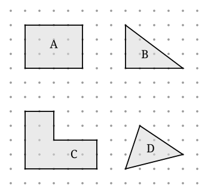

## Statement

On appelle **nœud** un point du plan dont les deux coordonnées sont des nombres entiers. Sur
le dessin ci-dessous, les nœuds sont les petits points gris.

Un **polygone sur nœuds** est un polygone dont tous les sommets sont des nœuds, et dont les
côtés ne se croisent pas. Pour un tel polygone on note :

- $A$ son aire, en carreaux ;
- $I$ le nombre de nœuds **strictement à l'intérieur** du polygone ;
- $B$ le nombre de nœuds **posés sur son bord** (les sommets comptent).

1. Pour chacun des quatre polygones $A$, $B$, $C$, $D$ du dessin, calcule son aire et compte
   ses nœuds intérieurs et ses nœuds du bord. Range tes résultats dans un tableau.
2. Trouve une formule qui donne l'aire à partir de $I$ et de $B$ seulement.
3. Dessine deux autres polygones de ton choix et vérifie que ta formule marche encore.

## Hints

1. Pour l'aire d'un polygone penché, n'essaie pas de mesurer : enferme-le dans le plus petit
   rectangle possible, calcule l'aire de ce rectangle, puis enlève les morceaux en trop. Ces
   morceaux sont des triangles rectangles dont les côtés suivent le quadrillage.
2. Compte les nœuds du bord avec méthode : parcours le bord côté par côté, et compte pour
   chaque côté son point de départ mais pas son point d'arrivée. Ainsi personne n'est compté
   deux fois.
3. Attention, un côté penché peut passer par des nœuds sans y avoir de sommet. Regarde bien le
   polygone $D$ avant de conclure.
4. Cherche une formule de la forme $A = a \times I + b \times B + c$, avec trois nombres
   $a$, $b$, $c$ à trouver, les mêmes pour tous les polygones.
5. Compare deux polygones qui ont le même nombre de nœuds sur le bord mais pas le même nombre
   de nœuds intérieurs : de combien l'aire augmente-t-elle quand un nœud intérieur s'ajoute ?
   Recommence en faisant varier $B$ au lieu de $I$.

## Solution

**1. Le tableau.**

*Le rectangle $A$* mesure $4$ carreaux sur $3$, donc $A = 12$. Ses nœuds intérieurs forment un
rectangle de $3$ sur $2$, donc $I = 6$. Sur le bord il y a $2 \times 4 + 2 \times 3 = 14$
nœuds.

*Le triangle rectangle $B$* a pour côtés de l'angle droit $4$ et $3$, donc son aire vaut
$\dfrac{4 \times 3}{2} = 6$. Son hypoténuse avance de $4$ vers la droite en montant de $3$ :
comme $4$ et $3$ n'ont pas de diviseur commun, elle ne passe par aucun nœud entre ses deux
extrémités. Le bord porte donc $4 + 3 + 1 = 8$ nœuds. À l'intérieur on en compte $3$.

*Le polygone $C$* est la réunion d'un rectangle $5 \times 2$ et d'un rectangle $2 \times 2$,
donc $A = 10 + 4 = 14$. En parcourant le bord on trouve $5 + 2 + 3 + 2 + 2 + 4 = 18$ nœuds, et
à l'intérieur $6$.

*Le triangle $D$* a pour sommets les coins d'un rectangle $4 \times 3$ rognés. L'aire du
rectangle qui l'enferme vaut $12$ ; on lui retire trois triangles rectangles d'aires
$\dfrac{4 \times 1}{2} = 2$, $\dfrac{3 \times 2}{2} = 3$ et $\dfrac{1 \times 3}{2} = \text{1,5}$.
Il reste

$$A = 12 - 2 - 3 - \text{1,5} = \text{5,5}$$

Aucun de ses trois côtés ne passe par un nœud intermédiaire, donc $B = 3$, et on compte $5$
nœuds intérieurs.

| polygone | $I$ | $B$ | $A$ |
| --- | --- | --- | --- |
| $A$ | $6$ | $14$ | $12$ |
| $B$ | $3$ | $8$ | $6$ |
| $C$ | $6$ | $18$ | $14$ |
| $D$ | $5$ | $3$ | $\text{5,5}$ |

**2. La formule.**

Comparons $A$ et $C$ : ils ont le même $I = 6$, mais $C$ a $4$ nœuds de bord de plus et une
aire plus grande de $2$. Un nœud de bord de plus, c'est donc une demi-unité d'aire en plus.

Comparons maintenant deux polygones à $B$ égal. Le triangle $B$ et le rectangle $A$ ne s'y
prêtent pas, mais on peut fabriquer l'expérience soi-même : un rectangle $1 \times 4$ a
$I = 0$, $B = 10$, $A = 4$ ; un rectangle $2 \times 4$ a $I = 3$, $B = 12$, $A = 8$. Entre les
deux, $B$ augmente de $2$ (donc $+1$ d'aire) et $A$ augmente de $4$ : il reste $3$ unités
d'aire pour $3$ nœuds intérieurs. Un nœud intérieur vaut donc une unité entière.

On essaie alors

$$A = I + \frac{B}{2} + c$$

et on cherche $c$ avec le rectangle $A$ : $12 = 6 + 7 + c$, donc $c = -1$. D'où la formule

$$\boxed{A = I + \frac{B}{2} - 1}$$

**Vérification sur les quatre polygones.**

| polygone | $I + \dfrac{B}{2} - 1$ | $A$ |
| --- | --- | --- |
| $A$ | $6 + 7 - 1 = 12$ | $12$ |
| $B$ | $3 + 4 - 1 = 6$ | $6$ |
| $C$ | $6 + 9 - 1 = 14$ | $14$ |
| $D$ | $5 + \text{1,5} - 1 = \text{5,5}$ | $\text{5,5}$ |

Les quatre collent.

**3. Ce que dit la formule.**

Elle est vraie pour **tout** polygone sur nœuds, quelle que soit sa forme, pourvu qu'il n'ait
pas de trou et que ses côtés ne se croisent pas. C'est le **théorème de Pick**, publié par
Georg Pick en 1899.

L'idée intuitive : chaque nœud intérieur « possède » un carreau entier autour de lui, chaque
nœud du bord n'en possède que la moitié puisque l'autre moitié est dehors, et le $-1$ corrige
le fait qu'en faisant le tour du polygone on tourne d'un tour complet.

Remarque utile : comme $I$ et $B$ sont des entiers, **l'aire d'un polygone sur nœuds est
toujours un entier ou un entier plus un demi**. On ne peut jamais tomber sur un tiers de
carreau, ni sur $\sqrt{2}$ carreaux.

## Going further

1. Dessine un polygone sur nœuds d'aire $100$ qui n'a aucun nœud à l'intérieur. Combien de
   nœuds y a-t-il alors sur son bord ?
2. Un triangle sur nœuds sans aucun nœud intérieur et sans nœud supplémentaire sur ses côtés :
   quelle est son aire ? Pourquoi est-ce la plus petite aire possible ?
3. Que devient la formule si le polygone a un trou, lui aussi bordé de nœuds ? Essaie avec un
   carré $6 \times 6$ dans lequel on a découpé un carré $2 \times 2$.
