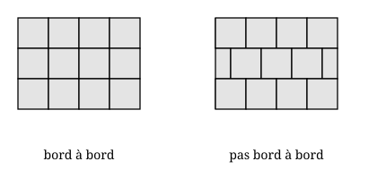
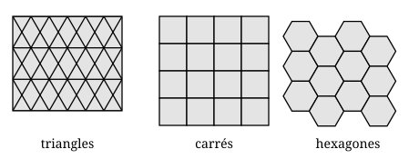

## Statement

**Paver** le plan, c'est le recouvrir entièrement de tuiles, sans trou et sans que deux tuiles
se chevauchent.

Un pavage est dit **bord à bord** lorsque deux tuiles voisines se touchent le long d'un côté
entier de chacune des deux, et non le long d'un bout de côté seulement. Les deux pavages par
des carrés ci-dessous montrent la différence.

Un pavage est dit **régulier** lorsqu'il est bord à bord et que toutes les tuiles sont des
copies d'un **même polygone régulier**.

Montre qu'il n'existe que **trois** pavages réguliers du plan, et dis lesquels.

*(On rappelle qu'un polygone régulier à $n$ côtés a tous ses côtés de même longueur et tous
ses angles égaux, et que la somme de ses angles vaut $(n-2) \times 180°$.)*

## Hints

1. Choisis un sommet du pavage, c'est-à-dire un coin de tuile. Combien de tuiles se
   rejoignent autour de lui ? Appelle $k$ ce nombre.
2. Comme le pavage est bord à bord, chaque tuile qui touche ce sommet y présente un de ses
   angles, et jamais un morceau de côté. Que vaut alors la somme des $k$ angles ?
3. Commence par calculer la mesure d'**un** angle d'un polygone régulier à $n$ côtés.
4. Tu obtiens une équation entre $k$ et $n$. Isole $k$ : tu dois arriver à
   $k = \dfrac{2n}{n-2}$.
5. Transforme cette fraction pour faire apparaître une division exacte :
   $\dfrac{2n}{n-2} = 2 + \dfrac{4}{n-2}$. Que doit alors être $n-2$ ?
6. N'oublie pas la fin du travail : tu auras trouvé les seules valeurs **possibles** de $n$.
   Il reste à vérifier que chacune donne vraiment un pavage.

## Solution

**L'équation de départ.**

Un polygone régulier à $n$ côtés a une somme d'angles de $(n-2) \times 180°$, et ses $n$
angles sont égaux. Chacun mesure donc

$$\alpha_n = \frac{(n-2) \times 180°}{n} .$$

Plaçons-nous maintenant à un sommet du pavage et appelons $k$ le nombre de tuiles qui se
rejoignent là. Comme le pavage est bord à bord, chacune de ces $k$ tuiles présente exactement
un de ses angles à ce sommet. Ces $k$ angles se suivent sans trou et sans recouvrement : leur
somme fait un tour complet.

$$k \times \frac{(n-2) \times 180°}{n} = 360° .$$

En divisant les deux membres par $180°$ :

$$k \times \frac{n-2}{n} = 2, \qquad \text{c'est-à-dire} \qquad k(n-2) = 2n .$$

**Résolution.**

Comme $n \geqslant 3$, on a $n - 2 \geqslant 1$ et on peut isoler $k$ :

$$k = \frac{2n}{n-2} .$$

Pour y voir clair, écrivons $2n = 2(n-2) + 4$ :

$$k = \frac{2(n-2) + 4}{n-2} = 2 + \frac{4}{n-2} .$$

Or $k$ est un nombre entier. Il faut donc que $\dfrac{4}{n-2}$ soit un entier, autrement dit
que $n-2$ soit un **diviseur de $4$** :

$$n - 2 \in \{1 ; 2 ; 4\}, \qquad \text{donc} \qquad n \in \{3 ; 4 ; 6\} .$$

| $n$ | la tuile | $\alpha_n$ | $k = 2 + \dfrac{4}{n-2}$ |
| --- | --- | --- | --- |
| $3$ | triangle équilatéral | $60°$ | $6$ |
| $4$ | carré | $90°$ | $4$ |
| $6$ | hexagone régulier | $120°$ | $3$ |

*Pourquoi les autres échouent.* Pour $n = 5$, on aurait $n - 2 = 3$, qui ne divise pas $4$ :
$k = 2 + \dfrac{4}{3}$ n'est pas entier. Concrètement, l'angle du pentagone régulier vaut
$108°$, et $3 \times 108° = 324°$ laisse un trou de $36°$, tandis que $4 \times 108° = 432°$
dépasse le tour complet. Pour $n \geqslant 7$, la fraction $\dfrac{4}{n-2}$ est strictement
comprise entre $0$ et $1$, donc $k$ est strictement compris entre $2$ et $3$ : impossible.

**Les trois pavages existent bien.**

Il reste à vérifier que les trois valeurs trouvées donnent effectivement un pavage, ce qui
n'allait pas de soi : l'équation ne disait que ce qui se passe autour d'**un** sommet.

- **Carrés :** le quadrillage ordinaire, $4$ carrés par sommet.
- **Triangles équilatéraux :** on empile des bandes de triangles alternativement pointés vers
  le haut et vers le bas ; $6$ triangles par sommet.
- **Hexagones réguliers :** le motif du nid d'abeilles, $3$ hexagones par sommet.

Autrement dit : triangle équilatéral, carré, hexagone régulier, et rien d'autre.

$$\boxed{\text{Trois pavages réguliers seulement : } n = 3, \ n = 4, \ n = 6 .}$$

## Going further

1. Un pavage est dit **semi-régulier** lorsqu'il est bord à bord, que ses tuiles sont des
   polygones réguliers (pas forcément tous les mêmes) et qu'autour de chaque sommet on
   retrouve toujours la même suite de polygones. Trouve les triplets de polygones réguliers
   dont les angles peuvent se refermer autour d'un point.
2. Les abeilles construisent des alvéoles hexagonales. Parmi les trois tuiles trouvées,
   laquelle a le plus petit périmètre à aire égale ? Le calcul explique le choix des abeilles.
3. Si on abandonne la condition « bord à bord », combien de pavages par un même polygone
   régulier trouve-t-on ?
