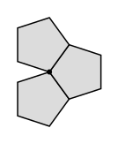

## Statement

Le **dodécaèdre régulier** est le solide dont toutes les faces sont des pentagones réguliers
identiques. Il en a $12$, et en chacun de ses sommets **trois** pentagones se rejoignent.

Le dessin montre ces trois pentagones à plat : il reste un trou, et c'est en refermant ce trou
que naît un coin du solide.

1. Combien le dodécaèdre a-t-il d'**arêtes** ? Combien de **sommets** ? On demande un
   raisonnement, pas un comptage sur une maquette.
2. L'**icosaèdre régulier** a $20$ faces triangulaires, et cinq triangles se rejoignent en
   chaque sommet. Mêmes questions.
3. Vérifie sur ces deux solides la **formule d'Euler** : $S - A + F = 2$, où $S$, $A$ et $F$
   désignent les nombres de sommets, d'arêtes et de faces.
4. Écris les formules générales pour un solide dont les $F$ faces sont des polygones à $n$
   côtés, avec $k$ faces par sommet.

## Hints

1. On ne sait pas compter les arêtes directement, mais on sait compter les **côtés de faces** :
   $12$ pentagones, cela fait combien de côtés en tout ?
2. Ce compte ne donne pas le nombre d'arêtes, parce qu'il compte chaque arête plusieurs fois.
   Combien de fois exactement ? Regarde une arête du solide : à combien de faces appartient-elle ?
3. Même méthode pour les sommets : compte les **coins de faces**, puis demande-toi combien de
   fois chaque sommet du solide a été compté.
4. C'est là que sert l'énoncé « trois pentagones par sommet ».
5. Pour la question 4, remplace simplement $12$ par $F$, $5$ par $n$ et $3$ par $k$ dans ce que
   tu viens de faire.

## Solution

L'idée est la même pour tout : **compter une chose de deux façons**. On compte d'abord les
morceaux face par face, ce qui est facile, puis on corrige les doublons.

**1. Le dodécaèdre.**

*Les arêtes.* Chaque face est un pentagone, donc a $5$ côtés. Les $12$ faces fournissent en
tout

$$12 \times 5 = 60 \text{ côtés de faces.}$$

Mais ce nombre n'est pas le nombre d'arêtes : sur le solide, chaque arête est le bord commun
de **deux** faces exactement, et elle a donc été comptée deux fois. D'où

$$A = \frac{60}{2} = 30 .$$

*Les sommets.* Chaque face a $5$ coins. Les $12$ faces fournissent en tout

$$12 \times 5 = 60 \text{ coins de faces.}$$

Mais en chaque sommet du solide, **trois** faces se rejoignent, et chacune y présente un coin.
Chaque sommet a donc été compté trois fois. D'où

$$S = \frac{60}{3} = 20 .$$

$$\boxed{\text{Le dodécaèdre a } 20 \text{ sommets, } 30 \text{ arêtes et } 12 \text{ faces.}}$$

**2. L'icosaèdre.**

Chaque face est un triangle, donc a $3$ côtés et $3$ coins. Les $20$ faces fournissent
$20 \times 3 = 60$ côtés de faces et $60$ coins de faces.

Chaque arête appartient à deux faces :

$$A = \frac{60}{2} = 30 .$$

Cinq triangles se rejoignent en chaque sommet :

$$S = \frac{60}{5} = 12 .$$

$$\boxed{\text{L'icosaèdre a } 12 \text{ sommets, } 30 \text{ arêtes et } 20 \text{ faces.}}$$

On remarque au passage que le dodécaèdre et l'icosaèdre ont le même nombre d'arêtes, et qu'ils
échangent leurs nombres de faces et de sommets. Ce n'est pas un hasard : chacun s'obtient à
partir de l'autre en plaçant un sommet au centre de chaque face.

**3. La formule d'Euler.**

| solide | $S$ | $A$ | $F$ | $S - A + F$ |
| --- | --- | --- | --- | --- |
| dodécaèdre | $20$ | $30$ | $12$ | $20 - 30 + 12 = 2$ |
| icosaèdre | $12$ | $30$ | $20$ | $12 - 30 + 20 = 2$ |

Les deux donnent $2$, conformément à la formule d'Euler.

**4. Le cas général.**

Un solide dont les $F$ faces sont des polygones à $n$ côtés, avec $k$ faces en chaque sommet,
fournit $nF$ côtés de faces et $nF$ coins de faces. Chaque arête est comptée $2$ fois et chaque
sommet $k$ fois :

$$A = \frac{nF}{2}, \qquad S = \frac{nF}{k} .$$

*Vérification sur les cinq solides de Platon :*

| solide | $n$ | $k$ | $F$ | $A = \dfrac{nF}{2}$ | $S = \dfrac{nF}{k}$ | $S - A + F$ |
| --- | --- | --- | --- | --- | --- | --- |
| tétraèdre | $3$ | $3$ | $4$ | $6$ | $4$ | $2$ |
| cube | $4$ | $3$ | $6$ | $12$ | $8$ | $2$ |
| octaèdre | $3$ | $4$ | $8$ | $12$ | $6$ | $2$ |
| dodécaèdre | $5$ | $3$ | $12$ | $30$ | $20$ | $2$ |
| icosaèdre | $3$ | $5$ | $20$ | $30$ | $12$ | $2$ |

Les cinq donnent $2$. Le tétraèdre a bien **quatre** sommets, pas trois.

## Going further

1. Un ballon de football est fait de $12$ pentagones et de $20$ hexagones, cousus de sorte que
   trois pièces se rejoignent en chaque sommet. Combien a-t-il de coutures (arêtes) et de
   points de rencontre (sommets) ? Vérifie la formule d'Euler.
2. Un polyèdre a toutes ses faces triangulaires et quatre faces par sommet. En utilisant les
   deux formules générales et la formule d'Euler, retrouve $F = 8$.
3. Pourquoi $nF$ est-il toujours un nombre pair ?
