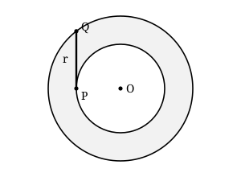

## Statement

Un vélo roule dans la neige et laisse deux traces, une par roue.

La roue arrière est fixée dans le cadre : elle pointe toujours vers le point de contact de la roue avant avec le sol, et à une distance constante $r$, qui est la longueur du cadre. Autrement dit :

> **le segment qui joint le point de contact de la roue arrière au point de contact de la roue avant mesure toujours $r$, et il est tangent à la trace de la roue arrière.**

Un cycliste roule en décrivant un cercle parfait. Les deux traces sont alors deux cercles concentriques : la trace de la roue arrière est le petit cercle, celle de la roue avant est le grand.

Montrer que l'aire de la zone comprise entre les deux traces vaut $\pi r^2$, **quelle que soit la taille des deux cercles**.

## Hints

1. Note $O$ le centre commun des deux cercles, $R_1$ le rayon du petit et $R_2$ le rayon du grand. Que vaut l'aire cherchée en fonction de $R_1$ et $R_2$ ?
2. Place $P$ le point de contact de la roue arrière et $Q$ celui de la roue avant. Où se trouve $P$ ? Où se trouve $Q$ ? Combien mesure $PQ$ ?
3. La droite $(PQ)$ est tangente au petit cercle en $P$. Quel est l'angle entre une tangente à un cercle et le rayon mené au point de contact ?
4. Tu as maintenant un triangle rectangle. Écris le théorème de Pythagore et compare avec l'expression trouvée à la question 1.

## Solution

**Réponse : l'aire vaut $\pi r^2$, et elle ne dépend donc pas des rayons des deux cercles.**

### L'aire de la zone entre les traces

Notons $O$ le centre commun des deux cercles, $R_1$ le rayon du petit (la trace de la roue arrière) et $R_2$ le rayon du grand (la trace de la roue avant).

La zone comprise entre les deux traces est le grand disque privé du petit. Son aire vaut donc
$$\mathcal{A} = \pi R_2^{\,2} - \pi R_1^{\,2} = \pi\left(R_2^{\,2} - R_1^{\,2}\right).$$

Tout revient donc à calculer $R_2^{\,2} - R_1^{\,2}$.

### Le triangle rectangle caché

Soit $P$ le point de contact de la roue arrière : il est sur le petit cercle, donc $OP = R_1$.

Soit $Q$ le point de contact de la roue avant : il est sur le grand cercle, donc $OQ = R_2$.

Par hypothèse, $PQ = r$ et la droite $(PQ)$ est tangente au petit cercle en $P$.

Or **une tangente à un cercle est perpendiculaire au rayon mené au point de contact.** Donc le triangle $OPQ$ est rectangle en $P$.

Le théorème de Pythagore donne
$$OQ^2 = OP^2 + PQ^2, \qquad \text{c'est-à-dire} \qquad R_2^{\,2} = R_1^{\,2} + r^2.$$

D'où
$$R_2^{\,2} - R_1^{\,2} = r^2.$$

### Conclusion

En reportant dans l'expression de l'aire :
$$\mathcal{A} = \pi\left(R_2^{\,2} - R_1^{\,2}\right) = \pi r^2.$$

Les rayons $R_1$ et $R_2$ ont disparu. Que le cycliste tourne en tout petit rond dans une cour ou qu'il décrive un immense cercle sur un lac gelé, la surface prise entre ses deux traces est toujours la même : celle d'un disque de rayon égal à la longueur de son vélo.

*Remarque.* On a utilisé $R_1$ et $R_2$ pour arriver au résultat, mais ils ne figurent plus dans la réponse. C'est le signe qu'il y a une raison plus profonde ; la question 3 de la rubrique suivante y mène.

## Going further

1. Reformule le résultat sans parler de vélo : une corde du grand cercle, tangente au petit cercle, a une longueur $2r$. Retrouve l'aire de la couronne.
2. Le vélo mesure $r = \text{1,05}$ m. Quelle est l'aire entre les deux traces, en mètres carrés ? Combien mesure le rayon de la trace arrière si celui de la trace avant vaut $10$ m ?
3. Le cycliste ne roule plus en cercle, mais suit une boucle fermée quelconque, sans jamais revenir en arrière, et il tourne toujours dans le même sens. On peut montrer que l'aire entre les deux traces vaut encore $\pi r^2$. Commence par le cas où la roue arrière suit exactement le contour d'un carré, en pivotant sur place à chaque coin : que dessine alors la roue avant dans les coins, et quelle est l'aire entre les deux traces ?
4. Refais la question 3 avec un triangle, puis avec un polygone convexe quelconque. Quelle propriété des angles d'un polygone fait marcher l'argument ?
