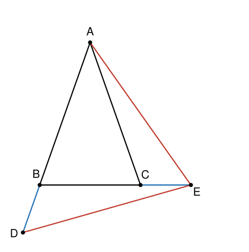

## Statement

Soit $ABC$ un triangle isocèle en $A$, avec $AB = AC > BC$.

On place :

- le point $D$ sur la droite $(AB)$, de sorte que $A$, $B$ et $D$ soient dans cet ordre ;
- le point $E$ sur la droite $(BC)$, de sorte que $B$, $C$ et $E$ soient dans cet ordre ;

et de sorte que

$$BD = CE = AB - BC .$$

Montrer que le triangle $ADE$ est isocèle.

## Hints

1. Pose $c = AB = AC$ et $a = BC$. Exprime $BD$, $CE$ puis $BE$ en fonction de $a$ et $c$.
   Une de ces longueurs va te surprendre.
2. Le triangle $ADE$ a trois côtés : $AD$, $DE$ et $EA$. Deux d'entre eux sont difficiles à
   calculer. Cherche plutôt à montrer qu'ils sont **égaux entre eux**, sans les calculer.
3. Regarde les deux triangles $DBE$ et $ECA$. Compare leurs côtés deux à deux.
4. Compare enfin l'angle $\widehat{DBE}$ et l'angle $\widehat{ECA}$. Tous les deux se
   déduisent de l'angle à la base du triangle isocèle $ABC$.

## Solution

Posons $c = AB = AC$ et $a = BC$, avec $c > a$. Par hypothèse,

$$BD = CE = c - a .$$

**Une longueur inattendue.** Comme $B$, $C$, $E$ sont dans cet ordre, le point $C$ est entre
$B$ et $E$, donc

$$BE = BC + CE = a + (c - a) = c .$$

Autrement dit, $BE = c = CA$. Voilà la clé.

**Deux angles égaux.** Le triangle $ABC$ est isocèle en $A$, donc ses angles à la base sont
égaux :

$$\widehat{ABC} = \widehat{ACB} = \beta .$$

Regardons maintenant l'angle $\widehat{DBE}$. Le point $D$ est sur la demi-droite opposée à
$[BA)$, et le point $E$ est sur la demi-droite $[BC)$. Donc $\widehat{DBE}$ et
$\widehat{ABC}$ sont supplémentaires :

$$\widehat{DBE} = 180^\circ - \beta .$$

De même, le point $E$ est sur la demi-droite opposée à $[CB)$, donc $\widehat{ECA}$ et
$\widehat{BCA}$ sont supplémentaires :

$$\widehat{ECA} = 180^\circ - \beta .$$

Les deux angles sont donc égaux.

**Deux triangles superposables.** Comparons les triangles $DBE$ et $ECA$ :

- $BD = CE$ (ce sont les deux longueurs $c - a$ de l'énoncé) ;
- $BE = CA$ (c'est ce qu'on vient de calculer : les deux valent $c$) ;
- $\widehat{DBE} = \widehat{ECA}$, et dans chaque triangle c'est **l'angle compris entre les
  deux côtés qu'on vient d'apparier**.

D'après le cas d'égalité « deux côtés et l'angle compris entre eux », les triangles $DBE$ et
$ECA$ sont superposables. Leurs troisièmes côtés sont donc égaux :

$$DE = EA .$$

**Conclusion.** Le triangle $ADE$ a deux côtés égaux, $[ED]$ et $[EA]$ : il est isocèle en
$E$.

## Going further

Le pas décisif est le calcul $BE = BC + CE = a + (c-a) = c$. La longueur bizarre $c - a$ de
l'énoncé n'est bizarre qu'en apparence : elle a été choisie exactement pour que $BE$ devienne
égal à $AB$, ce qui rend les deux triangles superposables.

C'est une chose à retenir quand un énoncé donne une longueur compliquée : elle est rarement
compliquée par hasard. Essayez de l'additionner ou de la soustraire à ce qui traîne autour,
et regardez ce qui se simplifie.

Une question pour continuer : le troisième côté $AD$ vaut $AB + BD = 2c - a$. Existe-t-il des
triangles $ABC$ pour lesquels $ADE$ est en fait **équilatéral** ?
