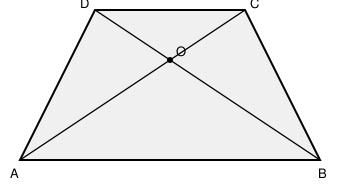

## Statement

$ABCD$ est un trapèze isocèle de grande base $[AB]$ : les côtés $[AB]$ et $[CD]$ sont parallèles, et $AB$ est le plus long des deux.

Ses diagonales $[AC]$ et $[BD]$ se coupent en un point $O$ tel que
$$\frac{OA}{OC} = 2 .$$

On sait de plus que l'aire du triangle $BOC$ vaut $10$.

Quelle est l'aire du trapèze $ABCD$ ?

## Hints

1. Les diagonales découpent le trapèze en **quatre** triangles : $AOB$, $BOC$, $COD$ et $DOA$. Il suffit de trouver l'aire de chacun.
2. Les triangles $AOB$ et $BOC$ ont un sommet commun $B$, et leurs bases $[OA]$ et $[OC]$ sont portées par la même droite. Que peux-tu dire de leurs hauteurs issues de $B$ ?
3. Deux triangles de même hauteur ont des aires proportionnelles à leurs bases.
4. Applique la même idée aux triangles $BOC$ et $COD$ : ils ont le sommet $C$ en commun et leurs bases $[OB]$ et $[OD]$ sont alignées. Quel est le rapport $OB/OD$ ?
5. Pour le dernier triangle, utilise la symétrie du trapèze isocèle.

## Solution

**Le rapport des diagonales.**

Comme $(AB)$ et $(CD)$ sont parallèles, les triangles $OAB$ et $OCD$ sont en configuration de Thalès (« papillon ») : ils sont semblables, et
$$\frac{OA}{OC} = \frac{OB}{OD} = \frac{AB}{CD} = 2 .$$

**Aire de $AOB$.**

Les triangles $AOB$ et $BOC$ ont le même sommet $B$, et leurs bases $[OA]$ et $[OC]$ sont sur la même droite $(AC)$. Ils ont donc la **même hauteur** issue de $B$, et leurs aires sont dans le rapport de leurs bases :
$$\frac{\text{aire}(AOB)}{\text{aire}(BOC)} = \frac{OA}{OC} = 2 .$$

Donc $\text{aire}(AOB) = 2 \times 10 = 20$.

**Aire de $COD$.**

Les triangles $BOC$ et $COD$ ont le même sommet $C$, et leurs bases $[OB]$ et $[OD]$ sont sur la même droite $(BD)$. Même raisonnement :
$$\frac{\text{aire}(COD)}{\text{aire}(BOC)} = \frac{OD}{OB} = \frac{1}{2} .$$

Donc $\text{aire}(COD) = \dfrac{10}{2} = 5$.

**Aire de $DOA$.**

Le trapèze est **isocèle** : il est symétrique par rapport à la médiatrice commune de $[AB]$ et $[CD]$. Cette symétrie échange $A$ et $B$, échange $C$ et $D$, et laisse $O$ en place. Elle transforme donc le triangle $BOC$ en le triangle $AOD$, qui a par conséquent la même aire :
$$\text{aire}(DOA) = 10 .$$

**Le total.**

$$\text{aire}(ABCD) = 20 + 10 + 5 + 10 = 45 .$$

**Conclusion.** L'aire du trapèze vaut $\boxed{45}$.

## Going further

1. Retrouve l'aire de $DOA$ sans utiliser la symétrie, en remarquant que les triangles $AOD$ et $BOC$ ont la même aire dans **n'importe quel** trapèze. *(Indication : compare les triangles $ACD$ et $BCD$, qui ont la même base et la même hauteur.)*
2. Refais le calcul avec $\dfrac{OA}{OC} = k$ au lieu de $2$, l'aire de $BOC$ valant toujours $10$. Exprime l'aire du trapèze en fonction de $k$.
3. Montre que dans tout trapèze, $\text{aire}(AOB) \times \text{aire}(COD) = \text{aire}(BOC) \times \text{aire}(DOA)$.
