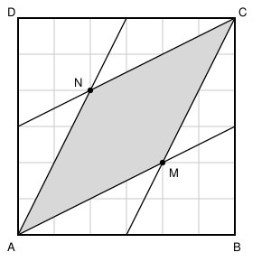

## Statement

$ABCD$ est un carré de côté $1$. On note $E$, $F$, $G$ et $H$ les milieux respectifs des côtés $[AB]$, $[BC]$, $[CD]$ et $[DA]$.

Les droites $(AF)$ et $(EC)$ se coupent en $M$, et les droites $(AG)$ et $(CH)$ se coupent en $N$.

Quelle est l'aire du quadrilatère $AMCN$ ?

## Hints

1. Pour placer $M$ précisément, quadrille le carré. Essaie un quadrillage $6 \times 6$ : les points $E$, $F$, $G$, $H$ tombent sur des nœuds du quadrillage.
2. Sur ce quadrillage, la droite $(AF)$ part du coin et avance de $2$ vers la droite quand elle monte de $1$. Marque les nœuds par lesquels elle passe.
3. Fais de même pour $(EC)$, qui monte de $2$ quand elle avance de $1$. Les deux droites se croisent-elles sur un nœud ?
4. Une fois $M$ et $N$ placés, découpe $AMCN$ en deux triangles par la diagonale $[AC]$.
5. Pour l'aire d'un triangle dont on connaît les sommets sur un quadrillage, on peut soustraire des triangles rectangles au rectangle qui l'entoure.

## Solution

**On quadrille le carré en $6 \times 6$.**

Prenons le carré $ABCD$ et partageons-le en $36$ petits carreaux, $6$ dans chaque direction. Chaque carreau a une aire de $\dfrac{1}{36}$.

Repérons les points par leurs coordonnées en carreaux, en partant de $A$ :
$$A = (0,0), \quad B = (6,0), \quad C = (6,6), \quad D = (0,6),$$
$$E = (3,0), \quad F = (6,3), \quad G = (3,6), \quad H = (0,3).$$

**Où se croisent $(AF)$ et $(EC)$ ?**

La droite $(AF)$ part de $(0,0)$ et va vers $(6,3)$ : elle monte d'un carreau chaque fois qu'elle en avance de deux. Elle passe donc par les nœuds
$$(0,0),\ (2,1),\ (4,2),\ (6,3) .$$

La droite $(EC)$ part de $(3,0)$ et va vers $(6,6)$ : elle monte de deux carreaux chaque fois qu'elle en avance d'un. Elle passe par
$$(3,0),\ (4,2),\ (5,4),\ (6,6) .$$

Le nœud $(4,2)$ figure dans les deux listes : c'est le point $M$.

Par symétrie par rapport à la diagonale $(AC)$ (qui échange $B$ et $D$, donc $E$ et $H$, et $F$ et $G$), on obtient
$$M = (4,2) \qquad \text{et} \qquad N = (2,4) .$$

**L'aire du quadrilatère.**

La diagonale $[AC]$ coupe $AMCN$ en deux triangles $AMC$ et $ANC$, échangés par la symétrie : ils ont la même aire. Il suffit donc de calculer l'aire de $AMC$, avec $A = (0,0)$, $M = (4,2)$ et $C = (6,6)$, puis de doubler.

La diagonale $(AC)$ passe par tous les nœuds $(k,k)$, en particulier par le point $P = (2,2)$, qui est situé entre $A$ et $C$. Le segment $[PM]$ partage donc le triangle $AMC$ en deux triangles $APM$ et $CPM$.

Ce segment $[PM]$ est **horizontal** : il va de $(2,2)$ à $(4,2)$, donc il mesure $2$ carreaux. Prenons-le comme base commune.

- Triangle $APM$ : base $[PM]$ de longueur $2$ ; le sommet opposé $A$ est à la hauteur $0$, donc la hauteur vaut $2 - 0 = 2$. Son aire vaut $\dfrac{2 \times 2}{2} = 2$.
- Triangle $CPM$ : même base de longueur $2$ ; le sommet opposé $C$ est à la hauteur $6$, donc la hauteur vaut $6 - 2 = 4$. Son aire vaut $\dfrac{2 \times 4}{2} = 4$.

Donc
$$\text{aire}(AMC) = 2 + 4 = 6 \text{ carreaux}, \qquad \text{aire}(AMCN) = 2 \times 6 = 12 \text{ carreaux}.$$

**Conclusion.**

Le carré compte $36$ carreaux, donc
$$\text{aire}(AMCN) = \frac{12}{36} = \boxed{\dfrac{1}{3}} .$$

## Going further

1. Quelle est la nature du quadrilatère $AMCN$ ? Justifie.
2. Les quatre droites $(AF)$, $(EC)$, $(AG)$ et $(CH)$ découpent le carré en plusieurs morceaux. Calcule l'aire de chacun.
3. Reprends le problème en plaçant $E$ et $F$ non plus aux milieux, mais au tiers des côtés : $AE = \tfrac13 AB$ et $BF = \tfrac13 BC$. Que devient l'aire de $AMCN$ ?
