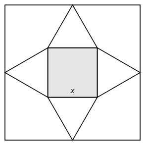

## Statement

On a posé quatre triangles équilatéraux sur les quatre côtés d'un petit carré, tournés vers l'extérieur. Les quatre pointes de ces triangles touchent exactement les côtés d'un grand carré, comme sur la figure.

Le petit carré a pour côté $x$. Quelle est la longueur du côté du grand carré ?

## Hints

1. Regarde la ligne horizontale qui passe par le centre de la figure. Quels morceaux, mis bout à bout, forment un côté du grand carré ?
2. Il te manque la hauteur d'un triangle équilatéral de côté $x$. Trace cette hauteur sur ton dessin : elle partage le triangle en deux.
3. Ces deux morceaux sont des triangles rectangles. Dans l'un d'eux, l'hypoténuse mesure $x$ et l'un des côtés de l'angle droit mesure $\tfrac{x}{2}$. Le théorème de Pythagore donne le troisième côté.

## Solution

**Le côté du grand carré mesure $x\left(1 + \sqrt{3}\right)$, c'est-à-dire environ $\text{2,73}\,x$.**

**Étape 1 : la hauteur d'un triangle équilatéral de côté $x$.**

Soit $ABC$ un triangle équilatéral de côté $x$, et soit $H$ le milieu de $[AB]$. La hauteur issue de $C$ tombe en $H$, et le triangle $AHC$ est rectangle en $H$. Ses côtés sont

$$AC = x, \qquad AH = \frac{x}{2}, \qquad CH = h .$$

Le théorème de Pythagore donne $AC^2 = AH^2 + CH^2$, donc

$$h^2 = x^2 - \left(\frac{x}{2}\right)^2 = x^2 - \frac{x^2}{4} = \frac{3x^2}{4}.$$

Comme $h$ est une longueur, elle est positive, et donc

$$h = \sqrt{\frac{3x^2}{4}} = \frac{x\sqrt{3}}{2}.$$

**Étape 2 : on recompose un côté du grand carré.**

Traçons la ligne horizontale qui passe par le centre de la figure. En allant de gauche à droite, elle rencontre successivement :

- la pointe du triangle de gauche, puis le côté gauche du petit carré : c'est la hauteur de ce triangle, soit $h$ ;
- le petit carré, de gauche à droite : c'est son côté, soit $x$ ;
- le côté droit du petit carré, puis la pointe du triangle de droite : encore $h$.

Ces trois morceaux mis bout à bout forment exactement un côté du grand carré. Donc

$$\text{côté du grand carré} = h + x + h = x + 2 \times \frac{x\sqrt{3}}{2} = x + x\sqrt{3}.$$

**Conclusion : le côté du grand carré vaut $x\left(1 + \sqrt{3}\right) \approx \text{2,73}\,x$.**

## Going further

Quelle fraction du grand carré le petit carré occupe-t-il ? Le rapport des aires vaut

$$\frac{x^2}{x^2\left(1+\sqrt{3}\right)^2} = \frac{1}{4 + 2\sqrt{3}} \approx \text{0,134},$$

soit un peu plus du huitième seulement.
