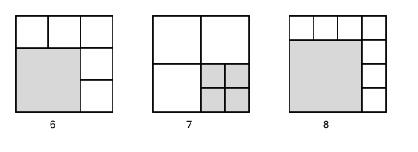

## Statement

On veut découper un carré en $n$ carrés plus petits. Ces petits carrés n'ont pas besoin d'être tous de la même taille, mais ils doivent recouvrir entièrement le grand carré sans se chevaucher.

Pour quelles valeurs de l'entier $n \ge 1$ ce découpage est-il possible ?

## Hints

1. Commence par les petits cas à la main : $n = 1$ marche évidemment, $n = 4$ aussi. Essaie $n = 2$ et $n = 3$ : y arrives-tu ?
2. Pour montrer que $n = 2$ et $n = 3$ sont impossibles, regarde les quatre coins du grand carré. Combien de petits carrés faut-il, au minimum, pour les couvrir ?
3. Pour construire beaucoup de valeurs : si tu sais découper en $n$ carrés, tu peux découper l'un d'eux en quatre. Combien de carrés obtiens-tu alors ?
4. Cette opération fait passer de $n$ à $n + 3$. Il te suffit donc de trouver un point de départ dans chacun des trois restes modulo $3$.

## Solution

**La réponse : le découpage est possible pour tout $n \ge 1$, sauf $n = 2$, $n = 3$ et $n = 5$.**

Dans tout ce qui suit, le grand carré a pour côté $c$.

**Étape 1 : $n = 2$ et $n = 3$ sont impossibles.**

Regardons les quatre coins du grand carré. Un petit carré qui contient deux coins du grand carré contient un côté entier, donc il est aussi large que le grand carré : c'est le grand carré lui-même. Donc, dès que le découpage a au moins deux pièces, les quatre coins sont occupés par quatre pièces **différentes**.

Un découpage a donc $1$ pièce, ou bien au moins $4$. Cela élimine $n = 2$ et $n = 3$.

**Étape 2 : $n = 5$ est impossible.**

Supposons un découpage en $5$ carrés. D'après l'étape 1, quatre d'entre eux occupent les quatre coins. Notons leurs côtés :

$$a \ \text{(en bas à gauche)}, \quad b \ \text{(en bas à droite)}, \quad d \ \text{(en haut à gauche)}, \quad e \ \text{(en haut à droite)} .$$

Le cinquième carré, de côté $s > 0$, est quelque part ailleurs.

*D'abord, chaque côté du grand carré est exactement couvert par ses deux carrés de coin.*

Prenons par exemple le côté du bas. Les carrés du bas à gauche et du bas à droite y posent des segments de longueurs $a$ et $b$, sans se chevaucher, donc $a + b \le c$. Supposons $a + b < c$ : il reste un morceau libre au milieu du côté du bas, et seul le cinquième carré peut le couvrir. Mais alors ce cinquième carré est collé au bord du bas, donc il ne touche aucun des trois autres côtés (sauf à être aussi large que le grand carré, ce qui est exclu). Les trois autres côtés sont donc exactement couverts par leurs carrés de coin :

$$d + e = c \ \text{(haut)}, \qquad a + d = c \ \text{(gauche)}, \qquad b + e = c \ \text{(droite)} .$$

De $a + d = c$ et $d + e = c$ on tire $a = e$, puis de $b + e = c$ on tire $b = c - a$, donc $a + b = c$. C'est la contradiction cherchée. Donc $a + b = c$, et le même raisonnement vaut pour les quatre côtés :

$$a + b = c, \qquad d + e = c, \qquad a + d = c, \qquad b + e = c .$$

*Ensuite, on compte les aires.* Posons $t = c - a$. Les quatre égalités donnent $b = t$, $d = t$, $e = a$. L'aire des quatre carrés de coin vaut donc $2a^2 + 2t^2$, et comme $c = a + t$ :

$$s^2 = c^2 - 2a^2 - 2t^2 = (a+t)^2 - 2a^2 - 2t^2 = 2at - a^2 - t^2 = -(a - t)^2 .$$

Or $s > 0$, donc $s^2 > 0$, alors que $-(a-t)^2 \le 0$. C'est impossible. **Donc $n = 5$ ne se peut pas.**

**Étape 3 : l'opération qui fait gagner trois pièces.**

Voici l'idée centrale. Partons d'un découpage en $n$ carrés, choisissons-en un, et coupons-le en quatre carrés égaux en joignant les milieux de ses côtés opposés. On retire une pièce et on en ajoute quatre, donc le nouveau découpage compte

$$n - 1 + 4 = n + 3$$

carrés. **Si $n$ est réalisable, alors $n+3$ l'est aussi.**

**Étape 4 : trois points de départ.**

Il suffit maintenant de réaliser un découpage pour un $n$ dans chacune des trois familles $n \equiv 0$, $n \equiv 1$ et $n \equiv 2 \pmod 3$ ; l'étape 3 fournira alors tous les suivants de trois en trois.

- **$n = 6$.** Prenons le grand carré de côté $3$ et plaçons dans le coin en bas à gauche un carré de côté $2$. Il reste une bande en forme de $\mathsf{L}$, de largeur $1$, que l'on découpe en $3 + 2 = 5$ carrés unité. Total : $1 + 5 = 6$.
- **$n = 7$.** Coupons le grand carré en $4$ carrés égaux, puis coupons l'un d'eux en quatre : $4 + 3 = 7$.
- **$n = 8$.** Prenons le grand carré de côté $4$ et plaçons dans le coin en bas à gauche un carré de côté $3$. La bande en $\mathsf{L}$ restante, de largeur $1$, se découpe en $4 + 3 = 7$ carrés unité. Total : $1 + 7 = 8$.

Les voici dessinés :

**Étape 5 : on rassemble.**

À partir de $6$, $7$ et $8$, l'étape 3 donne $9$, $10$, $11$, puis $12$, $13$, $14$, et ainsi de suite : **tout entier $n \ge 6$ est réalisable**, puisque tout entier $n \ge 6$ s'écrit $6 + 3k$, $7 + 3k$ ou $8 + 3k$ avec $k \ge 0$.

Pour les petites valeurs : $n = 1$ marche (on ne coupe rien) et $n = 4$ aussi (les quatre quarts). Les valeurs $2$, $3$ et $5$ sont impossibles d'après les étapes 1 et 2.

**Conclusion.** Le découpage est possible exactement pour

$$\boxed{n = 1, \quad n = 4, \quad \text{et tout entier } n \ge 6 .}$$

## Going further

Le même raisonnement, avec la découpe d'un carré en $9$ au lieu de $4$, fait gagner $8$ pièces d'un coup. On peut aussi se demander ce qui se passe si l'on exige que tous les carrés soient **de tailles deux à deux différentes** : c'est un problème beaucoup plus dur, appelé le « carré parfait », et la plus petite solution connue utilise $21$ carrés.
