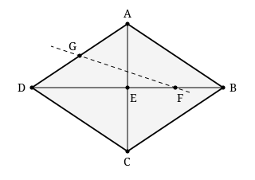

## Statement

$ABCD$ est un losange et $E$ le point d'intersection de ses diagonales.

On note $F$ le milieu du segment $[BE]$ et $G$ le milieu du segment $[AD]$. La droite $(FG)$ coupe la droite $(AC)$ en un point $I$, et on appelle $K$ le symétrique de $A$ par rapport à $I$.

Que vaut le rapport $\dfrac{EK}{EA}$ ?

*(Sur la figure, $I$ est le point où la droite en pointillés croise la diagonale $[AC]$ ; le point $K$ n'est pas dessiné, c'est à toi de le placer.)*

## Hints

1. Que sais-tu des diagonales d'un losange ? En particulier, comment se coupent-elles ?
2. On aimerait appliquer le théorème de la droite des milieux, mais il manque un milieu bien placé. Ajoute le point $H$, milieu du segment $[DE]$. Que peux-tu dire alors de $E$ dans le segment $[HF]$ ?
3. Applique le théorème de la droite des milieux dans le triangle $ADE$, avec les milieux $G$ et $H$.
4. Tu as maintenant deux droites parallèles, $(GH)$ et $(AC)$. Applique une deuxième fois le théorème de la droite des milieux, cette fois dans le triangle $FGH$.
5. Il ne reste plus qu'à placer les quatre points $A$, $I$, $E$, $K$ sur la diagonale et à calculer des longueurs.

## Solution

Posons $a = EA$ pour alléger l'écriture. Tout se passe le long de la diagonale $(AC)$, et l'enjeu est de calculer $EI$.

**Étape 1 : un milieu de plus.**

Dans un losange, les diagonales se coupent en leur milieu. Donc $E$ est le milieu de $[BD]$, ce qui donne $DE = EB$.

Appelons $H$ le milieu du segment $[DE]$. Alors

$$HE = \frac{DE}{2} = \frac{EB}{2} = EF ,$$

la dernière égalité parce que $F$ est le milieu de $[BE]$.

Comme $H$ et $F$ sont de part et d'autre de $E$ sur la droite $(BD)$, et que $HE = EF$, le point $E$ est le **milieu du segment $[HF]$**.

**Étape 2 : première droite des milieux.**

Dans le triangle $ADE$, le point $G$ est le milieu de $[AD]$ et le point $H$ est le milieu de $[DE]$. Le théorème de la droite des milieux donne

$$(GH) \parallel (AE) \qquad \text{et} \qquad GH = \frac{AE}{2} = \frac{a}{2} .$$

**Étape 3 : deuxième droite des milieux.**

La droite $(AE)$ n'est autre que la diagonale $(AC)$, et le point $I$ est sur cette diagonale. Donc $(EI)$ et $(GH)$ sont parallèles.

Plaçons-nous maintenant dans le triangle $FGH$. La droite $(EI)$ passe par $E$, milieu du côté $[HF]$ (étape 1), et elle est parallèle au côté $(HG)$. Elle coupe donc le troisième côté $[FG]$ en son milieu, qui est précisément $I$, et

$$EI = \frac{GH}{2} = \frac{a}{4} .$$

**Étape 4 : placer $K$ et conclure.**

Les points $A$, $I$, $E$ et $K$ sont tous sur la droite $(AC)$. D'après l'étape 3, $I$ est situé entre $A$ et $E$, à la distance

$$AI = AE - EI = a - \frac{a}{4} = \frac{3a}{4} .$$

Comme $K$ est le symétrique de $A$ par rapport à $I$, on a $AK = 2 \times AI = \dfrac{3a}{2}$, et $K$ est du même côté que $E$. Donc

$$EK = AK - AE = \frac{3a}{2} - a = \frac{a}{2} .$$

**Conclusion.**

$$\frac{EK}{EA} = \frac{a/2}{a} = \boxed{\frac{1}{2}} .$$

## Going further

Les correcteurs mettent en garde contre une tentation naturelle : traiter l'exercice avec des coordonnées. C'est possible, mais un piège attend : le repère « évident » formé par les deux diagonales du losange **n'est pas orthonormé** en général, et la formule habituelle des longueurs, qui repose sur le théorème de Pythagore, ne s'y applique pas.

Remarque aussi que la réponse ne dépend ni de la longueur du côté du losange, ni de ses angles. Vérifie-le en dessinant un losange très aplati.
